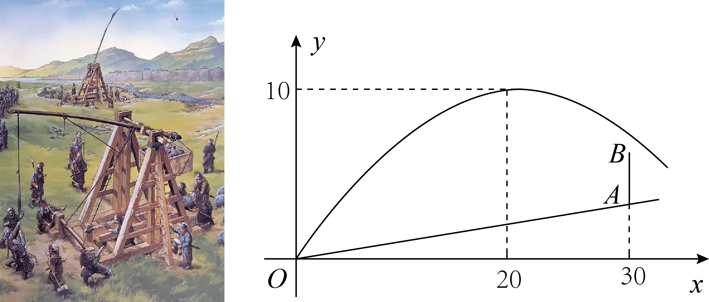

# Mathematics - 题目 3055

**ID**: 983de477b82747d2b8a291954d1f2400
**年级**: Grade 9
**难度**: Medium-Hard
**题型**: Calculation

## 题目
发石车是古代远程攻击的武器，现有一发石车，发射出去的石块沿抛物线轨迹运行，距离发射点20米时达到最大高度10米，如图所示，现将发石车置于山坡底部O处，山坡上有一点A，距离O的水平距离为30米，垂直高度3米， $AB$ 是垂直高度为3米的防御墙．(1)求石块运行的函数关系式；​​​​​​​‌(2)计算说明石块能否飞跃防御墙 $AB$ ；(3)石块飞行时与坡面 $OA$ 之间的最大距离是多少？(4)如果发石车想恰好击中点B，那么发石车应向后平移多远？

## 解答

1. （1）解：设石块运行的函数关系式为y＝a（x－20）^{2}＋10，
2. 把（0，0）代入解析式得：400a＋10＝0，解得：a＝－ $\frac {1}{40}$
3. ∴石块运行的函数解析式为：y＝－ $\frac {1}{40}$ （x－20）^{2}＋10，
4. 即y＝－ $\frac {1}{40}$x^{2}＋x（0⩽x⩽40）；
5. （2）解：石块能飞越防御墙AB，理由如下：
6. 把x＝30代入y＝－ $\frac {1}{40}$x^{2}＋x得：y＝－ $\frac {1}{40}$ ×900＋30＝7.5，
7. 而点B的最大垂直高度为3＋3＝6，
8. 由于7.5＞6，
9. ∴石块能飞越防御墙AB；
10. （3）解：设OA的解析式为y＝kx，
11. 由于A（30，3），
12. ∴3＝30k，
13. ∴k＝ $\frac {1}{10}$ ．
14. ∴OA的解析式为y＝ $\frac {1}{10}x$ ；
15. 如图，设抛物线上一点P（t，－ $\frac {1}{40}t{{}^{2}}+t$ ），过点P作PQ⊥x轴，交OA于点Q，则Q（t， $\frac {1}{10}t$ ）
16. 
17. ∴PQ的长d＝－ $\frac {1}{40}$t^{2}＋t－ $\frac {1}{10}$t＝－ $\frac {1}{40}$t^{2}＋ $\frac {9}{10}$t
18. ∵－ $\frac {1}{40}$ ＜0，
19. ∴函数图象的开口向下，d有最大值．
20. 当t＝－ $\frac {\frac {9}{10}}{2\times （-\frac {1}{40}）}$ ＝18时，d＝－ $\frac {1}{40}$ ×18^{2}＋ $\frac {9}{10}$ ×18＝8.1
21. ∴石块飞行时与坡面OA之间的最大距离时8.1米；
22. （4）解：设向后平移后的解析式为y＝－ $\frac {1}{40}$ （x－h）^{2}＋10，
23. 把（30，6）代入解析式，得：6＝－ $\frac {1}{40}$ （30－h）^{2}＋10，
24. 解得h_{1}＝30－4 $\sqrt {10}$ ，h_{2}＝30＋4 $\sqrt {10}$ （不合题意，舍去）
25. ∴20－（30－4 $\sqrt {10}$ ）＝4 $\sqrt {10}$ －10．
26. ∴如果发石车想恰好击中点B，那么发石车应向后平移（4 $\sqrt {10}$ －10）米．

## 知识点

**中文**:
  - 投球问题

**English**:
  - Projectile Problems

---
