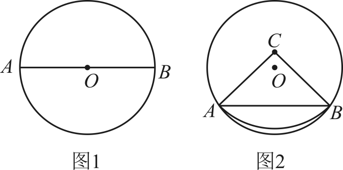

# Mathematics - 题目 1468

**ID**: 9914f673166f46e4ac80cdd8aed4112b
**年级**: Grade 9
**难度**: Medium-Hard
**题型**: Calculation

## 题目
用若干张半径为 $\sqrt {2}$ 的圆形纸片（ $\odot O$ ）剪不同的扇形纸片，如图1和图2．操作：当扇形的圆心C在 $\odot O$ 上时，如图 ${\rm 1，}AB$ 为 $\odot O$ 的直径．（1）①尺规作图：作 $AB$ 的垂直平分线交 $\odot O$ 于C，D两点（点C在点D的上方），连接 $AC，BC$ ，再以点C为圆心， $AC$ 长为半径画劣弧 $\overset{\frown}{{AB}}$ ，得到扇形 $CAB$ ；​​​​​​​‌②求出①中所作的扇形 $CAB$ 的面积（结果保留π）；计算：当扇形的圆心C在 $\odot O$ 内部时，如图2，已知 $AB$ 为扇形 $CAB$ 与 $\odot O$ 的公共弦， $AB=\sqrt {6}$ ， $\angle ACB\mathrm{=}90{}\degree $ ．（2）求出点O与点C的距离，并直接写出扇形 $CAB$ 的面积（结果保留π）；探究：（3）在半径为 $\sqrt {2}$ 的圆形纸片（ $\odot O$ ）上剪一个圆心角 $\angle ACB=120\mathrm{°}$ 的扇形 $CAB$ （点A，B在 $\odot O$ 上），直接写出所剪的扇形面积S的取值范围（结果保留π）．

## 解答

1. 解：（1）①如图所示，即为所求；
2. 
3. ②∵ $CD$ 垂直平分 $AB$ ，
4. ∴  $CA=CB$ ，
5. ∵ $AB$ 是直径，
6. ∴ $\angle ACB\mathrm{=}90{}\degree $ ，
7. ∴ $△ACB$ 是等腰直角三角形，
8. ∴ $OC=OA=\frac {1}{2}AB=\sqrt {2}$ ，
9. ∴ $AC=\sqrt {OA{^{2}}+OC{^{2}}}=2$ ，
10. ∴ $S{{}_{扇形ACB}}=\frac {90π\times 2{^{2}}}{360}=π$ ；
11. （2）如图所示，过点C作 $CT\bot AB$ 于T，连接 $OA，OB$ ，
12. ∵ $OA=OB，CA=CB$ ，
13. ∴ $OC$ 垂直平分 $AB$ ，
14. ∴O、C、T三点共线，
15. ∵ $AB=\sqrt {6}$ ， $\angle ACB\mathrm{=}90{}\degree $ ，
16. ∴ $CT=AT=BT=\frac {1}{2}AB=\frac {\sqrt {6}}{2}$ ，
17. 在 ${\rm{R}}{\rm{t}}\vartriangle AOB$ 中，由勾股定理得 $OT=\sqrt {OA{^{2}}-AT{^{2}}}=\sqrt {{\left({\sqrt {2}}\right)^{2}}-{\left({\frac {\sqrt {6}}{2}}\right)^{2}}}=\frac {\sqrt {2}}{2}$ ，
18. ∴ $OC=CT-OC=\frac {\sqrt {6}-\sqrt {2}}{2}$ ，
19. ∴点O与点C的距离为 $\frac {\sqrt {6}-\sqrt {2}}{2}$ ；
20. 在 ${\rm{R}}{\rm{t}}\mathrm{△}ABC$ 中，由勾股定理得 $AB=\sqrt {AC{^{2}}+BC{^{2}}}=\sqrt {2}AC=\sqrt {6}$ ，
21. ∴ $AC=\sqrt {3}$ ，
22. ∴ $S{{}_{扇形ACB}}=\frac {90π\times {\left({\sqrt {3}}\right)^{2}}}{360}=\frac {3}{4}π$ ；
23. 
24. （3）∵ $CA=CB，OA=OB$ ，
25. ∴ $OC$ 垂直平分 $AB$ ，
26. ∴点C一定在 $\odot O$ 的某条直径 $EF$ 上运动，
27. 设 $EF，AB$ 交于M，
28. ∵ $∠AMC=90{}\degree ，∠ACM=60{}\degree $ ，
29. ∴ $AC=\frac {AM}{\sin ∠ACM}=\frac {2\sqrt {3}AM}{3}$ ，
30. ∴ $AC$ 随着 $AM$ 的增大而增大，即扇形 $CAB$ 的面积随着 $AM$ 的增大而增大
31. 如图所示，当点C与点E重合时，
32. ∵ $OE\bot AB$ ，
33. ∴ $∠OCA=∠OCB=\frac {1}{2}∠ACB=60{}\degree $ ，
34. ∵ $OC=OA$ ，
35. ∴ $\mathrm{△}AOC$ 是等边三角形，
36. ∴ $AC=OA=\sqrt {2}$ ，
37. ∴ $S{{}_{扇形ACB}}=\frac {120π\times {\left({\sqrt {2}}\right)^{2}}}{360}=\frac {2}{3}π$ ；
38. 
39. 如图所示，当点M恰好与点O重合时，此时 $AC=\frac {OA}{\sin ∠ACO}=\frac {2\sqrt {6}}{3}$ ，
40. ∴ $S{{}_{扇形ACB}}=\frac {120π\times {\left({\frac {2\sqrt {6}}{3}}\right)^{2}}}{360}=\frac {8}{9}π$
41. 
42. ∴ $\frac {2}{3}\mathrm{π}\leqslant S\leqslant \frac {8}{9}\mathrm{π}$ ．

## 知识点

**中文**:
  - 半圆（或直径）所对的圆周角是直角
  - 扇形面积的计算
  - 解直角三角形

**English**:
  - Angle in a Semicircle is Right
  - Sector Area Calculation
  - Solving Right Triangles

---
