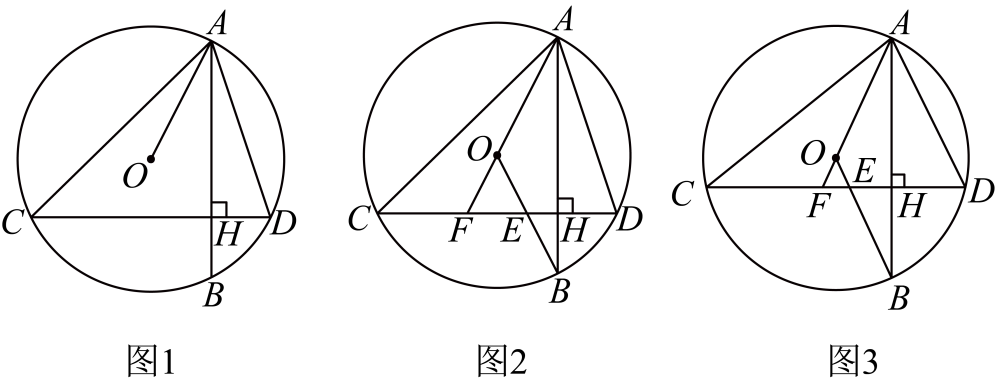

# Mathematics - 题目 3306

**ID**: 997572eaea9142019ea8ca190f9ea760
**年级**: Grade 9
**难度**: Medium-Hard
**题型**: Calculation

## 题目
在 $\odot O$ 中，弦 $AB\bot CD$ ，垂足为点 $H$ ，分别连接 $CA$ 、 $OA$ 、 $DA$ ．（1）如图1，求证： $\angle CAB=\angle OAD$ ；​​​​​​​‌（2）如图2，延长 $AO$ 交 $CD$ 于点 $F$ ，连接 $OB$ 交 $CD$ 于点 $E$ ，求证： $CF=DE$ ；（3）如图3，在（2）的条件下，若 $\angle DEB=\angle BAO+\angle ACD$ ， $AO+AD=\frac {\sqrt {5}}{2}CD$ ， $DH=3$ ，求 $\odot O$ 半径的长．

## 解答

1. （1）证明：连接 $OD$ ．
2. $\because OA=OD$ ，
3. $∴\angle OAD=\angle ODA$ ．
4. $\because \angle OAD+\angle ODA+\angle AOD=180{}\degree $ ，
5. $\therefore 2\angle OAD+\angle AOD=180{}\degree $ ．
6. 即 $\angle OAD+\frac {1}{2}\angle AOD=90{}\degree $ ．
7. $\because $ 弧 $AD=$ 弧 $AD$ ，
8. $\therefore \frac {1}{2}\angle AOD=\angle ACD$ ．
9. $\therefore \angle OAD+\angle ACD=90{}\degree $ ．
10. $\because AB\bot CD$ ，
11. $\therefore \angle ACD+\angle CAB=90{}\degree $ ．
12. $\therefore \angle CAB=\angle OAD$ ．
13. （2）证明：过点 $O$ 作 $OP\bot CD$ 于点 $P$ ．
14. $\because OA=OB$ ，
15. $\therefore $  $\angle OAB=\angle OBA$ ．
16. $\because $  $AB\bot CD$ ，
17. $\therefore $  $\angle OAB+\angle AFH=90{}\degree $ ， $\angle OBA+\angle BEH=90{}\degree $ ．
18. $\therefore $  $\angle AFH=\angle BEH$ ．
19. $\because $  $\angle OEF=\angle BEH$ ，
20. $\therefore $  $\angle OFE=\angle OEF$ ．
21. $\therefore $  $OE=OF$ ．
22. $\because $  $OP\bot CD$ ，
23. $\therefore $  $EP=FP$ ， $CP=DP$ ．
24. $\therefore $  $CP-FP=DP-EP$
25. $\therefore $  $CF=DE$ ．
26. （3）解：过点 $O$ 作 $OP\bot CD$ 于点 $P$ ，延长 $PO$ 交 $DA$ 的延长线于点 $G$ ，连接 $DB$ ．
27. 
28. $\because $  $OA=BO$ ，
29. $\therefore $  $\angle OAB=\angle OBA$ ．
30. $\because $  $\angle ACD=\angle ABD$ ， $\angle DBE=\angle ABD+\angle OBA$ ，
31. 又 $\angle DEB=\angle BAO+\angle ACD$ ，
32. $\therefore $  $\angle DEB=\angle DBE$ ．
33. $\therefore $  $DB=DE$ ．
34. $\because $  $AB\bot CD$ ，
35. $\therefore $  $\angle AHD=\angle OPD=90{}\degree $
36. $\therefore $  $PG/\mskip-4mu/AB$ ．
37. $\therefore $  $\angle BAD=\angle G$ ， $\angle BAO=\angle AOG$ ．
38. $\because $  $\angle CAB=\angle OAD$ ，
39. $\therefore $  $\angle CAF=\angle BAD$ ．
40. $\because $  $\angle DEB=\angle BAO+\angle ACD=\angle OEF=\angle OFE=\angle ACD+\angle CAF$ ，
41. $\therefore $  $\angle BAO=\angle CAF$ ．
42. $\therefore $  $\angle BAD=BAO$ ．
43. $\therefore $  $∠AOG=∠G$ ．
44. $\therefore $  $AO=AG$ ．
45. $\therefore $  $AD+AO=AD+AG=DG$ ．
46. $\because $  $OP\bot CD$ ，
47. $\therefore $  $DC=2DP$ ．
48. $\because $  $AO+AD=\frac {\sqrt {5}}{2}CD$ ，
49. $\therefore $  $\frac {DP}{DG}=\frac {1}{\sqrt {5}}$ ．
50. $\because $  $DP{^{2}}+PG{^{2}}=DG{^{2}}$ ，
51. $\therefore $  $\frac {PG}{DP}=2={\tan}\angle PDG=\frac {AH}{DH}$ ．
52. $\because $  $DH=3$ ，
53. $\therefore $  $AH=6$ ．
54. $\because $  $\angle OAB=\angle AOG$ ，
55. $\therefore $  $\angle G=\angle ABO$ ．
56. $\therefore $  $\angle PDG=\angle BEH$ ．
57. $\therefore $  ${\tan}\angle BEH=2$
58. $\therefore $  $BH=2EH$ ．
59. 设 $EH=k$ ， $BH=2k$ ，则 $DB=DE=k+3$ ．
60. $\because $  $DH{^{2}}+BH{^{2}}=DB{^{2}}$ ，
61. $\therefore $  $3{^{2}}+{\left({2k}\right)^{2}}={\left({k+3}\right)^{2}}$ ．
62. $\therefore $  $k{{}_{1}}=0$ （舍去）， $k{{}_{2}}=2$ ．
63. $\therefore $  $BH=4$ ．
64. $\therefore $  $AB=AH+BH=10$ ．
65. 过点 $O$ 作 $OM\bot AB$ 于点 $M$ ．
66. $\therefore $  $AM=5$ ．
67. ${\tan}\angle OAM={\tan}\angle G=\frac {1}{2}=\frac {OM}{AM}$ ，
68. $\therefore $  $OM=\frac {5}{2}$ ．
69. $\therefore $  $AO=\sqrt {AM{^{2}}+OM{^{2}}}=\frac {5}{2}\sqrt {5}$ ．
70. $\therefore $  $\odot O$ 的半径为 $\frac {5}{2}\sqrt {5}$ ．

## 知识点

**中文**:
  - 圆周角定理
  - 垂径定理的应用
  - 解直角三角形

**English**:
  - Inscribed Angle Theorem
  - Applications of Perpendicular Chord Theorem
  - Solving Right Triangles

---
