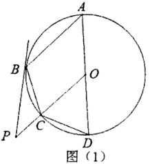
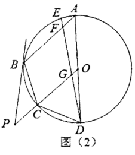
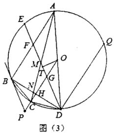

# Mathematics - 题目 2600

**ID**: 9a50e5d8aaca49debe0999d701f7b19e
**年级**: Grade 9
**难度**: Medium-Hard
**题型**: Calculation

## 题目
如图， $\odot O$ 的内接四边形 $ABCD$ 中 $AD$ 为 $\odot O$ 直径， $OC//AB$ ， $BP$ 是 $\odot O$ 的切线， $BP$ 交 $OC$ 的延长线于点 $P$ ．（1）如图（1）求证： $\angle COD=2\angle CBP$ ；​​​​​​​‌（2）如图（2）点 $E$ 在弧 $AB$ 上，连接 $DE$ 分别交 $AB$ 、 $OC$ 于点 $F$ 、 $G$ ，且 $\angle ADC+2\angle AFE=180{}^\circ $ ，求证： $CD=CG$ ；（3）如图（3）在（2）的条件下，连接 $AC$ 分别交 $DE$ 、 $BD$ 于点 $M$ 、 $N$ ， $OT\bot DE$ ，垂足为 $T$ ， $Q$ 是 $\odot O$ 上一点，连接 $DQ$ ，已知 $2\angle ANB-\angle ADQ=2\angle ADB$ ， $TG=\sqrt {3}$ ， $FM=2\sqrt {3}$ ，求 $DQ$ 的长．

## 解答

1. （1）连接OB，
2. ∵BP是⊙O的切线，
3. ∴OB⊥PB，
4. ∵∠PBO＝90º，
5. ∴∠CBP+∠OBC=90°，
6. ∴2∠CBP+2∠OBC=180°，
7. ∵OB=OC，
8. ∴∠OBC=∠OCB，
9. ∵∠OBC+∠OCB+∠BOC=180°，
10. ∴2∠OBC+∠BOC=180°，
11. ∴∠BOC=2∠CBP，
12. ∵OC∥AB，
13. ∴∠BOC=∠ABO，∠COD=∠OAB，
14. ∵OB=OA，
15. ∴∠OBA=∠OAB，
16. ∴∠COD=2∠CBP．
17. 
18. （2）∵OC∥AB，
19. ∴∠AFE=∠OGF，
20. ∵∠CGD=∠OGF，
21. ∴∠AFE=∠DGC，
22. ∵∠ADC＋2∠AFE＝180º，
23. ∵OD=OC∴∠GCD=∠ADC，
24. ∴∠GCD＋2∠AFE＝180º，
25. ∵∠GCD+∠CDG+∠CGD=180°，
26. ∴∠GCD=∠CDG，
27. ∴CD＝CG；
28. 
29. （3）连接AE、AQ，过M点作MS⊥AB于S．
30. ∵AD为⊙O直径，
31. ∴AE⊥DE，
32. ∴∠AED＝90º，
33. ∵OT⊥DE，
34. ∴TE=TD，∠OTD＝90º，
35. ∴OT= ${\rm \frac {1}{2}AE}$ ，
36. ∵OC∥AB，
37. ∴∠AFE=∠OGT，
38. ${\rm \therefore {\rm{t}}{\rm{a}}{\rm{n}}\angle AFE={\rm{t}}{\rm{a}}{\rm{n}}\angle OGT}$ ，
39. ∵EF=2TG=2 $\sqrt {3}$ ，
40. ${\rm \therefore \angle CGD=\angle AFE,\angle GDC=\angle CAE,\angle CGD=\angle CDG}$ ，
41. ${\rm \therefore \angle AFE=\angle EAM}$ ，
42. ${\rm\hspace{-0.5em}\begin{array}{l}\rm \therefore {\rm{t}}{\rm{a}}{\rm{n}}\angle AFE={\rm{t}}{\rm{a}}{\rm{n}}\angle EAM\\\therefore \frac {AE}{EF}=\frac {EM}{AE}\end{array}\hspace{-0.5em}}$
43. ∵FM= $2\sqrt {3}$ ， 即EM= $4\sqrt {3}$ ，
44. ∴AE= $2\sqrt {6}$ ，
45. 可得，tan∠EAF= $\frac {\sqrt {2}}{2}$ ，
46. 解△AFM，可得tan∠FAM= $\frac {\sqrt {2}}{4}$ ，AF=6，
47. 设TM= $\sqrt {3}$ x，则 ${\rm DT=ET=4\sqrt {3}+\sqrt {3}x,DG=3\sqrt {3}+\sqrt {3}x,}$
48. 用三角函数可导出CD=CG= ${\rm 4+2x,GH=1+x}$ ，
49. ∴CD= $3x+3,$
50. 即 $4+2x{\rm{=}}3x+3$
51. 解得 $x=1$
52. ∴GH=4，BF=8，AF=6
53. ∴AB=14
54. ∵∠ANB-∠ADB=∠CAD
55. 又∵ 2∠ ANB-∠ADQ=2∠ADB，
56. ∴∠ ADQ=2∠CAD，
57. 由 (1) 可知∠BAD=2∠CAD，
58. ∴∠ADQ= ∠BAD，
59. ∴DQ∥AB∴四边形ABDQ的四角均为90°
60. ∴四边形ABDQ为矩形，
61. ∴DQ=AB=14
62. 

## 知识点

**中文**:
  - 圆心角与圆周角
  - 圆的综合问题
  - 相似三角形的判定与性质综合

**English**:
  - Central and Inscribed Angles
  - Comprehensive Circle Problems
  - Determination and Properties

---
