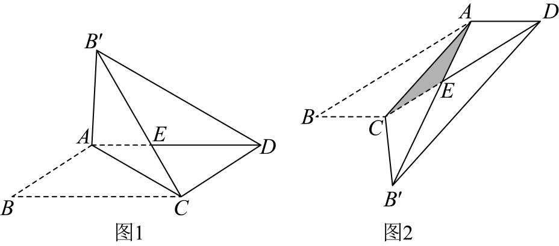

# Mathematics - 题目 3933

**ID**: 9a6152c7319f4b998d1db5d724be8d52
**年级**: Grade 9
**难度**: Medium-Hard
**题型**: Calculation

## 题目
现在如果我们把平行四边形沿着它的一条对角线翻折，【发现与证明】$▱ABCD$ 中， $AB\ne BC$ ，将 $\vartriangle ABC$ 沿 $AC$ 翻折至 $\vartriangle AB{^{\prime }}C$ ，连结 $B^{′}D$ ．结论1： $\vartriangle AB{^{\prime }}C$ 与 $▱ABCD$ 重叠部分的图形是等腰三角形；​​​​​​​‌结论2： $B^{′}D{\rm{/\mskip-4mu/}}AC$ ．……（1）请利用图1证明结论1或结论2（只需证明一个结论）．【理解与应用】在 $▱ABCD$ 中，将 $\vartriangle ABC$ 沿 $AC$ 翻折至 $\vartriangle AB{^{\prime }}C$ ，连结 $B^{′}D$ ．（2）如图2，已知 $\angle B=30{}\degree $ ，若 $AB>BC$ ， $\angle AB^{′}D=15{}\degree $ ，则 $∠ACB=$°；【探究与拓展】在 $▱ABCD$ 中，将 $\vartriangle ABC$ 沿 $AC$ 翻折至 $\vartriangle AB{^{\prime }}C$ ，连结 $B^{′}D$ ．（3）已知 $\angle B=30{}\degree $ ， $AB=6$ ，翻折后四边形为 $ACB^{′}D$ 时，如果 $AB^{′}$ 平分 $\angle CB^{′}D$ ，求 $BC$ 的值；（4）已知 $\angle B=30{}\degree $ ， $AB=6$ ，当 $\vartriangle AB^{′}D$ 是直角三角形时，则 $BC=$．

## 解答

1. 解：（1）由折叠可知 $\angle BCA=\angle ACB^{′}$ ，
2. ∵在 $▱ABCD$ 中 $AD{\rm{/\mskip-4mu/}}BC$ ，
3. $\therefore \angle EAC=\angle ACB$ ，
4. $\therefore \angle EAC=\angle ACE$ ，
5. $\therefore AE=EC$ ，
6. ∴ $△ACE$ 是等腰三角形；
7. $\because AD=BC=B^{′}C$ ，
8. $\therefore B^{′}E=ED$ ，
9. $\because \angle AEC=\angle DEB^{′}$ ，
10. $\therefore \angle EDB^{′}=\angle EB^{′}D$ ，
11. $\therefore \angle ACB^{′}=\angle CB^{′}D$ ，
12. $\therefore AC{\rm{/\mskip-4mu/}}B^{′}D$ ；
13. （2）∵ $\angle B=30{}\degree $ ，
14. 根据折叠可得 $\angle AB^{′}C=\angle B=30{}\degree $ ，
15. $\because \angle AB\prime D=15{}\degree $ ，
16. $\therefore \angle CB\prime D=45{}\degree $ ，
17. $\because AC{\rm{/\mskip-4mu/}}B^{′}D$ ，
18. $\therefore \angle B^{′}CA=\angle BCA=180{}\degree -45{}\degree =135{}\degree $ ;
19. （3）如图，过点 $C$ 作 $CF\bot AB{^{\prime }}$ 交于点 $F$ ，
20. 
21. $\because AC{\rm{/\mskip-4mu/}}B^{′}D$ ，
22. $\therefore \angle CAB^{′}=\angle AB\prime D$ ，
23. $\because AB^{′}$ 平分 $\angle CB^{′}D$ ，
24. $\therefore \angle CB\prime A=\angle AB^{′}D$ ，
25. $\therefore \angle CB^{′}A=\angle CAB^{′}$ ，
26. $\therefore AC=B^{′}C$ ，
27. 由折叠可知， $BC=B^{′}C,\angle B=\angle CB^{′}A=30{}\degree $ ，
28. $\because CF\bot AB^{′},AB=6$ ，
29. $\therefore B^{′}F=AF=3$ ，
30. $\because \angle B=\angle CB^{′}F=30{}\degree $ ，
31. $\therefore CB^{′}=\frac {B^{′}F}{{\rm{c}}{\rm{o}}{\rm{s}}30{}\degree }=2\sqrt {3}$ ，
32. $\therefore BC=2\sqrt {3}$ ；
33. （4）解：当 $\vartriangle AB^{′}D$ 是直角三角形时，分为
34. ①如图，当 $\angle ADB\prime =90{}\degree $ 时，
35. 
36. 由（1）知 $AC{\rm{/\mskip-4mu/}}B^{′}D$ ，
37. ∴ $\angle CAD=90{}\degree $ ，
38. 由折叠可得 $AB=AB^{′}$
39. ∵在在 $▱ABCD$ 中 $AB=CD$ ，
40. ∴ $AD=AD,AB=CD=AB^{′}$ ，
41. ∴ $\vartriangle ACD≌\vartriangle DB^{′}A\left ({{\rm{H}}{\rm{L}}}\right )$ ，
42. ∴ $AC=DB^{′}$ ，
43. ∴四边形 $ACB^{′}D$ 是矩形，
44. ∴ $\mathrm{△}ACB^{′}$ 是直角三角形，
45. 由折叠可得 $\angle B=\angle AB^{′}C=30{}\degree $ ， $AB=AB^{′}=6$ ，
46. ∴ $B^{′}C={\rm{c}}{\rm{o}}{\rm{s}}30{}\degree AB^{′}=3\sqrt {3}$ ，
47. ∴ $BC=3\sqrt {3}$ ；
48. ②如图，当 $\angle DAB\prime =90{}\degree $ 时，
49. 
50. ∵四边形 $ABCD$ 是平行四边形，
51. ∴ $AB\mathrm{/\mskip-4mu/}DC$ ，
52. ∴ $\angle BAC=\angle DCA$ ，
53. 由折叠可知， $\angle BAC=\angle B{^{\prime }}AC$ ，
54. ∴ $\angle ACE=\angle EAC$ ，
55. ∴ $EC=EA$ ，
56. 由（1）知 $AC{\rm{/\mskip-4mu/}}B^{′}D$ ，
57. $\therefore \angle CAB^{′}=\angle AB^{′}D$ ，
58. 由折叠可知 $B^{′}C=BC,AB=AB^{′}$ ，
59. ∴ $B^{′}C=BC=AC,CD=AB=AB^{′}$ ，
60. ∵ $B^{′}D=B^{′}D,AB^{′}=CD,CB^{′}=AD$ ，
61. ∴ $\vartriangle B^{′}AD≌\vartriangle DCB^{′}{\left ({{\rm{S}}{\rm{S}}{\rm{S}}}\right )}$ ，
62. ∴ $\angle DCB^{′}=\angle B^{′}DA=90{}\degree $ ，
63. ∵ $\angle B=30{}\degree $ ，
64. ∴ $\angle B=\angle AB^{′}C=30{}\degree $ ，
65. 设 $CE=AE=x$ ，则 $B^{′}E=2x,B^{′}C=\sqrt {3}x$ ，
66. ∴ $AB^{′}=2x+x=6$ ，
67. ∴ $x=2$ ，
68. ∴ $B{^{\prime }}C=2\sqrt {3}$ ，
69. ∴ $BC=2\sqrt {3}$ ；
70. ③如图，当 $\angle AB\prime D=90{}\degree $ 时，
71. 
72. 由（1）知 $AC{\rm{/\mskip-4mu/}}B^{′}D$ ，
73. $\therefore \angle B^{′}AC=90{}\degree $ ，
74. 由折叠可知， $\angle BAC=\angle B^{′}AC=90{}\degree $ ，
75. ∵ $\angle B=30{}\degree $ ， $AB=6$ ，
76. ∴ $BC=\frac {AB}{{\rm{c}}{\rm{o}}{\rm{s}}30{}\degree }=4\sqrt {3}$ ；
77. ④如图，当 $\angle DAB^{′}=90{}\degree $ 时，
78. 
79. ∵四边形 $ABCD$ 是平行四边形，
80. ∴ $BC{\rm{/\mskip-4mu/}}AD$ ，
81. ∴ $\angle BCA=\angle DAC$ ，
82. 由折叠可知， $\angle BCA=\angle B{^{\prime }}CA$ ，
83. ∴ $\angle ACE=\angle EAC$ ，
84. ∴ $EC=EA$ ，
85. 由折叠可知， $BC=B^{′}C,AB=A^{′}B=6,\angle B=\angle AB^{′}C=30{}\degree $ ，
86. ∴ $CE=AE={\rm{t}}{\rm{a}}{\rm{n}}30{}\degree AB^{′}=2\sqrt {3}$ ，
87. ∴ $B^{′}E=2AE=4\sqrt {3}$ ，
88. ∴ $B^{′}C=B^{′}E+CE=6\sqrt {3}$ .
89. 综上所述, $BC$ 的值为 $2\sqrt {3}$ 或 $3\sqrt {3}$ 或 $4\sqrt {3}$ 或 $6\sqrt {3}$ ．

## 知识点

**中文**:
  - 平行四边形的性质
  - 矩形的判定与性质综合
  - 解直角三角形
  - 折叠问题

**English**:
  - Properties of Parallelograms
  - Determination and Properties of Rectangles
  - Solving Right Triangles
  - Folding Problems

---
