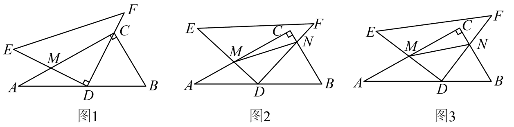

# Mathematics - 题目 3450

**ID**: 9a83d02d87df4c259e5614e54edafaa8
**年级**: Grade 9
**难度**: Medium-Hard
**题型**: Calculation

## 题目
将一副直角三角尺按图1摆放，其中 $∠ACB=90{}\degree ，$  $\angle EDF=90\mathrm{°}，$  $\angle B=60{}\degree ，$  $\angle F=45{}\degree $ ，等腰 ${\rm{R}}{\rm{t}}\mathrm{△}DEF$ 顶点D在 $AB$ 边上， $DF$ 边经过点C，DE与 $AC$ 交于点M．（1）若D为 $AB$ 的中点．① $\frac {DM}{CD}=$；​​​​​​​‌②如图2．将 $\vartriangle DEF$ 绕点D按顺时针方向旋转，直角边 $DF$ 交 $BC$ 于N，试猜想 $DM$ 与 $DN$ 之间的数量关系，并说明理由；③如图2，若 $BC=2\sqrt {3}$ ，在 $\vartriangle DEF$ 绕点D的旋转过程中，求 $MN$ 的最小值；（2）如图3，若 $BC=2\sqrt {3}$ ，在 $\vartriangle DEF$ 绕点D的旋转过程中，同时改变点D在 $AB$ 上位置， $MN$ 的最小值也会发生变化，当 $BD=$时，在 $\vartriangle DEF$ 绕点D的旋转过程中 $MN$ 的最小值达到最小，最小值为．

## 解答

1. （1）解：①∵ $\angle ACB=90{}\degree ，AD=DB$ ，
2. ∴ $CD=DA=DB$ ，
3. ∵ $\angle B=60{\rm °}$ ，
4. ∴ $\vartriangle BDC$ 是等边三角形，
5. ∴ $\angle DCB=\angle CDB=60{}\degree $ ，
6. ∵ $\angle ACB=\angle CDM=90{}\degree $ ，
7. ∴ $\angle MCD=30{}\degree $ ，
8. ∴ $\frac {DM}{CD}={\rm{t}}{\rm{a}}{\rm{n}}30{}\degree =\frac {\sqrt {3}}{3}$ ;
9. ②如图，过点 $D$ 作 $DH\bot AC$ 于点 $H$ ， $DP\bot BC$ 于点 $P$ ，
10. ，
11. ∴ $\angle DHA=\angle DPN=90{}\degree $ ，
12. ∵ $\angle B{\rm{=}}{{6}}{{0}}{}\degree $ ，
13. ∴ $\angle PDB=\angle HAD=30{}\degree $ ，
14. ∴ $\angle HDA=60{}\degree $ ，
15. ∴ $\frac {DH}{AD}={\rm{s}}{\rm{i}}{\rm{n}}\angle A={\rm{s}}{\rm{i}}{\rm{n}}30{}\degree =\frac {1}{2}$ ， $\frac {PD}{BD}={\rm{c}}{\rm{o}}{\rm{s}}\angle PDB={\rm{c}}{\rm{o}}{\rm{s}}30{}\degree =\frac {\sqrt {3}}{2}$ ，
16. ∴ $DH=\frac {1}{2}AD,DP=\frac {\sqrt {3}}{2}BD$ ，
17. ∵ $D$ 为 $AB$ 的中点，
18. ∴ $AD=BD$ ，
19. ∴ $\frac {DP}{DH}=\frac {\frac {\sqrt {3}}{2}BD}{\frac {1}{2}AD}=\sqrt {3}$ ；
20. ∵ $\angle HDA=60{}\degree $ ， $\angle PDB=30{}\degree $ ，
21. ∴ $\angle HDP=90{}\degree $ ，
22. ∴ $\angle HDF+\angle PDF=90{}\degree $ ，
23. ∵ $\angle EDF=90{}\degree $ ，
24. ∴ $\angle HDE+\angle HDF=90{}\degree $ ，
25. ∴ $\angle HDM=\angle PDN$ ，
26. 又 $\angle DHM=\angle DPN=90{}\degree $ ，
27. ∴ $\vartriangle DHM∽\vartriangle DPN$ ，
28. ∴ $\frac {DN}{DM}=\frac {DP}{DH}$ ，
29. ∴ $\frac {DN}{DM}=\sqrt {3}$ ，即 $DN=\sqrt {3}DM$ ；
30. ③连接 $CD$ ,
31. 
32. ∵ $\angle MCN=\angle MDN=90{}\degree $ ，
33. ∴ $\angle MCN+\angle MDN=180{}\degree $ ，
34. ∴M，D，N，C四点共圆，
35. ∴ $MN$ 是该圆的直径，
36. ∵ $MN\geqslant CD$ ，
37. ∴当 $MN=CD$ 时， $MN$ 的长最短，此时 $MN=CD=\frac {1}{2}AB=BC=2\sqrt {3}$ ;
38. （2）解：如图，当 $CD\bot AB$ 时，
39. 
40. 根据“垂线段最短”知， $CD$ 的长最短，
41. 当四边形 $MDNC$ 是矩形时， $MN=CD$ ，此时 $MN$ 最短,
42. ∵ $CD\bot AB,\angle B=60{}\degree $ ，
43. ∴ $\angle BCD=30{}\degree $ ，
44. ∴ $BD=\frac {1}{2}BC=\sqrt {3}$ ，
45. ∴ $CD=\sqrt {BC{^{2}}-BD{^{2}}}=3$ ，
46. ∴ $MN$ 的最小值为3.

## 知识点

**中文**:
  - 几何变换——旋转综合题
  - 相似三角形的判定与性质综合
  - 解直角三角形

**English**:
  - Rotation Comprehensive Problems
  - Determination and Properties
  - Solving Right Triangles

---
