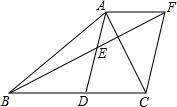

# Mathematics - 题目 1042

**ID**: 9aa2096c5712441e95a5b1b50d7d599f
**年级**: Grade 9
**难度**: Medium-Hard
**题型**: Calculation

## 题目
已知：在 $\vartriangle ABC$ 中，AD是BC边上的中线，点E是AD的中点；过点A作 $AF//BC$ ，交BE的延长线于F，连接CF．$\left ({1}\right )$ 求证：四边形ADCF是平行四边形；$\left ({2}\right )$ 填空：$①$ 当 $AB=AC$ 时，四边形ADCF是形；$②$ 当 $\angle BAC=90{^{\circ }}$ 时，四边形ADCF是形 $.​​​​​​​‌$

## 解答

1. 证明： $\because AF//BC$ ， $\therefore \angle AFE=\angle EBD.$
2. 在 $\vartriangle AEF$ 和 $\vartriangle DEB$ 中
3. $\because \begin{cases}\angle AFE=DBE\\\angle FEA=\angle BED\\AE=DE\end{cases}$ ，
4. $\therefore \vartriangle AEF$ ≌ $\vartriangle DEB\left ({AAS}\right ).$
5. $\therefore AF=BD.$
6. $\therefore AF=DC$ ．
7. 又 $\because AF//BC$ ，
8. $\therefore $ 四边形ADCF为平行四边形；
9. $\left ({2}\right )①$ 当 $AB=AC$ 时，四边形ADCF是矩形；
10. $②$ 当 $\angle BAC=90{^{\circ }}$ 时，四边形ADCF是菱形．
11. 故答案为矩，菱．

## 知识点

**中文**:
  - 一组对边平行且相等的四边形是平行四边形
  - 全等三角形的判定与性质

**English**:
  - One Pair of Parallel and Equal Opposite Sides
  - Determination and Properties

---
