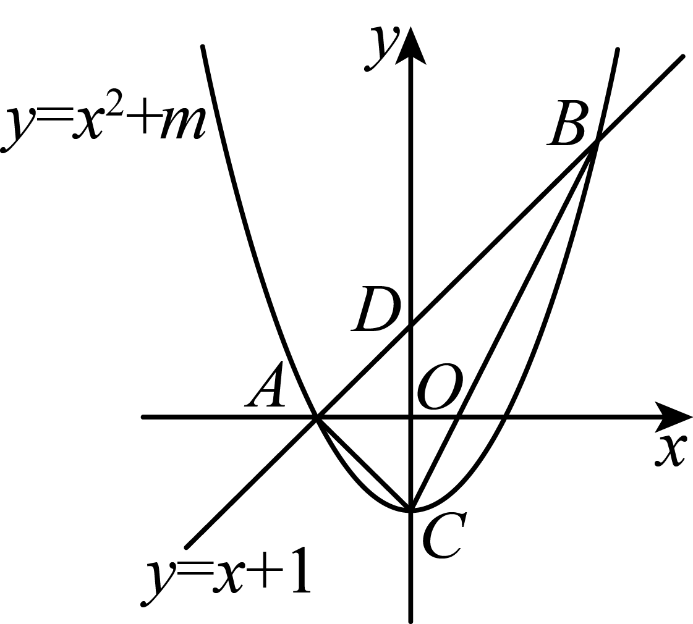

# Mathematics - 题目 848

**ID**: 9ba17e5c874847cfb43a3b4c6c749a63
**年级**: Grade 9
**难度**: Medium-Hard
**题型**: Calculation

## 题目
如图，抛物线 $y=x{^{2}}+m$ 的图象与一次函数 $y=x+1$ 的图象交于 $A$ 、 $B$ 两点，其中 $A$ 点在 $x$ 轴上，点 $C$ 是抛物线和 $y$ 轴的交点， $D$ 点是直线和 $y$ 轴的交点．（1）利用图中条件，求抛物线的函数关系式和 $B$ 点坐标；​​​​​​​‌（2）连接 $A$ 、 $B$ 、 $C$ 三点，求 $\vartriangle ABC$ 的面积；（3）直接写出不等式 $x{^{2}}+m>x+1$ 的解集．

## 解答

1. （1）解：把 $y=0$ 代入 $y=x+1$ 得： $0=x+1$ ，
2. 解得： $x=-1$ ，
3. ∴ $A\left ({-1,0}\right )$ ，
4. 把 $A\left ({-1,0}\right )$ 代入 $y=x{^{2}}+m$ 得： $0={\left({-1}\right)^{2}}+m$ ，
5. 解得： $m=-1$ ，
6. ∴抛物线的解析式为： $y=x{^{2}}-1$ ，
7. 联立 $\begin{cases}y=x+1\\y=x{^{2}}-1\end{cases}$ ，
8. 解得： $\begin{cases}x=-1\\y=0\end{cases}$ 或 $\begin{cases}x=2\\y=3\end{cases}$ ，
9. ∴点B的坐标为 $\left ({2,3}\right )$ ；
10. （2）解：把 $x=0$ 代入 $y=x{^{2}}-1$ 得 $y=-1$ ，
11. ∴点 $C$ 的坐标为 $\left ({0,-1}\right )$ ，
12. 把 $x=0$ 代入 $y=x+1$ 得 $y=1$ ，
13. ∴点D的坐标为 $\left ({0,1}\right )$ ，
14. ∴ $CD=1-\left ({-1}\right )=1+1=2$ ，
15. ∴ $S{{}_{\vartriangle ABC}}=S{{}_{\vartriangle ACD}}+S{{}_{\vartriangle BCD}}=\frac {1}{2}\times 2\times 1+\frac {1}{2}\times 2\times 2=3$ ．
16. （3）解：根据函数图象可知：当 $x<-1$ 或 $x>2$ 时，二次函数的图象在一次函数图象的上方，
17. ∴不等式 $x{^{2}}+m>x+1$ 的解集为 $x<-1$ 或 $x>2$ ．

## 知识点

**中文**:
  - 二次函数与不等式（组）
  - 二次函数的综合
  - 待定系数法求二次函数解析式

**English**:
  - Quadratic Functions and Inequalities
  - Comprehensive Quadratic Function Problems
  - Finding Quadratic Expressions by Undetermined Coefficients

---
