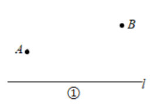
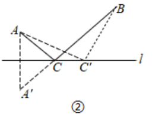
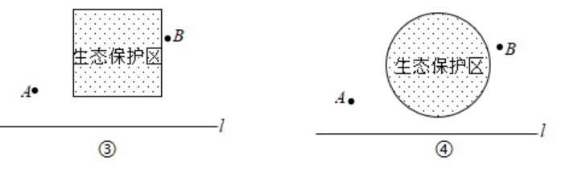

# Mathematics - 题目 2757

**ID**: 9c1d108239f54d1fbc526a6532e1002c
**年级**: Grade 9
**难度**: Medium-Hard
**题型**: Calculation

## 题目
如图①，要在一条笔直的路边 $l$ 上建一个燃气站，向 $l$ 同侧的A、B两个城镇分别发铺设管道输送燃气，试确定燃气站的位置，使铺设管道的路线最短．（1）如图②，作出点A关于 $l$ 的对称点 $A^{′}$ ，线 $A^{′}B$ 与直线 $l$ 的交点C的位置即为所求， 即在点C处建气站， 所得路线ACB是最短的，为了让明点C的位置即为所求，不妨在 $l$ 直线上另外任取一点 $C^{′}$ ，连接 $AC^{′}$ ， $BC^{′}$ ， 证明 $AC+CB<AC^{′}+C^{′}B$ ， 请完成这个证明．（2）如果在A、B两个城镇之间规划一个生态保护区，燃气管道不能穿过该区域请分别始出下列两种情形的铺设管道的方案（不需说明理由），①生市保护区是正方形区城，位置如图③所示②生态保护区是圆形区域，位置如图④所示．​​​​​​​‌

## 解答

1. （1）证明：如图，连接 $A^{′}C$
2. 
3. ∵点A、 $A^{′}$ 关于l对称，点C在l上
4. ∴ $A^{′}C=CA$ ，
5. ∴ $CA+CB=A^{′}C+CB=A^{′}B$ ，
6. 同理 $AC^{′}+C^{′}B=A^{′}C^{′}+C^{′}B$ ，
7. 在 $\Delta A^{′}C^{′}B$ 中，有 $A^{′}B<A^{′}C^{′}+C^{′}B$
8. ∴ $AC+CB<AC^{′}+C^{′}B$ ；
9. （2）解：①在点C处建燃气站，铺设管道的最短路线是AC+CD+DB（如图，其中D是正方形的顶点）．
10. 
11. ②在点C处建燃气站，铺设管道的最短路线是 $AC+CD+\overset ⌢{{DE}}+EB$ （如图，其中CD、BE都与圆相切）．
12. 

## 知识点

**中文**:
  - 几何变换——轴对称综合题
  - 最短路径问题
  - 切线的性质定理
  - 线段垂直平分线的性质

**English**:
  - Axial Symmetry Comprehensive Problems
  - Shortest Path Problems
  - Tangent Properties Theorem
  - Properties of Perpendicular Bisectors

---
