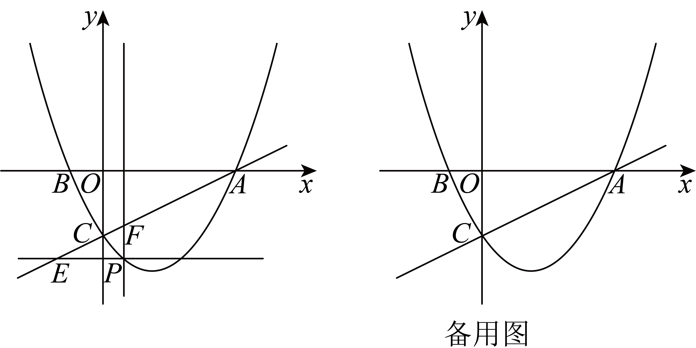

# Mathematics - 题目 3548

**ID**: 9da11ba705654bc18b0f9f562bd51353
**年级**: Grade 9
**难度**: Medium-Hard
**题型**: Calculation

## 题目
综合与探究：如图，在平面直角坐标系中，已知直线 $y=\frac {1}{2}x-2$ 与 ${\rm \mathit{x}}$ 轴交于点 ${\rm \mathit{A}}$ ，与 ${\rm \mathit{y}}$ 轴交于点 ${\rm \mathit{C}}$ ，过 ${\rm \mathit{A}，\mathit{C}}$ 两点的抛物线 $y=ax{^{2}}+bx+c\left ({a\ne 0}\right )$ 与 ${\rm \mathit{x}}$ 轴的另一个交点为点 $B(-1{\rm{，}}0)$ ，点 ${\rm \mathit{P}}$ 是抛物线位于第四象限图象上的动点，过点 ${\rm \mathit{P}}$ 分别作 ${\rm \mathit{x}}$ 轴和 ${\rm \mathit{y}}$ 轴的平行线，分别交直线 $AC$ 于点 ${\rm \mathit{E}}$ ，点 ${\rm \mathit{F}}$ ．(1)求抛物线的解析式；​​​​​​​‌(2)点 ${\rm \mathit{D}}$ 是 ${\rm \mathit{x}}$ 轴上的任意一点，若 $\vartriangle ACD$ 是以 $AC$ 为腰的等腰三角形，请直接写出点 ${\rm \mathit{D}}$ 的坐标；(3)当 $EF=AC$ 时，求点 ${\rm \mathit{P}}$ 的坐标；(4)在（3）的条件下，若点 ${\rm \mathit{N}}$ 是 ${\rm \mathit{y}}$ 轴上的一个动点，过点 ${\rm \mathit{N}}$ 作抛物线对称轴的垂线，垂足为 ${\rm \mathit{M}}$ ，连接 $NA{\rm{，}}MP$ ，则 $NA+MP$ 的最小值为．

## 解答

1. （1）解：∵直线 $y=\frac {1}{2}x-2$ 与 ${\rm \mathit{x}}$ 轴交于点 ${\rm \mathit{A}}$ ，与 ${\rm \mathit{y}}$ 轴交于点 ${\rm \mathit{C}}$ ，
2. ∴当 $y=0$ 时， $x=4$ ，即 $A\left ({4,0}\right )$ ；当 $x=0$ 时， $y{\rm{=}}-{{2}}$ ，即 $C\left ({0,-2}\right )$ ；
3. ∵ $B(-1{\rm{，}}0)$ ，∴设抛物线的解析式为 $y=a\left ({x+1}\right )\left ({x-4}\right )\left ({a\ne 0}\right )$ ，
4. 把 $C\left ({0,-2}\right )$ 代入可得 $-2=a\left ({0+1}\right )\left ({0-4}\right )$ ，解得 $a=\frac {1}{2}$ ，
5. ∴ $y=\frac {1}{2}\left ({x+1}\right )\left ({x-4}\right )=\frac {1}{2}x{^{2}}-\frac {3}{2}x-2$ ，
6. ∴抛物线的解析式为 $y=\frac {1}{2}x{^{2}}-\frac {3}{2}x-2$ ；
7. （2）解：∵ $A\left ({4,0}\right )$ ， $C\left ({0,-2}\right )$ ，∴ $OC=2,OA=4$ ,∴ $AC=\sqrt {OC{^{2}}+AB{^{2}}}=2\sqrt {5}$ ，
8. 如图：当 $CD{{}_{1}}=AC=2\sqrt {5},OC\bot AD{{}_{1}}$ ，∴ $OD{{}_{1}}=OA=4$ ,即 $D{{}_{1}}\left ({-4{\rm{,}}0}\right )$ ；
9. 如图：当 $AD{{}_{2}}=AC=2\sqrt {5}$ ，
10. ∴ $OD{{}_{2}}=AD{{}_{2}}-AC=2\sqrt {5}-4$ ,即 $D{{}_{2}}\left ({4-2\sqrt {5}{\rm{,}}0}\right )$ ；
11. 如图：当 $AD{{}_{3}}=AC=2\sqrt {5}$ ，∴ $OD{{}_{3}}=AD{{}_{3}}+AC=2\sqrt {5}+4$ ,即 $D{{}_{2}}\left ({4-2\sqrt {5}{\rm{,}}0}\right )$ ；
12. 综上，点 ${\rm \mathit{D}}$ 的坐标为 $D{{}_{1}}\left ({-4{\rm{,}}0}\right ),D{{}_{2}}\left ({4+2\sqrt {5}{\rm{,}}0}\right ),D{{}_{3}}\left ({4-2\sqrt {5}{\rm{,}}0}\right )$ ；
13. 
14. （3）解：如图：∵ $PE{\rm{/\mskip-4mu/}}x$ 轴，∴ $\angle PEA=\angle OAC$ ，
15. ∵ $PF\mathrm{/\mskip-4mu/}y$ 轴，∴ $\angle PFE=\angle OCA$ ，
16. ∵ $EF=AC$ ，∴ $\vartriangle AOC≌\vartriangle EPF\left ({{\rm{A}}{\rm{S}}{\rm{A}}}\right )$ ,∴ $PF=OC=2$ ,
17. ∵设 $P\left ({m,\frac {1}{2}m{^{2}}-\frac {3}{2}m-2}\right )\left ({0<m<4}\right )$ ，则 $F\left ({m,\frac {1}{2}m-2}\right )$ ,
18. ∴ $PF=\frac {1}{2}m-2-\left ({\frac {1}{2}m{^{2}}-\frac {3}{2}m-2}\right )=-\frac {1}{2}m{^{2}}+2m$ ，
19. ∴ $-\frac {1}{2}m{^{2}}+2m=2$ ，解得 $m=2$ （负值舍去），
20. 当 $m=2$ 时， $\frac {1}{2}\times 2{^{2}}-\frac {3}{2}\times 3-2=-3$ ，∴ $P\left ({2，-3}\right )$ ；
21. （4）解： ∵抛物线的解析式为 $y=\frac {1}{2}x{^{2}}-\frac {3}{2}x-2$ ，
22. ∴抛物线的对称轴为直线 $x=\frac {3}{2}$ ，
23. 如图：将线段 $NA$ 向右平移 $\frac {3}{2}$ 单位得到 $MG$ ,
24. ∴四边形 $MNAG$ 是平行四边形，∴ $NA=MG,AG=MN=\frac {3}{2}$ ,即 $G\left ({\frac {11}{2}，0}\right )$ ,
25. 作 $P\left ({2，-3}\right )$ 关于对称轴 $x=\frac {3}{2}$ 的点 $P{{}_{1}}\left ({1,-3}\right )$ ,则 $MP=MP{{}_{1}}$ ，
26. ∴ $P{{}_{1}}G=\sqrt {{\left({1-\frac {11}{2}}\right)^{2}}+{\left({-3-0}\right)^{2}}}=\frac {3\sqrt {13}}{2}$ ,
27. ∵ $NA+MP=MG+MP{{}_{1}}\mathrm{\geqslant }P{{}_{1}}G=\frac {3\sqrt {13}}{2}$ ，
28. ∴ $NA+MP$ 的最小值为 $\frac {3\sqrt {13}}{2}$ ．
29. 

## 知识点

**中文**:
  - 两点间的距离公式
  - 二次函数的综合
  - 全等三角形的判定与性质
  - 二次函数的对称

**English**:
  - Distance Formula
  - Comprehensive Quadratic Function Problems
  - Determination and Properties
  - Symmetry of Quadratic Functions

---
