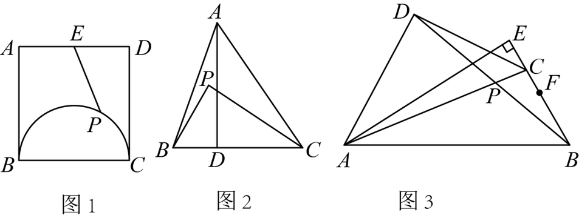

# Mathematics - 题目 1609

**ID**: 9e4ed6fd6c764b97abe52aa4abaf1093
**年级**: Grade 9
**难度**: Medium-Hard
**题型**: Calculation

## 题目
【问题提出】（1）如图1，在矩形 $ABCD$ 中， $AD=10$ ， $AB=12$ ，点E为 $AD$ 的中点，点P为矩形 $ABCD$ 内以 $BC$ 为直径的半圆上一点，则 $PE$ 的最小值为；​​​​​​​‌【问题探究】（2）如图2，在 $\vartriangle ABC$ 中， $AD$ 为 $BC$ 边上的高，且 $AD=BC=4$ ，P为 $\vartriangle ABC$ 内一点，当 $S{{}_{\vartriangle PBC}}=\frac {1}{2}S{{}_{\vartriangle ABC}}$ 时，求 $PB+PC$ 的最小值；【问题解决】（3）如图3，滨河学校餐厅门口有一块“疯狂四季”四边形菜园 $ABCD$ ， $\angle ABC=\angle BAD=60{}^\circ $ ， $AC$ 与 $BD$ 相交于点P，且 $AD+BC=AB$ ，过点A作直线 $BC$ 的垂线交直线 $BC$ 于点E，即 $AE\bot BE$ ， $BE=200\sqrt {3}$ 米．赵老师准备在 $\vartriangle ABP$ 内种植当季蔬菜，边BE的中点F为菜园出入口，为了种植方便，她打算在 $AE$ 边上取点M，并沿 $PM$ 、 $MF$ 修两条人行走道，要求人行走道的总长度尽可能小，问 $PM+MF$ 的长度是否存在最小值？若存在，求出其最小值；若不存在，请说明理由．

## 解答

1. 解：（1）取 $BC$ 的中点F，连接 $EF{\rm{、}}PF$ ，如图1所示，
2. 
3. ∵四边形 $ABCD$ 是矩形，且E、F分别是 $AD、BC$ 的中点，
4. ∴四边形 $ABFE$ 为矩形，
5. $\therefore EF=AB=12$ ，
6. $\because FP=FB=FC=\frac {1}{2}BC=5$ ，
7. $\therefore PE\geqslant EF-FP=12-5=7$ ，
8. $\therefore PE\geqslant 7$ ，
9. 当且仅当E、P、F三点共线时，PE取最小值，此时 $PE=7$ ，
10. 故答案为：7；
11. （2）作 $AD$ 的垂直平分线l，作点B关于直线l的对称点 $B^{′}$ ，连接 $BB^{′}$ 、 $PB^{′}$ 、 $CB^{′}$ ， $CB^{′}$ 交直线l于点 $P^{′}$ ，连接 $BP^{′}$ ，如图2．
12. 
13. ∵ $S{{}_{\vartriangle PBC}}=\frac {1}{2}S{{}_{\vartriangle ABC}}$ ，
14. ∴点P到BC的距离等于 $\frac {1}{2}AD$ ，
15. ∴点P在 $\vartriangle ABC$ 内直线l上．
16. 则 $BB^{′}=AD=BC$ ， $PB=PB^{′}$ ， $P^{′}B=P^{′}B^{′}$ ，
17. ∴ $PB+PC=PB^{′}+PC$ ．
18. ∵ $PB^{′}+PC\geqslant B^{′}C$ ，
19. ∴当点P在点 $P^{′}$ 的位置时， $PB+PC$ 取得最小值，最小值为 $B^{′}C$ 的长．
20. ∵ $BB^{′}{\bot }l$ ， $AD\bot l$ ， $AD⊥BC$ ，
21. ∴ $B^{′}B\bot BC$ ．
22. ∴ $\mathrm{△}B^{′}BC$ 为等腰直角三角形，
23. ∴ $B^{′}C=\sqrt {2}BC=4\sqrt {2}$ ，
24. 即 $PB+PC$ 的最小值为 $4\sqrt {2}$ ．
25. （3） $PM+MF$ 存在最小值，理由如下：
26. 延长 $AD$ ， $BC$ 交于点G，作点F关于 $AE$ 的对称 $F^{′}$ ，
27. ∵ $\angle ABC=\angle BAD=60{}^\circ $ ，
28. ∴ $\vartriangle ABG$ 是等边三角形，
29. ∴ $AG=AB$ ，
30. ∵ $AD+BC=AB$ ，
31. ∴ $DG=BC$ ，
32. 又∵ $\angle ABC=\angle G=60{}^\circ $ ， $BG=AB$ ，
33. ∴ $\vartriangle BDG≌\vartriangle ACB\left ({{\rm{S}}{\rm{A}}{\rm{S}}}\right )$ ，
34. ∴ $\angle DBG=\angle CAB$ ，
35. ∴ $\angle APB=180{}^\circ -\angle CAB-\angle PBA=180{}^\circ -\angle DBG-\angle PBA=180{}^\circ -\angle ABC=120{}^\circ $ ，
36. 以 $AB$ 为底边，在 $AB$ 的下方作等腰 $\vartriangle AOB$ ，使 $\angle AOB=120{}^\circ $ ，则点P以点O为圆心， $OA$ 为半径的圆上运动，
37. 连接 $OF^{′}$ ，交 $AE$ 于点M，此时 $PM+MF=PM+MF^{′}{\geqslant }PF^{′}$ ，
38. 当点P在 $OF^{′}$ 上时， $PF^{′}$ 取最小值，最小值为 $OF^{′}-OP$ ，
39. ∵ $BE=200\sqrt {3}$ ， $AE\bot BE$ ， $\vartriangle ABG$ 是等边三角形，
40. ∴ $AB=BG=2BE=400\sqrt {3}$ ，
41. 作 $OH\bot AB$ 于点H，
42. ∵ $\angle AOB=120{}^\circ $ ， $OA=OB$ ，
43. ∴ $\angle ABO=\angle BAO=30{}^\circ $ ， $AH=\frac {1}{2}AB=200\sqrt {3}$ ，
44. ∴ $OH=\frac {1}{2}OA$ ，
45. ∵ $OH{^{2}}+AH{^{2}}=OA{^{2}}$ ，
46. ∴ $\left ({\frac {1}{2}OA}\right ){^{2}}+\left ({200\sqrt {3}}\right ){^{2}}=OA{^{2}}$ ，
47. 解得 $OA=400$ ，
48. ∴ $OP=OA=OB=400$ ，
49. ∵ $\angle ABO=30{}^\circ $ ， $\angle CBA=60{}^\circ $ ，
50. ∴ $\angle F^{′}BO=90{}^\circ $ ，
51. ∵ $BF^{′}=BE+EF^{′}=BE+\frac {1}{2}BE=\frac {3}{2}BE=300\sqrt {3}$ ，
52. ∴ $OF^{′}=\sqrt {OB{^{2}}+BF^{′}{{^{2}}}}=\sqrt {400{^{2}}+\left ({300\sqrt {3}}\right ){^{2}}}=100\sqrt {43}$ ，
53. $PM+MF$ 的最小值为 $\left ({100\sqrt {43}-400}\right )$ 米．
54. 
55. 【点睛】本题考查了圆的综合运用，等腰直角三角形的性质，勾股定理等内容，综合性较强，巧妙的添加辅助线，求出点P的运动轨迹是解题的关键．

## 知识点

**中文**:
  - 圆的综合问题

**English**:
  - Comprehensive Circle Problems

---
