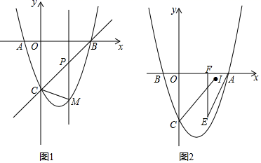

# Mathematics - 题目 268

**ID**: 9e5a8d90251e4d42b825e9e05b362c3c
**年级**: Grade 9
**难度**: Medium-Hard
**题型**: Calculation

## 题目
如图，抛物线y＝ax^{2}﹣2ax﹣3a（a＞0）与x轴交于A，B两点（点A在点B的左边），与y轴交于点C，且OB＝OC．（1）求抛物线的解析式；​​​​​​​‌（2）如图1，若点P是线段BC（不与B，C重合）上一动点，过点P作x轴的垂线交抛物线于M点，连接CM，将△PCM沿CM对折，如果点P的对应点N恰好落在y轴上，求此时点P的坐标；（3）如图2，若第四象限有一动点E，满足AE＝OA，过E作EF⊥x轴于点F，设F坐标为（t，0），0＜t＜3，△AEF的内心为I，连接CI，直接写出CI的最小值．

## 解答

1. 解：（1）在y＝ax^{2}﹣2ax﹣3a（a＞0）中，
2. 令y＝0，得：ax^{2}﹣2ax﹣3a＝0，
3. 解得：x_{1}＝3，x_{2}＝﹣1，
4. ∴A（﹣1，0），B（3，0），
5. ∴OB＝3，
6. ∵OB＝OC，
7. ∴OC＝3，
8. ∴C（0，﹣3），
9. ∴﹣3a＝﹣3，
10. ∴a＝1，
11. ∴抛物线解析式为：y＝x^{2}﹣2x﹣3．
12. （2）如图1，
13. 
14. 设直线BC解析式为y＝kx+b，
15. ∵B（3，0），C（0，﹣3），
16. ∴ $\begin{cases}3k+b=0\\b=-3\end{cases}$ ，
17. 解得 $\begin{cases}k=1\\b=-3\end{cases}$ ，
18. ∴直线BC解析式为：y＝x﹣3，
19. 设M点坐标为（m，m^{2}﹣2m﹣3），
20. ∵PM⊥x轴，
21. ∴P（m，m﹣3），
22. ∴PM＝m﹣3﹣（m^{2}﹣2m﹣3）＝﹣m^{2}+3m，
23. ∵OB＝OC，∠BOC＝90°，
24. ∴CB＝ $\sqrt {2}$OB，
25. ∴CP＝ $\sqrt {2}$m，
26. ∵△PCM沿CM对折，点P的对应点N恰好落在y轴上，
27. ∴∠PCM＝∠NCM，
28. ∵PM∥y轴，
29. ∴∠NCM＝∠PMC，
30. ∴∠PCM＝∠PMC，
31. ∴PC＝PM，
32. ∴ $\sqrt {2}$m＝﹣m^{2}+3m，
33. 整理得：m^{2}+（ $\sqrt {2}$ ﹣3）m＝0，
34. 解得：m_{1}＝0（舍去），m_{2}＝3﹣ $\sqrt {2}$ ，
35. ∴当m＝3﹣ $\sqrt {2}$ 时，m﹣3＝﹣ $\sqrt {2}$ ，
36. ∴P（3﹣ $\sqrt {2}$ ，﹣ $\sqrt {2}$ ）．
37. （3）如图2，连接AI，OI，EI，作△OAI的外接圆⊙M，连接OM，AM，MI，CM，过M作MH⊥y轴于H，
38. 
39. ∵EF⊥x轴，
40. ∴∠AFE＝90°，
41. ∴∠FAE+∠FEA＝90°，
42. ∵△AEF的内心为I，
43. ∴AI，EI分别平分∠FAE，∠FEA，
44. ∴∠IAE＝ $\frac {1}{2}$ ∠FAE，∠IEA＝ $\frac {1}{2}$ ∠FEA，
45. ∴∠IAE+∠IEA＝ $\frac {1}{2}$ （∠FAE+∠FEA）＝45°，
46. ∴∠AIE＝135°，
47. 在△AIO和△AIE中，
48. $\begin{cases}OA=EA\\\angle OAI=\angle EAI\\AI=AI\end{cases}$ ，
49. ∴△AIO≌△AIE（SAS），
50. ∴∠AIO＝∠AIE＝135°，
51. ∵⊙M是△OAI的外接圆，
52. ∴∠OMA＝2×（180°﹣∠AIO）＝90°，
53. ∴OM＝AM＝ $\frac {\sqrt {2}}{2}$OA＝ $\frac {3\sqrt {2}}{2}$ ，
54. ∴MI＝OM＝ $\frac {3\sqrt {2}}{2}$ ，
55. ∴∠MOA＝∠MOH＝45°，
56. ∵MH⊥y轴，
57. ∴∠HOM＝∠HMO＝45°，
58. ∴OH＝HM＝ $\frac {\sqrt {2}}{2}$OM＝ $\frac {3}{2}$ ，
59. ∴CH＝OH+OC＝ $\frac {3}{2}$ +3＝ $\frac {9}{2}$ ，
60. ∴CM＝ $\sqrt {HM{^{2}}+CH{^{2}}}$ ＝ $\frac {3\sqrt {10}}{2}$ ，
61. ∵CI⩾CM﹣MI，当且仅当C、M、I三点共线时，CI取得最小值，
62. ∴CI的最小值为 $\frac {3\sqrt {10}}{2}$ ﹣ $\frac {3\sqrt {2}}{2}$ ．

## 知识点

**中文**:
  - 三角形内切圆与外接圆综合
  - 二次函数的综合
  - 线段的性质：两点之间线段最短
  - 待定系数法求二次函数解析式
  - 全等三角形的判定与性质

**English**:
  - Incircle and Circumcircle
  - Comprehensive Quadratic Function Problems
  - Property of Line Segments
  - Finding Quadratic Expressions by Undetermined Coefficients
  - Determination and Properties

---
