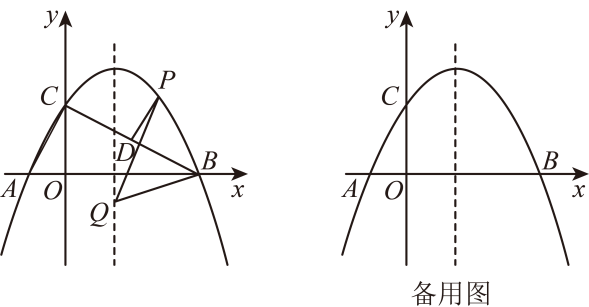

# Mathematics - 题目 2264

**ID**: 9e6df04e1da54b8d918417a6b7b3bed7
**年级**: Grade 9
**难度**: Medium-Hard
**题型**: Calculation

## 题目
如图，在平面直角坐标系中，抛物线 $y=ax{^{2}}+bx+2\left ({a\ne 0}\right )$ 过点 $\left ({1,3}\right )$ ，交y轴于C点，交x轴于 ${\rm \mathit{A}，}B\left ({4,0}\right )$ 两点（A在B的左侧），连接 $AC$ ， $BC$ ．（1）求抛物线的表达式；​​​​​​​‌（2）点P是直线 $BC$ 上方抛物线上的一动点，过点P作 $PD\bot BC$ 于点D，点Q是抛物线对称轴上的一动点，连接 $PQ$ ， $BQ$ ，当线段 $PD$ 长度取得最大值时，求 $PQ+BQ$ 的最小值；（3）在（2）中线段 $PD$ 长度取得最大值的条件下，连接 $PA$ ，将抛物线沿射线 $CB$ 方向平移得到新抛物线 $y^{′}$ ，使得新抛物线 $y^{′}$ 经过点B，且与直线 $CB$ 相交于另一点M，点N为新抛物线 $y^{′}$ 上的一个动点，当 $\angle PAC+\angle BMN=45{}\degree $ ，请直接写出所有符合条件的点N的坐标．

## 解答

1. （1）解：将 $\left ({1,3}\right )$ ， $B\left ({4,0}\right )$ 代入 $y=ax{^{2}}+bx+2\left ({a\ne 0}\right )$
2. $\therefore $  $\begin{cases}a+b+2=3\\16a+4b+2=0\end{cases}$ ，
3. $\therefore $  $\begin{cases}a=-\frac {1}{2}\\b=\frac {3}{2}\end{cases}$ ，
4. $\therefore y=-\frac {1}{2}x{^{2}}+\frac {3}{2}x+2$ ；
5. （2）解：如图1，
6. 
7. 作 $PE\bot AB$ 于 $E$ ，交 $BC$ 于 $F$ ，
8. $\therefore PE{\rm{/\mskip-4mu/}}y$ 轴，
9. $\therefore \angle PFD=\angle BCO$ ，
10. ∵当 $x=0$ 时， $y=2$ ，
11. $\therefore C\left ({0,2}\right )$ ，
12. $\therefore OC=2$ ，又 $OB=4$ ，
13. $\therefore BC=\sqrt {2{^{2}}+4{^{2}}}=2\sqrt {5}$ ，
14. $\therefore \sin \angle PFD=\sin \angle BCO=\frac {OB}{BC}=\frac {2\sqrt {5}}{5}$ ，
15. $\therefore PD=PF\cdot \sin \angle PFD=\frac {2\sqrt {5}}{5}PF$ ，
16. $\therefore $ 当 $PF$ 最大时， $PD$ 最大，
17. $\because C(0,2)$ ， $B(4,0)$ ，
18. $\therefore $ 直线 $BC$ 的解析式为： $y=-\frac {1}{2}x+2$ ，
19. 设 $P(m,-\frac {1}{2}m{^{2}}+\frac {3}{2}m+2)$ ， $F(m,-\frac {1}{2}m+2)$ ，
20. $\therefore PF=(-\frac {1}{2}m{^{2}}+\frac {3}{2}m+2)-(-m+2)=-\frac {1}{2}(m-2){^{2}}+2$ ，
21. $\because -\frac {1}{2}<0$ ， $0<m<4$ ，
22. $\therefore $ 当 $m=2$ 时， $PF$ 最大，
23. $\because -\frac {1}{2}\times 2{^{2}}+\frac {3}{2}\times 2+2=3$ ，
24. $\therefore P(2,3)$ ，
25. 连接 $AP$ ，交对称轴于点 $Q$ ，则 $PQ+BQ$ 最小，最小值是 $AP$ 的长，
26. 由 $-\frac {1}{2}x{^{2}}+\frac {3}{2}x+2=0$ 得，
27. $x=4$ 或 $x=-1$ ，
28. $\therefore A(-1,0)$ ，
29. $\therefore AP=\sqrt {{\left({-1-2}\right)^{2}}+3{^{2}}}=3\sqrt {2}$ ，
30. $\therefore PQ+BQ$ 的最小值为： $3\sqrt {2}$ ；
31. （3）解：如图2，
32. 
33. 抛物线 $y=-\frac {1}{2}x{^{2}}+\frac {3}{2}x+2=-\frac {1}{2}(x-\frac {3}{2}){^{2}}+2+\frac {9}{8}$ 向右平移4个单位，向下平移2个单位后为： $y=-\frac {1}{2}(x-\frac {3}{2}-4){^{2}}+\frac {9}{8}$ ，
34. 即： $y=-\frac {1}{2}(x-\frac {11}{2}){^{2}}+\frac {9}{8}=-\frac {1}{2}x{^{2}}+\frac {11}{2}x-14$ ，
35. $\because PE=AE=3$ ， $\angle AEP=90{}\degree $ ，
36. $\therefore \angle PAE=45{}\degree $ ，
37. $\because \angle AOC=90{}\degree $ ，
38. $\therefore \angle AFO=45{}\degree $ ，
39. $\therefore \angle PAC+\angle ACF=\angle AFO=45{}\degree $ ，
40. $\because {\tan}\angle ACO=\frac {OA}{OC}=\frac {1}{2}$ ， ${\tan}\angle ABC\mathrm{=}\frac {OC}{OB}\mathrm{=}\frac {2}{4}\mathrm{=}\frac {1}{2}$ ，
41. $\therefore \angle ACO=\angle ABC$ ，
42. $\therefore \angle ABC+\angle PAC=45{}\degree $ ，
43. $\because \angle PAC+\angle BMN=45{}\degree $ ，
44. $\therefore \angle ABC=\angle BMN$ ，
45. 当 $MN{\rm{/\mskip-4mu/}}AB$ 时， $\angle ABC=\angle BMN$ ，
46. 由题意得，
47. 当 $C$ 平移到点 $B$ ，点 $B(4,0)$ 平移到 $M$ ，
48. $\therefore M\left ({8,-2}\right )$ ，
49. $\therefore N\left ({\frac {11}{2}\times 2-8,-2}\right )$ ，即 $N\left ({3,-2}\right )$ ，
50. 作 $\angle BMN^{′}=\angle BMN$ ，交 $y^{′}$ 于 $N^{′}$ ，交 $x$ 轴于点 $W$ ，
51. 设 $W(t,0)$ ，
52. $\because \angle WBM=\angle ABC$ ，
53. $\therefore \angle WBM=\angle BMN^{′}$ ，
54. $\therefore WB=WM$ ，
55. $\therefore (8-t){^{2}}+2{^{2}}=(t-4){^{2}}$ ，
56. $\therefore t=\frac {13}{2}$ ，
57. $\therefore W\left ({\frac {13}{2},0}\right )$ ，
58. $\therefore MW$ 的解析式为： $y=-\frac {4}{3}x+\frac {26}{3}$ ，
59. 由 $-\frac {4}{3}x+\frac {26}{3}=-\frac {1}{2}x{^{2}}+\frac {11}{2}x-14$ 得， $x=8$ 或 $x=\frac {17}{3}$ ，
60. $\because $  $-\frac {1}{2}\times (\frac {17}{3}){^{2}}+\frac {11}{2}\times \frac {17}{3}-14=\frac {10}{9}$ ，
61. $\therefore N^{′}(\frac {17}{3},\frac {10}{9})$ ，
62. 综上所述： $N(3,-2)$ 或 $(\frac {17}{3},\frac {10}{9})$ ．

## 知识点

**中文**:
  - 二次函数图象的平移
  - 二次函数的综合
  - 解直角三角形
  - 待定系数法求二次函数解析式

**English**:
  - Translation of Quadratic Graphs
  - Comprehensive Quadratic Function Problems
  - Solving Right Triangles
  - Finding Quadratic Expressions by Undetermined Coefficients

---
