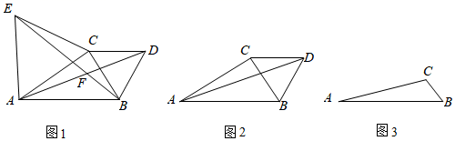

# Mathematics - 题目 3598

**ID**: 9e8fc1b81bc944b882128a17a8be8604
**年级**: Grade 9
**难度**: Medium-Hard
**题型**: Calculation

## 题目
（1）如图1，在△ABC的外部，分别以AC，BC为边，作等边三角形△ACE和等边三角形△BCD，连接AD，BE，相交于点F．①求证：△ACD≌△ECB；​​​​​​​‌②求∠AFB的度数；（2）如图2，在 $\vartriangle ABC$ 中， $\angle ACB=90{^{\circ }}$ ，在 $\mathrm{△}ACB$ 的外部以BC为边，作等边三角形△BCD，连接AD，当AB＝8，请直接写出AD长的最大值为；（3）如图3，在△ABC中，当AB＝8，AC＝3BC时，请直接写出 $\vartriangle ABC$ 面积的最大值为．

## 解答

1. 解：（1）①∵△ACE和△BCD都是等边三角形，
2. ∴AC＝CE，CD＝BC，∠ACE＝∠BCD＝60°，
3. ∴∠ACE＋∠ACB＝∠BCD＋∠ACB，
4. ∴∠ACD＝∠ECB，
5. 在△ACD和△ECB中，
6. $\begin{cases}AC=CE\\\angle ACD=\angle ECB\\CD=BC\end{cases}$ ，
7. ∴△ACD≌△ECB（SAS）；
8. ②∵△ACE是等边三角形，
9. ∴∠AEC＝∠EAC＝60°，
10. 由①知，△ACD≌△ECB，
11. ∴∠CAD＝∠CEB，
12. ∴∠AFB＝∠AEF＋∠EAF＝∠AEF＋∠CAD＋∠EAC＝∠AEF＋∠CEB＋∠EAC＝∠AEC＋∠EAC＝120°；
13. （2）如图2，过点D作DG⊥AC交AC的延长线于G，
14. 
15. ∵△BCD时等边三角形，
16. ∴BC＝CD，∠BCD＝60°，
17. ∵∠ACB＝90°，
18. ∴∠DCG＝180°−∠BCD−∠ACB＝30°，
19. 设DG＝x，则BC＝CD=2x，CG＝ $\sqrt {3}$x，
20. 设AC＝2y，
21. ∴AG＝AC＋CG＝2y＋ $\sqrt {3}$x，
22. 在Rt△ADG中，AD^{2}＝AG^{2}＋DG^{2}＝（2y＋ $\sqrt {3}$x）^{2}＋x^{2}＝4x^{2}＋4y^{2}＋4 $\sqrt {3}$xy，
23. 在Rt△ABC中，AB＝8，
24. 根据勾股定理得出，BC^{2}＋AC^{2}＝64，
25. ∴4x^{2}＋4y^{2}＝64，
26. ∴AD^{2}＝64＋4 $\sqrt {3}$xy，
27. 设点C到AB的距离为h，
28. ∴S_{△}_{ABC}= $\frac {1}{2}$AB•h＝ $\frac {1}{2}$BC•AC，
29. ∴8h＝2x•2y，
30. ∴xy＝2h，
31. ∴AD^{2}＝64＋8 $\sqrt {3}$h，
32. ∴要AD最大，则h最大，
33. ∵∠ACB＝90°，
34. ∴点C是以AB为直径的圆上，
35. ∴h最大为 $\frac {1}{2}$AB＝4，
36. ∴AD^{2}最大＝64＋8 $\sqrt {3}$ ×4＝（4＋4 $\sqrt {3}$ ）^{2}，
37. ∴AD最大＝4＋4 $\sqrt {3}$ ，
38. 故答案为4＋4 $\sqrt {3}$ ；
39. （3）如图3，过点C作CH⊥BC于H，
40. 
41. ∵AB＝8，
42. ∴S_{△}_{ABC}＝ $\frac {1}{2}$AB•CH＝4CH，
43. 要△ABC的面积最大，则CH最大，
44. 设BH＝a，则AH＝8−a，
45. 设BC＝b，则AC＝3b，
46. 在Rt△BCH中，CH2＝BC^{2}−BH^{2}＝b^{2}−a^{2}，
47. 在Rt△ACH中，CH^{2}＝AC^{2}−AH^{2}＝9b^{2}−（8−a）^{2}，
48. ∴b^{2}−a^{2}＝9b^{2}−（8−a）^{2}，
49. ∴a＝4− $\frac {1}{2}$b^{2}，
50. ∴CH^{2}＝b^{2}−a^{2}＝b^{2}−（4− $\frac {1}{2}$b^{2}）^{2}＝− $\frac {1}{4}$b^{4}＋5b^{2}−16＝− $\frac {1}{4}$ （b^{2}−10）^{2}＋9，
51. ∵BC＝b，AC＝3b，AB＝8，
52. ∴2＜b＜4，
53. ∴4＜b^{2}＜16，
54. ∴当b= $\sqrt {10}$ 时，CH^{2}最大＝9，
55. ∴CH_{最大}＝3，
56. ∴S_{△}_{AB}C最大＝4CH_{最大}＝4×3＝12，
57. 故答案为12．

## 知识点

**中文**:
  - 三角形的综合
  - 二次函数的综合
  - 圆的综合问题
  - 全等三角形的判定与性质

**English**:
  - Comprehensive Triangle Problems
  - Comprehensive Quadratic Function Problems
  - Comprehensive Circle Problems
  - Determination and Properties

---
