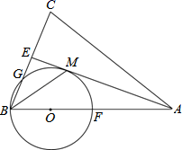

# Mathematics - 题目 752

**ID**: a00d30adffce4a5d9eac08700ac8aa00
**年级**: Grade 9
**难度**: Medium-Hard
**题型**: Calculation

## 题目
如图，在△ABC中，AB＝AC，AE是∠BAC的平分线，∠ABC的平分线BM交AE于点M，点O在AB上，以点O为圆心，OB的长为半径的圆经过点M，交BC于点G，交AB于点F．（1）求证：AE为⊙O的切线；​​​​​​​‌（2）当BC＝8，AC＝12时，求EM的长；（3）在（2）的条件下，可求出⊙O的半径为，线段BG的长．

## 解答

1. （1）证明：连接OM．
2. ∵AC＝AB，AE平分∠BAC，
3. ∴AE⊥BC，CE＝BE＝BC＝4，
4. ∵OB＝OM，
5. ∴∠OBM＝∠OMB，
6. ∵BM平分∠ABC，
7. ∴∠OBM＝∠CBM，
8. ∴∠OMB＝∠CBM，
9. ∴OM∥BC，
10. 又∵AE⊥BC，
11. ∴AE⊥OM，
12. ∴AE是⊙O的切线；
13. （2）设⊙O的半径为R，
14. ∵OM∥BE，
15. ∴△OMA∽△BEA，
16. ∴ $\frac {OM}{BE}=\frac {AO}{AB}$  ，
17. ∵AC＝AB＝12，
18. 即 $\frac {R}{4}=\frac {12-R}{12}$  ，
19. 解得R＝3，
20. ∴⊙O的半径为3，
21. ∵OM∥BE，
22. ∴AM：EM＝AO：BO，
23. ∵BE＝4，AB＝12，
24. ∴AE＝ $\sqrt {AB{^{2}}-BE{^{2}}}=8\sqrt {2}$
25. 即 $\frac {8\sqrt {2}-EM}{EM}=\frac {9}{3}$  ．
26. 解得：EM＝2 $\sqrt {2}$  ；
27. （3）由（2）可知圆的半径为3，
28. 过点O作OH⊥BG于点H，则BG＝2BH，
29. ∵∠OME＝∠MEH＝∠EHO＝90°，
30. ∴四边形OMEH是矩形，
31. ∴HE＝OM＝3，
32. ∴BH＝1，
33. ∴BG＝2BH＝2．
34. 故答案为3，2．
35. 

## 知识点

**中文**:
  - 圆的综合问题
  - 平行线的判定与性质
  - 相似三角形的判定与性质综合

**English**:
  - Comprehensive Circle Problems
  - Determination and Properties
  - Determination and Properties

---
