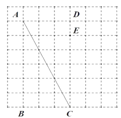

# Mathematics - 题目 1339

**ID**: a0ac91d92b684c1983ea40be3f14e356
**年级**: Grade 9
**难度**: Medium-Hard
**题型**: Calculation

## 题目
如图是由边长为 $1$ 的小正方形构成的网格，每个小正方形的顶点叫做格点．四边形 $ABCD$ 的顶点在格点上，点 $E$ 是边 $DC$ 边上的一点．请选择适当的格点，用无刻度的直尺在网格中完成下列画图，保留连线的痕迹，不要求说明理由．（1）①过 $E$ 作 $EF\bot AC$ 交 $AB$ 边于 $F$ ；​​​​​​​‌②过 $F$ 作 $FH\bot CD$ 于 $H$ 点；③在 $AB$ 上作线段 $AM=EH$（2）在（1）的条件下，连 $AE,FC$ ，若 $E$ 为 $CD$ 边上的动点，在网格中求作一条线段 $MN$ 等于 $AE+FC$ 的最小值．

## 解答

1. 解：（1）①如图所示，EF即为所求；
2. ②如图所示，FH即为所求；
3. ③如图所示，AM即为所求；
4. （2）如图所示，MN即为所求．
5. 

## 知识点

**中文**:
  - 几何变换——轴对称综合题
  - 矩形的判定与性质综合

**English**:
  - Axial Symmetry Comprehensive Problems
  - Determination and Properties of Rectangles

---
