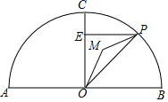

# Mathematics - 题目 2699

**ID**: a0db4534e6324f12b648bc61c0cd1cf6
**年级**: Grade 9
**难度**: Medium-Hard
**题型**: Calculation

## 题目
如图，AB为⊙O的直径，且AO＝4，点C在半圆上，OC⊥AB，垂足为点O，P为半圆上任意一点过P点作PE⊥OC于点E，设△OPE的内心为M，连接OM（1）求∠OMP的度数；​​​​​​​‌（2）随着点P在半圆上位置的改变，∠CMO的大小是否改变，说明理由；（3）当点P在半圆上从点B运动到点A时，直接写出内心M所经过的路径长．

## 解答

1. 解：（1）∵OC⊥AB，
2. ∴∠OEP＝90°，
3. ∴∠EOP+∠EPO＝90°，
4. ∵M为△OPE的内心，
5. ∴∠MOP＝∠MOC＝ $\frac {1}{2}$ EOP，∠MPO＝∠MPE＝ $\frac {1}{2}$ ∠EPO，
6. ∴∠MOP+∠MPO＝ $\frac {1}{2}$ （∠EOP+∠EPO）＝45°，
7. ∴∠OMP＝180°﹣（∠MOP+∠MPO）＝135°；
8. （2）∠CMO的大小不改变，理由如下：
9. 如图2，连接CM，
10. 在△COM和△POM中，
11. $\begin{cases}{\rm{C}}{\rm{O}}={\rm{B}}0\\\angle {\rm{C}}{\rm{O}}{\rm{M}}=\angle {\rm{P}}{\rm{O}}{\rm{M}}\\{\rm{O}}{\rm{M}}={\rm{O}}{\rm{M}}\end{cases}$ ，
12. ∴△COM≌△POM（SAS），
13. ∴∠CMO＝∠OMP＝135°，
14. ∴∠CMO的大小不改变，为135°；
15. （3）如图3，连接AC，BC，
16. ∵AB为直径，CO⊥AB，
17. ∴AC＝BC，
18. ∴△ACB为等腰直角三角形，
19. ∴△ACO与△BCO为等腰直角三角形，
20. ∴AC＝ $\sqrt {2}A0=4\sqrt {2}$ ，
21. ∴CQ＝ $\frac {1}{2}AC=2\sqrt {2}$
22. 分别取AC，BC的中点Q，N，连接OQ，ON，
23. 则∠CQO＝90°，∠CNO＝90°，
24. 当点P在半径OC的左侧和右侧的半圆上时，点M的轨迹分别在以AC，BC为直径的圆弧上，所对圆心角为90°，
25. ∴ $2\times \frac {90π\times 2\sqrt {2}}{180}=2\sqrt {2}π$ ，
26. ∴内心M所经过的路径长为2 $\sqrt {2}π$
27. 
28. 
29. 

## 知识点

**中文**:
  - 三角形内切圆
  - 全等三角形的判定与性质

**English**:
  - Incircle of Triangle
  - Determination and Properties

---
