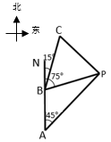

# Mathematics - 题目 1470

**ID**: a0f4148dc6394da7872b87febf2d824e
**年级**: Grade 9
**难度**: Medium-Hard
**题型**: Calculation

## 题目
如图，一个人骑自行车由A地到C地途经B地当他由A地出发时，发现他的北偏东 $45{}^\circ $ 方向有一电视塔P，他由A地向正北方向骑行了 $3\sqrt {2}{\rm{k}}{\rm{m}}$ 到达B地，发现电视塔P在他北偏东 $75{}^\circ $ 方向，然后他由B地向北偏东 $15{}^\circ $ 方向骑行了 ${\rm{6}}{\rm{k}}{\rm{m}}$ 到达C地．（1）求A地与电视塔P的距离；​​​​​​​‌（2）求C地与电视塔P的距离．

## 解答

1. （1）由题意知：∠A=45°，∠NBC=15°，∠NBP=75°，
2. 过点B作BE⊥AP于点E，如图，
3. 在Rt△ABE中，∠ABE=90°-45°=45°，
4. ∴AE=BE，
5. ∵ $AB=3\sqrt {2}$ ，
6. ∴AE=BE=3，
7. 在Rt△BEP中，∠EBP=180°-∠ABE-∠NBP=60°，
8. ∴PE= $BE\cdot {\tan}60{^{\circ }}=3\sqrt {3}$ ，
9. ∴AP=AE+PE= $3+3\sqrt {3}$ ；
10. 
11. （2）∵BE=3，∠BEP=90°，∠EBP=60°，
12. ∴BP= $\frac {BE}{{\cos}60{^{\circ }}}=6$ ，
13. 又∵∠CBP=∠NBP-∠NBC=75°-15°=60°，BC=6，
14. ∴△BCP是等边三角形，
15. ∴CP=BP=6．

## 知识点

**中文**:
  - 等边三角形的判定与性质
  - 解直角三角形的实际应用

**English**:
  - Determination and Properties
  - Applications of Solving Right Triangles

---
