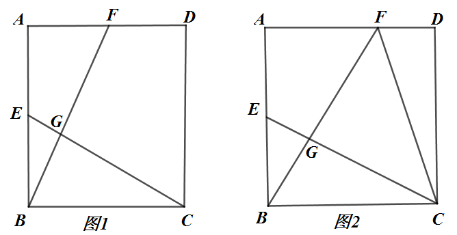
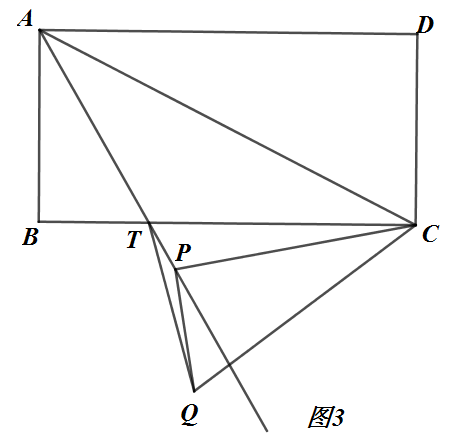

# Mathematics - 题目 1954

**ID**: a3ec798c913541db9af848d37314d36c
**年级**: Grade 9
**难度**: Medium-Hard
**题型**: Calculation

## 题目
如图所示， 矩形 $ABCD$ 中，  $\frac {AD}{AB}=n(n>0)$ ，点 $E$ 、 $F$ 分别为边 $AB$ ， $AD$ 上的动点，（1）连接 $BF$ 、 $CE$ 、 $BF$ 与 $CE$ 相交于点 $G$ ，且 $E$ 为 $AB$ 的中点．①如图 $1$ ， $n=1$ 时， 若 $BG\bot CE$ ，求 $\frac {EG}{CG}$ 的值：②如图 $2$ ，若 $FB$ 平分 $\angle AFC$ ， 且 $\frac {EG}{CG}=\frac {1}{3}$ ，求 $n$ 的值．（2） 如图 $3$ ， 当 $n=\frac {24}{7}$ 时， 连接 $AC$ ， 点 $T$ 在边 $BC$ 上， 且 $AT$ 平分 $\angle BAC$ ．点 $P$ 为射线 $AT$ 上一点，点 $Q$ 为 $PC$ 下方平面内一点，且 $PQ\bot PC$ ， ${\tan}\angle PQC=\frac {24}{7}$ ，若 $AB=1$ ，请直接写出 $QT$ 的最小值为．​​​​​​​‌

## 解答

1. 解：（1）
2. ①
3. $EG\bot BF$
4. 可以得到 $\angle 1=\angle 2$
5. $\vartriangle EGB∽\vartriangle BGC$
6. $\frac {EG}{BG}=\frac {BG}{CG}=\frac {EB}{BC}=\frac {1}{2}$
7. $\therefore OG=2BG$ ， $BG=2EG$
8. $\therefore CG=4EG$
9. $\frac {EG}{CG}=\frac {1}{4}$
10. ②
11. 
12. 设 $BC=a$
13. 作 $EM{\rm{/}}{\rm{/}}BC$ 交 $BF$ 于 $M$
14. $\therefore EM{\rm{/}}{\rm{/}}AD{\rm{/}}{\rm{/}}BC$
15. $\therefore $  $\vartriangle EBM∽\vartriangle ABF$ ， $\vartriangle EGM∽\vartriangle CGB$
16. $\therefore \frac {EM}{AF}=\frac {EB}{AB}=\frac {1}{2}$ ， $\frac {EM}{CB}=\frac {EG}{CG}=\frac {1}{3}$
17. $\therefore EM=\frac {b}{3}$ ， $AF=\frac {2}{3}b$ ， $DF=\frac {b}{3}$
18. $\because $  $\angle 1=\angle 2$ ， $AD{\rm{/}}{\rm{/}}BC$
19. $\therefore ∠1=∠3$
20. $\because $  $FB$ 平分 $\angle AFC$ ， $\therefore \angle 2=\angle 3{\rm{=}}\angle 4$ ， $\therefore $  $CF=BC=b$
21. $\therefore CD=\sqrt {CF{^{2}}-DF{^{2}}}=\frac {2}{3}\sqrt {2}b$
22. 故 $AB=CD=\frac {2}{3}\sqrt {2}b$
23. $n=\frac {AD}{AB}=\frac {b}{\frac {2}{3}\sqrt {2}b}=\frac {3}{4}\sqrt {2}$
24. （2）
25. 
26. 如图，因为 $2\angle 1=\angle BAC$ ，由倍角公式 ${\cos}2\angle 1=2{\cos}{^{2}}\angle 1-1$ 及AB=1可计算出 $BT=\frac {3}{4}$ ， $CT=\frac {75}{28}$
27. 构 $Rt\vartriangle TKC$ 使 $\frac {TK}{TC}=\frac {7}{24}$ ，即 $\frac {TC}{KC}=\frac {24}{25}$
28. $\because $  ${\tan}\angle PQC=\frac {24}{7}$ ， $\therefore $  $\frac {PC}{QC}=\frac {24}{25}$ ， $\angle TCK=\angle PCQ$
29. $\therefore $  $\angle TCP=\angle KCQ$
30. $\therefore $  $\vartriangle TPC∽\vartriangle KQC$
31. 设 $\angle 1=\angle 2=a$
32. $\therefore {\tan}2a=\frac {24}{7}$ ， ${\tan}a=\frac {3}{4}$
33. $\angle TKC=2a$ ， $\angle CKQ=\angle CTP=90{^{\circ }}-a$
34. $TR\bot KQ$ 于 $R$
35. $TQ{{}_{{\rm \min }}}=TR$
36. $TK=\frac {25}{32}$
37. $TR=\frac {5}{8}$
38. 即 $QT{{}_{{\rm \min }}}=\frac {5}{8}$ ．

## 知识点

**中文**:
  - 相似三角形的综合问题
  - 解直角三角形

**English**:
  - Comprehensive Similar Triangle Problems
  - Solving Right Triangles

---
