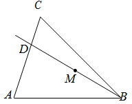
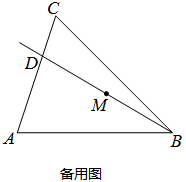

# Mathematics - 题目 16

**ID**: a414f7bd21624309b00c563b45663aea
**年级**: Grade 9
**难度**: Medium-Hard
**题型**: Calculation

## 题目
如图，在△ABC中， $AC=\sqrt {10}$ ，tanA=3，∠ABC=45°，射线BD从与射线BA重合的位置开始，绕点B按顺时针方向旋转，与射线BC重合时就停止旋转，射线BD与线段AC相交于点D，点M是线段BD的中点．（1）求线段BC的长；​​​​​​​‌（2）①当点D与点A、点C不重合时，过点D作DE⊥AB于点E，DF⊥BC于点F，连接ME，MF，在射线BD旋转的过程中，∠EMF的大小是否发生变化？若不变，求∠EMF的度数；若变化，请说明理由．②在①的条件下，连接EF，直接写出△EFM面积的最小值．

## 解答

1. 解：（1）如图1中，作 $CH\bot AB$ 于 $H$ ．
2. 
3. 在 ${\rm{R}}{\rm{t}}Δ{\rm{A}}{\rm{C}}{\rm{H}}$ 中， $\because \angle AHC=90{}^\circ $ ， $AC=\sqrt {10}$ ， ${\tan}A=\frac {CH}{AH}=3$ ，
4. $\therefore AH=1$ ， $CH=3$ ，
5. $\because \angle CBH=45{}^\circ $ ， $\angle CHB=90{}^\circ $ ，
6. $\therefore \angle HCB=\angle CBH=45{}^\circ $ ，
7. $\therefore CH=BH=3$ ，
8. $\therefore BC=\sqrt {2}CH=3\sqrt {2}$ ．
9. （2）①结论： $\angle EMF=90{}^\circ $ 不变．
10. 
11. 理由：如图2中， $\mathrm{∵}DE\mathrm{⊥}AB$ ， $DF\bot BC$ ，
12. $\therefore \angle DEB=\angle DFB=90{}^\circ $ ，
13. $\because DM=MB$ ，
14. $\therefore ME=\frac {1}{2}BD$ ， $MF=\frac {1}{2}BD$ ，
15. $\therefore ME=MF=BM$ ，
16. $\therefore \angle MBE=\angle MEB$ ， $\angle MBF=\angle MFB$ ，
17. $\because \angle DME=\angle MEB+\angle MBE$ ， $\angle DMF=\angle MFB+\angle MBF$ ，
18. $\therefore \angle EMF=\angle DME+\angle DMF=2(\angle MBE+\angle MBF)=90{}^\circ $ ，
19. ②如图2中，作 $CH\bot AB$ 于 $H$ ，由①可知 $ΔMEF$ 是等腰直角三角形，
20. $\therefore $ 当 $ME$ 的值最小时， $ΔMEF$ 的面积最小，
21. $\because ME=\frac {1}{2}BD$ ，
22. $\therefore $ 当 $BD\bot AC$ 时， $ME$ 的值最小，此时 $BD=\frac {AB\centerdot CH}{AC}=\frac {3\times 4}{\sqrt {10}}=\frac {6\sqrt {10}}{5}$ ，
23. $\therefore EM$ 的最小值 $=\frac {3\sqrt {10}}{5}$ ，
24. $\therefore ΔMEF$ 的面积的最小值 $=\frac {1}{2}\times \frac {3\sqrt {10}}{5}\times \frac {3\sqrt {10}}{5}=\frac {9}{5}$ ．
25. 故答案为 $\frac {9}{5}$ ．

## 知识点

**中文**:
  - 三角形的综合

**English**:
  - Comprehensive Triangle Problems

---
