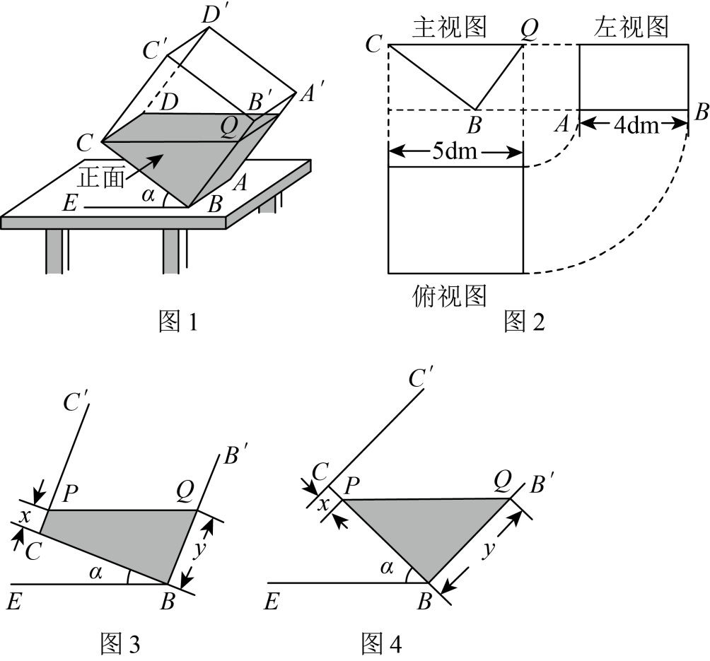

# Mathematics - 题目 960

**ID**: a569b116c247459f9d8dfc9196e74772
**年级**: Grade 9
**难度**: Medium-Hard
**题型**: Calculation

## 题目
一透明的敞口正方体容器 $ABCD$  ${\rm{﹣}}A^{′}B^{′}C^{′}D^{′}$ 装有一些液体，棱 $AB$ 始终在水平桌面上，容器底部的倾斜角为 $α$ （ $\angle CBE=α$ ，如图所示）．探究：如图1，液面刚好过棱 $CD$ ，并与棱 $BB^{′}$ 交于点Q，此时液体的形状为直三棱柱，其三视图及尺寸如图②．解决问题：(1) $CQ$ 与 $BE$ 的位置关系是， $BQ$ 的长是${\rm{d}}{\rm{m}}$ ， $α=$°（注： ${\sin}49{}^\circ ={\rm{c}}{\rm{o}}{\rm{s}}41{}^\circ =\frac {3}{4}$ ， ${\tan}37{}^\circ =\frac {3}{4}$ ）(2)求液体的体积；​​​​​​​‌（参考算法：直棱柱体积V液 $=$ 底面积 $SBCQ\times $ 高 $AB$ ）(3)在图1的基础上，以棱 $AB$ 为轴将容器向左或向右旋转，但不能使液体溢出．图3或图4是其正面示意图，若液面与棱 $C{^{\prime }}C$ 或 $CB$ 交于点P、点Q始终在棱 $BB^{′}$ 上，设 $PC=x$ ， $BQ=y$ ，分别就图3和图4求y与x的函数关系式，并写出相应的 $α$ 的范围．

## 解答

1. （1）解： $\because $ 液体的形状为直三棱柱，
2. $\therefore CQ{\rm{/\mskip-4mu/}}BE$ ，
3. 由题知， $BC=AB=4{\rm{d}}{\rm{m}}$ , $CQ=5{\rm{d}}{\rm{m}}$ ,
4. 根据勾股定理得． $BQ=\sqrt {5{^{2}}-4{^{2}}}=3$ ；
5. 在 ${\rm{R}}{\rm{t}}\vartriangle BCQ$ 中，  ${\tan}\angle BCQ=\frac {3}{4}$ ，
6. $\therefore α=\angle BCQ=37{}^\circ $ ．
7. 故此题答案为： $CQ{\rm{/\mskip-4mu/}}BE$ ，3， $37{}^\circ $ ．
8. （2）解： $V{{}_{{\rm{液}}}}=\frac {1}{2}\times 3\times 4\times 4=24$ （ ${\rm{d}}{\rm{m}}{^{3}}$ ）．
9. （3）解：当容器向左旋转时， $0{}^\circ \leqslant α\leqslant 37{}^\circ $ ，
10. $\because $ 液体体积不变，
11. $\therefore $  $\frac {1}{2}\left ({x+y}\right )\times 4\times 4=24$ ，
12. $\therefore $  $y=-x+3$ ．
13. 当液面恰好到达容器口沿，即点Q与点 $B^{′}$ 重合时，如图5，
14. 
15. $\because $  $BB^{′}=4$ ，且 $\frac {1}{2}PB\cdot BB^{′}{\times }4=24$ ，
16. $\therefore $  $PB=3$ ，
17. $\therefore $  ${\tan}\angle PB^{′}B=\frac {3}{4}$ ，
18. $\therefore $  $\angle PB^{′}B=37{}^\circ $ ．
19. $\therefore $  $α=\angle B^{′}PB=53{}^\circ $ ．
20. 此时 $37{}^\circ \leqslant α\leqslant 53{}^\circ $ ；
21. $\therefore $ 当容器向右旋转时， $37{}^\circ <α\leqslant 53{}^\circ $ ，
22. $\because $ 液体体积不变，
23. $\therefore $  $\frac {1}{2}\times y\times \left ({4-x}\right )\times 4=24$ ，
24. $\therefore $  $y=\frac {12}{4-x}$  ；
25. 综上所述，图3中y与x的函数关系式为 $y=-x+3$ ，相应的 $α$ 的范围是 $0{}^\circ \leqslant α\leqslant 37{}^\circ $ ，
26. 图4中y与x的函数关系式为 $y=\frac {12}{4-x}$ ，相应的 $α$ 的范围是 $37{}^\circ <α\leqslant 53{}^\circ $ ．

## 知识点

**中文**:
  - 三视图的相关计算
  - 函数的应用
  - 解直角三角形的实际应用

**English**:
  - Calculations with Three Views
  - Applications of Functions
  - Applications of Solving Right Triangles

---
