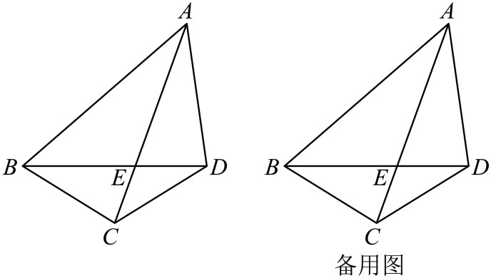

# Mathematics - 题目 2168

**ID**: a5c30be0713b45d6b9e0312ed3547408
**年级**: Grade 9
**难度**: Medium-Hard
**题型**: Calculation

## 题目
如图，在四边形 $ABCD$ 中， $\angle BAD=60{}\degree $ ．对角线 $AC$ 和 $BD$ 相交于点E．（1）求 $\angle ABD+\angle ADB$ ；​​​​​​​‌（2）若 $\angle BCD=120{}\degree $ ，且点C在线段 $BD$ 的垂直平分线上．①求 $\frac {DE}{AE}$ 的最小值；②若 $AE=6$ ，当 $AB+AD$ 最小时，求四边形 $ABCD$ 的面积．

## 解答

1. （1）解：∵ $\angle BAD=60{}\degree $
2. ∴在 $\mathrm{△}ABD$ 中， $\angle ABD+\angle ADB=180{}\degree -\angle BAD=180{}\degree -60{}\degree =120{}\degree $ ；
3. （2）解：①过点C分别作 $AB$ ， $AD$ 的垂线，垂足分别为M，N．
4. 
5. ∵ $AC$ 平分 $∠BAD$ ，且 $CM\bot AB$ ， $CN\bot AD$ ，
6. ∴ $\angle CMB=\angle CND=\angle CMA=\angle CNA=90{}\degree $ ．
7. ∴ $\angle MCN=360{}\degree -\angle BAD-\angle CMA-\angle CNA=120{}\degree $ ．
8. ∵ $\angle BCD=120{}\degree $ ，
9. ∴ $\angle BCD-\angle MCD=\angle MCN-\angle MCD$ ．
10. ∴ $\angle BCM=\angle DCN$ ．
11. ∵点C在线段 $BD$ 的垂直平分线上，
12. ∴ $CB=CD$ ．
13. ∴ $△CMB≌△CND$ ．
14. ∴ $CM=CN$ ．
15. ∴ $AC$ 平分 $∠BAD$ ．
16. ∴ $\angle CAD=\frac {1}{2}\angle BAD=30{}\degree $ ．
17. 过点E作 $AD$ 的垂线，垂足为F．
18. 在 ${\rm{R}}{\rm{t}}\vartriangle AEF$ 中， $\frac {EF}{AE}=\sin \angle CAD=\frac {1}{2}$ ．
19. 由垂线段最短可得 $ED\geqslant EF$ ．
20. ∴ $\frac {ED}{AE}\geqslant \frac {EF}{AE}=\frac {1}{2}$ ，
21. 当且仅当 $ED\bot AD$ 时等号成立．
22. ∴ $\frac {ED}{AE}$ 的最小值为 $\frac {1}{2}$ ．
23. ②过点E分别作 $AB$ ， $AD$ 的垂线，垂足分别为P，Q．
24. 
25. 由①得： $\angle CAB=\angle CAD=30{}\degree $ ．
26. ∴ $AP=AQ=AC{\cos}30{}\degree =3\sqrt {3}$ ， $EP=EQ$ ， $\angle EPA=\angle EQD=90{}\degree $ ．
27. 在线段 $AP$ 上截取 $PF=DQ$
28. 同理可得 $△EPF≌△EQD$ ．
29. ∴ $\angle FEP=\angle DEQ$ ， $PF=QD$ ．
30. ∴ $\angle FED=\angle FEQ+\angle DEQ=\angle FEQ+\angle FEP=\angle PEQ$
31. $=360{}\degree -\angle APE-\angle AQE-\angle BAD=120{}\degree $ ．
32. $AF+AD=AF+AQ+QD=AF+PF+AQ=AP+AQ=3\sqrt {3}+3\sqrt {3}=6\sqrt {3}$ ．
33. ∴ $AB+AD=FB+AF+AD=FP+6\sqrt {3}$ ．
34. ∴当 $FB$ 最小时， $AB+AD$ 最小．
35. ∵ $\angle FED=120{}\degree $ ，
36. ∴ $\angle FEB=180{}\degree -\angle FED-60{}\degree $ ．
37. 作 $\vartriangle FEB$ 的外接圆，圆心为I．则 $\angle FIB=2\angle FEB=120{}\degree $ ．
38. 过点I作 $IG\bot FB$ 于点G．
39. 
40. ∵ $IB=IF$ ，
41. ∴ $\angle FIG=\frac {1}{2}\angle FIB=60{}\degree $ ．
42. 在 ${\rm{R}}{\rm{t}}\mathrm{△}FGI$ 中， $IG=IF{\cos}\angle FIG=\frac {1}{2}r$ ．
43. ∴ $IG+IE=\frac {1}{2}r+r\geqslant EP=AE\sin \angle PAE=3$ ．
44. ∴ $r\geqslant 2$ ．
45. ∴ $FB=2FG=2IF\sin \angle FIG=\sqrt {3}r\geqslant 2\sqrt {3}$ ．
46. 当G，I，E三点共线时，等号成立．
47. ∴ $\left ({AB+AD}\right ){{}_{{\rm \min }}}=2\sqrt {3}+6\sqrt {3}=8\sqrt {3}$ ．
48. 此时点P与点G重合．
49. 
50. ∴ $GE$ 垂直平分 $FB$ ．
51. ∴ $EF=EB$ ．
52. ∴ $\angle FBE=\frac {180{}\degree -\angle FEB}{2}=60{}\degree $ ．
53. ∵ $\angle BAD=60{}\degree $ ，
54. ∴ $\mathrm{△}ABD$ 为等边三角形．
55. ∴ $AB=AD=BD=\frac {8\sqrt {3}}{2}=4\sqrt {3}$ ．
56. ∵ $CB=CD$ ，
57. ∴ $AC$ 垂直平分 $BD$ ．
58. ∴ $S{{}_{四边形ABCD}}=S{{}_{△ABC}}+S{{}_{△ADC}}$
59. $=\frac {1}{2}AC\cdot BD$
60. $=\frac {1}{2}\cdot \frac {AB+AD}{\sqrt {3}}\cdot BD$
61. $=\frac {1}{2}\times \frac {8\sqrt {3}}{\sqrt {3}}\times 4\sqrt {3}=16\sqrt {3}$ ．

## 知识点

**中文**:
  - 圆周角定理
  - 等边三角形的判定与性质
  - 解直角三角形

**English**:
  - Inscribed Angle Theorem
  - Determination and Properties
  - Solving Right Triangles

---
