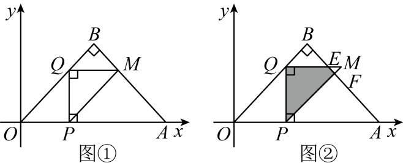

# Mathematics - 题目 2830

**ID**: a82358a00d23478fa3cf6d3bedbaaa89
**年级**: Grade 9
**难度**: Medium-Hard
**题型**: Calculation

## 题目
在平面直角坐标系中， $O$ 为原点， $\vartriangle OAB$ 是等腰直角三角形， $\angle OBA=90{}^\circ $ ，点 $A\left ({5,0}\right )$ ，点 $B$ 在第一象限，点 $P$ 在边 $OA$ 上（点 $P$ 不与点 $O$ ， $A$ 重合），过点 $P$ 作 $PQ\bot OA$ ，交 $\vartriangle OAB$ 的直角边于点 $Q$ ，将线段 $QP$ 绕点 $Q$ 逆时针旋转 $90{}^\circ $ 得到线段 $QM$ ，点 $P$ 的对应点为 $M$ ，连接 $PM$ ．(1)如图①，若点 $M$ 落在 $AB$ 上，点 $B$ 的坐标是，点 $M$ 的坐标是；​​​​​​​‌(2)设 $\vartriangle PQM$ 与 $\vartriangle OAB$ 重合部分面积为 $S$ ， $OP=t$ ．①如图②，若重合部分为四边形 $PQEF$ ，与边 $AB$ 交于点 $E$ ， $F$ ，试用含 $t$ 的式子表示 $S$ ，并直接写出 $t$ 的取值范围；②当 $1\leqslant t\leqslant 4$ 时，求 $S$ 的取值范围（请直接写出结果即可）．

## 解答

1. （1）解：∵ $\vartriangle OAB$ 是等腰直角三角形， $A\left ({5,0}\right )$ ，
2. ∴ $OA=5$ ， $\angle BOA=\angle BAO=45{}^\circ $ ，
3. ∵ $PQ\bot OA$ ，
4. ∴ $△OPQ$ 是等腰直角三角形，
5. ∵将线段 $QP$ 绕点 $Q$ 逆时针旋转 $90{}^\circ $ 得到线段 $QM$ ，
6. ∴ $\vartriangle PQM$ 是等腰直角三角形，
7. ∴ $OP=PQ=QM$ ， $\angle OQP=\angle QPM=45{}^\circ $ ，
8. ∴ $PM{\rm{/\mskip-4mu/}}OB$ ，
9. ∴ $\angle MPA=45{}^\circ $ ，
10. ∴ $△PAM$ 是等腰直角三角形，
11. 作 $BC\bot OA$ 于点 $C$ ，
12. 
13. ∴ ${\rm{△}}OBC$ 和 $\vartriangle BCA$ 都是等腰直角三角形，
14. ∴ $OC=BC=\frac {1}{2}OA=\frac {5}{2}$ ，
15. ∴点 $B$ 的坐标是 $\left ({\frac {5}{2},\frac {5}{2}}\right )$ ，
16. 设 $OP=t$ ，则 $OP=PQ=QM=t$ ， $PM=\sqrt {t{^{2}}+t{^{2}}}=\sqrt {2}t$ ，
17. 点 $M$ 落在 $AB$ 上时， $PA=5-t$ ， $PM=AM=\sqrt {2}t$ ，
18. ∴ $PA=\sqrt {2}PM$ ，即 $5-t=\sqrt {2}\cdot \sqrt {2}t$ ，
19. ∴ $t=\frac {5}{3}$ ，
20. ∴点 $M$ 的坐标是 $\left ({\frac {10}{3},\frac {5}{3}}\right )$ ；
21. （2）解：①作 $ED\bot OA$ 于点 $D$ ，
22. 同（1） $△OPQ$ 、 $\vartriangle PQM$ 、 $\vartriangle PFA$ 和 $\vartriangle EDA$ 都是等腰直角三角形，四边形 $PQED$ 为矩形，
23. 
24. 由（1） $OP=PQ=ED=DA=t$ ， $PA=5-t$ ， $QE=PD=5-2t$ ，
25. ∴ $PF=AF=\frac {\sqrt {2}}{2}\left ({5-t}\right )$ ，
26. ∴四边形 $PQEF$ 的面积 $S=S{{}_{梯形\vartriangle PQEA}}-S{{}_{\vartriangle PFA}}=\frac {1}{2}\left ({5-2t+5-t}\right )t-\frac {1}{2}\left [\frac {\sqrt {2}}{2}\left ({5-t}\right )\right ]{^{2}}$
27. $=-\frac {7}{4}t{^{2}}+\frac {15}{2}t-\frac {25}{4}\left ({\frac {5}{3}<t<\frac {5}{2}}\right )$ ；
28. ②当 $1\leqslant t\leqslant 4$ 时，
29. 当 $t=1$ 时， $S=\frac {1}{2}\times 1\times 1=\frac {1}{2}$ ；
30. 当 $t=\frac {5}{3}$ 时， $S\mathrm{=}\frac {1}{2}\times \frac {5}{3}\times \frac {5}{3}\mathrm{=}\frac {25}{18}$ ；
31. 当 $\frac {5}{3}<t<\frac {5}{2}$ 时，
32. ∵ $-\frac {7}{4}<0$ ，
33. ∴当 $t=-\frac {\frac {15}{2}}{2\times \left ({-\frac {7}{4}}\right )}=\frac {15}{7}$ 时， $S$ 有最大值，最大值为 $\frac {25}{14}$ ；
34. 当 $t=4$ 时，如图，同理 $PA=PQ=1$ ，
35. ∴ $S=\frac {1}{2}\times \frac {1}{2}\times 1\times 1=\frac {1}{4}$ ；
36. 
37. 综上，当 $1\leqslant t\leqslant 4$ 时， $S$ 的取值范围为 $\frac {1}{4}\leqslant t\leqslant \frac {25}{14}$ ．

## 知识点

**中文**:
  - 图形问题
  - 旋转的性质
  - 等腰直角三角形的性质

**English**:
  - Geometric Problems
  - Properties of Rotation
  - Properties of Isosceles Right Triangles

---
