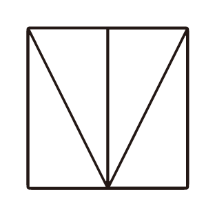
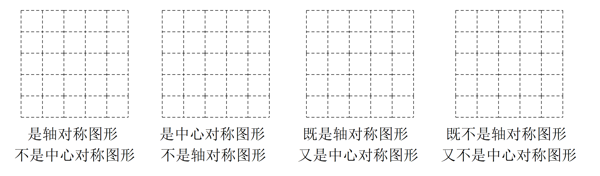

# Mathematics - 题目 3360

**ID**: a827f705de884f78896a68351d8b0d80
**年级**: Grade 9
**难度**: Medium-Hard
**题型**: Calculation

## 题目
将边长为2的正方形剪成四个全等的直角三角形，用这四个直角三角形拼成符合要求的四边形，请在下列网格中画出你拼成的四边形（注：①网格中每个小正方形的边长为1；​​​​​​​‌②所拼的图形不得与原图形相同；③四边形的各顶点都在格点上）．

## 解答

1. 解：①要求是轴对称图形但不是中心对称图形，则可作等腰梯形，如图四边形 $ABCD$ 即为所求；
2. ②要求是中心对称图形但不是轴对称图形，则可作一般平行四边形，如图四边形 $ABCD$ 即为所求；
3. ③要求既是轴对称图形又是中心对称图形，则可作菱形、矩形等，如图四边形 $ABCD$ 即为所求；
4. ④要求既不是轴对称图形又不是中心对称图形，则考虑作任意四边形，如图四边形 $ABCD$ 即为所求．
5. 
6. 【点睛】本题考查轴对称图形和中心对称图形的概念及作图，轴对称图形：把一个图形沿着某条直线折叠，能够与另一个图形重合；中心对称图形：把一个图形绕着某个点旋转 $180{}^\circ $ 能够和原图形重合．

## 知识点

**中文**:
  - 中心对称——作图
  - 轴对称的性质
  - 画轴对称图形
  - 中心对称的性质

**English**:
  - Construction: Central Symmetry
  - Properties of Axial Symmetry
  - Drawing Axially Symmetric Figures
  - Properties of Central Symmetry

---
