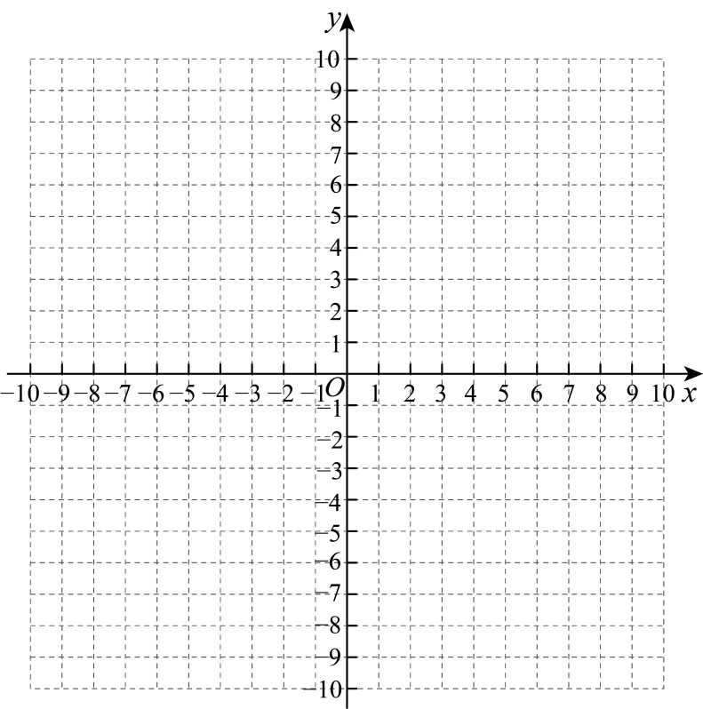

# Mathematics - 题目 857

**ID**: a89387641ec449eaa1684734eeea2746
**年级**: Grade 9
**难度**: Medium-Hard
**题型**: Calculation

## 题目
综合与实践【生成概念】抛物线L： $y=x{^{2}}+2mx+n$ 与y轴交于点A，若抛物线 $L^{′}$ 上的点和抛物线L上的点关于点A中心对称，则称 $L^{′}$ 是L的“兄弟抛物线 ”．【感知特例】（1）已知抛物线 $L：y=x{^{2}}+2x+2$ ，写出L的“兄弟抛物线” $L^{′}$ 的解析式，并画出抛物线L和 $L^{′}$ ．【代数推理】通过代数推理证明抛物线L图象的性质：从特定的条件开始，利用代数的定义、公式、运算法则，以及等式和不等式的性质，进行逻辑推理，验证已知的结果或得出结论，这一过程称为代数推理．我们不妨来试试．运用代数推理证明：抛物线 $L：y=x{^{2}}+2x+2$ 的图象是轴对称图形，对称轴是直线x=﹣1．证明：在抛物线L上任取一点 $M\left ({a,b}\right )$ ，则 $b=a{^{2}}+2a+2$ ，点M关于直线x=﹣1对称的点 $N\left ({-2-a,b}\right )$ ，∵ ${\left({-2-a}\right)^{2}}+2\left ({-2-a}\right )+2{\rm ＝}$  $a{^{2}}+2a+2{\rm ＝\mathit{b}}$ ，∴点N也在抛物线 $L：y=x{^{2}}+2x+2$ 的图象上，∵点 $M\left ({a,b}\right )$ 是抛物线 $L：y=x{^{2}}+2x+2$ 上的任意一点，它关于直线 $x=﹣1$ 对称的点  $N\left ({-2-a,b}\right )$ 在抛物线 $L：y=x{^{2}}+2x+2$ 的图象上，∴抛物线 $L：y=x{^{2}}+2x+2$ 的图象是轴对称图形，对称轴是直线 $x=﹣1$ ．（2）仿照上述方法，运用代数推理证明：抛物线 $L：y=x{^{2}}+2x+2$ 与L的“兄弟抛物线” $L^{′}$ 关于点A中心对称．【拓展延伸】（3）智慧小组发现抛物线L： $y=x{^{2}}+2x+2$ 和L的“兄弟抛物线” $L^{′}$ 的顶点所连直线l和m，n有一定的关系，请你求出直线l与x轴正半轴夹角 ${\rm \mathit{θ}}$ 的正切值 ${\rm{t}}{\rm{a}}{\rm{n}}θ$ （可用m，n表示）．​​​​​​​‌

## 解答

1. 解：L的“兄弟抛物线” $L^{′}$ 的解析式为 $y=-x{^{2}}+2x+2$ ，图象如图所示：
2. 
3. （2）运用代数推理证明：抛物线 $L：y=x{^{2}}+2x+2$ 与L的“兄弟抛物线” $L^{′}$ 关于点A中心对称，
4. 证明：在抛物线L上任取一点 $M\left ({a,b}\right )$ ，则 $b=a{^{2}}+2a+2$ ，
5. 点M关于点 $A\left ({0,2}\right )$ 成中心对称的 $N\left ({-a,4-b}\right )$ ， $L^{′}$ 的解析式为 $y=-x{^{2}}+2x+2$ ，
6. ∵ $-{\left({-a}\right)^{2}}+2\left ({-a}\right )+2=a{^{2}}-2a+2=4-b$ ，
7. ∴点N在抛物线 $L^{′}：y=-x{^{2}}+2x+2$ 的图象上，
8. ∵点 $M\left ({a,b}\right )$ 是抛物线 $L：y=x{^{2}}+2x+2$ 上的任意一点，它关于点 $A\left ({0,2}\right )$ 中心对称的点 $N\left ({-a,4-b}\right )$ 在抛物线 $L^{′}：y=-x{^{2}}+2x+2$ 的图象上，
9. ∴抛物线 $L：y=x{^{2}}+2x+2$ 的图象上的任意一点关于点 $A\left ({0,2}\right )$ 中心对称的点都在抛物线 $L^{′}：y=-x{^{2}}+2x+2$ 的图象上．
10. 同理，抛物线 $L^{′}：y=-x{^{2}}+2x+2$ 的图象上的任意一点关于点 $A\left ({0,2}\right )$ 中心对称的点都在抛物线 $L：y=x{^{2}}+2x+2$ 的图象上．
11. ∴抛物线 $L：y=x{^{2}}+2x+2$ 与L的“兄弟抛物线” $L^{′}$ 关于点A中心对称．
12. （3）∵抛物线 $L：y=x{^{2}}+2mx+n$ 的顶点坐标为 $\left ({-m,n-m{^{2}}}\right )$ ，点 $A\left ({0,n}\right )$ ，
13. ∴抛物线 $L^{′}：y=-x{^{2}}+2x+2$ 的顶点坐标为 $\left ({m,n+m{^{2}}}\right )$ ，
14. ∴ ${\rm{t}}{\rm{a}}{\rm{n}}θ=\frac {n+m{^{2}}-n}{m}=\frac {m{^{2}}}{m}=m$ .

## 知识点

**中文**:
  - 二次函数的对称
  - 二次函数的综合
  - 解直角三角形

**English**:
  - Symmetry of Quadratic Functions
  - Comprehensive Quadratic Function Problems
  - Solving Right Triangles

---
