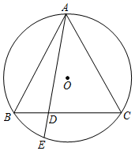

# Mathematics - 题目 3107

**ID**: a9b27da087944fe485d827b24cd59498
**年级**: Grade 9
**难度**: Medium-Hard
**题型**: Calculation

## 题目
如图，⊙ $O$ 是 $\vartriangle ABC$ 的外接圆，弦AE交BC于点D，且 $\frac {AB}{AE}=\frac {AD}{AB}$ ．（1）求证：AB＝AC；​​​​​​​‌（2）连接BO并延长交AC于点F，若AF＝4，CF＝5，求⊙O的半径．

## 解答

1. 解：（1）证明：如图1，连接BE，
2. ∵ $\frac {AB}{AE}=\frac {AD}{AB}$ ， $\angle BAD=\angle EAB$ ，
3. ∴ $\vartriangle ABD\mathrm{∽}\vartriangle AEB$ ，
4. ∴ $\angle ABD=\angle AEB$ ，
5. 又 $\angle C=\angle AEB$ ，
6. ∴ $\angle ABD=\angle C$ ，
7. ∴AB＝AC；
8. （2）如图2，连接OC，连接AO并延长交BC于点H，
9. ∵AF＝4，CF＝5，
10. ∴AB＝AC＝AF+CF＝4+5＝9，
11. ∵AB＝AC，OB＝OC，
12. ∴A、O在BC的垂直平分线上，
13. ∴ $AH\bot BC$ ，
14. 又AB＝AC，
15. ∴AH平分 $\angle BAC$ ，
16. ∴ $\angle BAH＝\angle CAH$ ，
17. ∵OA＝OB，
18. ∴ $\angle BAH=\angle ABF$ ，
19. ∴ $\angle CAH=\angle ABF$ ，
20. ∵ $\angle AFB＝\angle OFA$ ，
21. ∴ $\mathrm{△}AFB∽\mathrm{△}OFA$ ，
22. ∴ $\frac {AF}{OF}=\frac {AB}{OA}=\frac {FB}{FA}$ ，
23. 即 $\frac {4}{OF}=\frac {9}{r}=\frac {r+OF}{4}$ ，
24. ∴ $OF=\frac {4}{9}r$ ，
25. ∴ $\frac {9}{r}=\frac {r+\frac {4}{9}r}{4}$ ，
26. ∴ $r=\frac {18\sqrt {13}}{13}$ ．
27. 

## 知识点

**中文**:
  - 圆的基本认识
  - 相似三角形的判定与性质综合

**English**:
  - Basic Concepts of Circles
  - Determination and Properties

---
