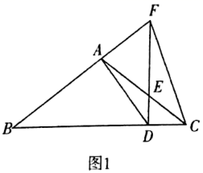
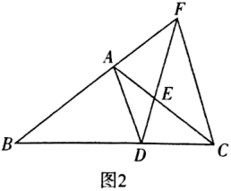

# Mathematics - 题目 2916

**ID**: a9eebd850fa04ae1855dfd41bdd976ed
**年级**: Grade 9
**难度**: Medium-Hard
**题型**: Calculation

## 题目
如图1， $\vartriangle ABC$ 中， $AB=AC$ ， ${\sin}B=\frac {3}{5}$ ， $D$ 为 $BC$ 上一动点，且 $\angle ADE=\angle B$ ， $DE$ 与 $BA$ 的延长线交于点 $F$ ，连接 $CF$ ．（1）①求证： $\mathrm{△}ABD\mathrm{∽}\mathrm{△}DCE$ ；​​​​​​​‌②若 $AB=10$ ，当 $AD\bot AB$ 时，求 $EF$ 的长；（2）如图2，当 $AD=AF$ 时，求证： $AC$ 平分 $\angle BCF$ ．

## 解答

1. （1）①证明：∵ $AB=AC$
2. ∴ $\angle B=\angle ACB$ ．
3. 又∵ $\angle ADE=\angle B$ ， $\angle ADC=\angle B+\angle BAD=\angle ADE+\angle CDE,$
4. ∴ $\angle EDC=\angle BAD$ ，
5. ∴ $\mathrm{△}ABD\mathrm{∽}\mathrm{△}DCE$ ．
6. ②解：如图，取 $BC$ 中点 $G$ ，连接 $AG$ ，则 $AG⊥BC$ ．
7. 
8. ∵ $AB=10$ ， ${\sin}B=\frac {3}{5}$ ，
9. ∴ $AG=10{\sin}B=6$ ， $BG=\sqrt {10{^{2}}-6{^{2}}}=8$ ，
10. ∴ $BC=16$ ．
11. ∵ $AG⊥BC$ ， $AD\bot AB$ ，
12. ∴ $\angle AGB=\angle AGD=\angle BAD=90{}^\circ ,$ ，
13. $\therefore \angle B+\angle BAG=90{}^\circ =\angle BAG+\angle DAG,$
14. $\therefore \angle B=\angle DAG$ ，
15. ∴ $△AGB∽△DGA$ ，
16. ∴ $\frac {AG}{GD}=\frac {BG}{AG}$ ，即 $\frac {6}{GD}=\frac {8}{6}$ ， $GD=\frac {9}{2}$ ．
17. ∴ $BD=\frac {25}{2}$ ， $DC=16-\frac {25}{2}=\frac {7}{2}$ ．
18. ∵ $\angle ADE=\angle B$ ，∴ $\angle BDF=90{}^\circ $ ，
19. ∴ $AG/\mskip-4mu/DF$ ，
20. ∴ $\frac {BG}{BD}=\frac {AG}{FD}$ ，即 $\frac {8}{\frac {25}{2}}=\frac {6}{FD}$ ，
21. ∴ $FD=\frac {75}{8}$ ．
22. ∵ $DE/\mskip-4mu/GA$ ，
23. ∴ $\frac {DC}{GC}=\frac {DE}{GA}$ ，即 $\frac {\frac {7}{2}}{8}=\frac {DE}{6}$ ，
24. ∴ $DE=\frac {21}{8}$ ．
25. ∴ $EF=\frac {75}{8}-\frac {21}{8}=\frac {27}{4}$ ．
26. （2）证明：∵ $AD=AF$ ，
27. ∴ $\angle ADF=\angle AFD$ ．
28. ∵ $\angle B=\angle ADE$ ， $\angle B=\angle ACB$ ，
29. ∴ $\angle DCE=\angle AFE$ ．
30. 又∵ $\angle AEF=\angle DEC$ ．
31. ∴ $\mathrm{△}AEF\mathrm{∽}\mathrm{△}DEC$ ，
32. ∴ $\frac {AE}{DE}=\frac {EF}{EC}$ ．
33. 又∵ $\angle AED=\angle FEC$ ，
34. ∴ $△AED∽△FEC$ ．
35. ∴ $\angle ADE=\angle FCE$ ，
36. ∴ $\angle FCE=\angle ACB$ ，
37. ∴ $AC$ 平分 $\angle BCF$ ．
38. 

## 知识点

**中文**:
  - 特殊角的三角函数值
  - 相似三角形的判定与性质综合

**English**:
  - Trigonometric Values of Special Angles
  - Determination and Properties

---
