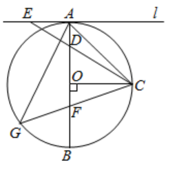

# Mathematics - 题目 3361

**ID**: a9f850b789664cc6ac383d46a4280832
**年级**: Grade 9
**难度**: Medium-Hard
**题型**: Calculation

## 题目
如图， $AB$ 是 $\odot O$ 的直径，半径 $OC\bot AB$ ，垂足为O，直线l为 $\odot O$ 的切线，A是切点，D是 $OA$ 上一点， $CD$ 的延长线交直线l于点 $E,F$ 是 $OB$ 上一点， $CF$ 的延长线交 $\odot O$ 于点G，连接 $AC,AG$ ，已知 $\odot O$ 的半径为3， $CE=\sqrt {34}$ ， $5BF-5AD=4$ ．（1）求 $AE$ 的长；​​​​​​​‌（2）求 $\cos \angle CAG$ 的值及 $CG$ 的长．

## 解答

1. (1)过点E作EH⊥OC，交OC的延长线于点H，
2. ∵直线l为 ${\rm \odot O}$ 的切线，A是切点，
3. ∴OA⊥AE，
4. ∵OC⊥AB，
5. ∴∠EHO=∠OAE=∠AOH=90°，
6. ∴四边形AOHE是矩形，
7. ∴EH=OA=3，AE=OH，
8. ∵ ${\rm CE=\sqrt {34}}$ ,
9. ∴ ${\rm CH=\sqrt {CE{^{2}}-EH{^{2}}}=\sqrt {(\sqrt {34})-3{^{2}}}=5}$ ,
10. ∴AE=OH=CH-OC=2；
11. 
12. (2)∵∠OAE=∠AOC=90°，
13. ∴OC∥AE，
14. ∴△ADE∽△OCD，
15. ∴ ${\rm \frac {AD}{OD}=\frac {AE}{OC}=\frac {2}{3}}$ ，
16. ∴AD=1.2，OD=1.8，
17. ∵ ${\rm 5BF-5AD=4}$ ，
18. ∴BF=2，
19. ∴OF=1，
20. ∴AF=4，CF= ${\rm \sqrt {OC{^{2}}+OF{^{2}}}=\sqrt {10}}$ ，
21. 连接BG，
22. ∵∠ACF=∠B，∠AFC=∠GFB，
23. ∴△AFC∽△GFB，
24. ∴ ${\rm \frac {AF}{GF}=\frac {CF}{BF}}$ ，
25. ∴ ${\rm \frac {4}{GF}=\frac {\sqrt {10}}{2}}$ ，
26. ∴ ${\rm GF=\frac {4\sqrt {10}}{5}}$ ，
27. ∴CG=CF+GF= $\frac {9\sqrt {10}}{5}$ ，
28. 设CO延长线交 ${\rm \odot O}$ 于点N，连接GN，则∠CNG=∠CAG，
29. 在Rt△CGN中，∠CGN=90°，CN=6，CG= $\frac {9\sqrt {10}}{5}$ ,
30. ∴NG= ${\rm \sqrt {CN{^{2}}-CG{^{2}}}=}$  $\frac {3\sqrt {10}}{5}$ ，
31. ∴cos∠CAG=cos∠CNG= ${\rm \frac {NG}{CN}=\frac {3\sqrt {10}}{5}\times \frac {1}{6}=\frac {\sqrt {10}}{10}}$ .
32. 

## 知识点

**中文**:
  - 余弦
  - 勾股定理的应用
  - 圆的综合问题
  - 相似三角形的判定与性质综合

**English**:
  - Cosine
  - Applications of Pythagorean Theorem
  - Comprehensive Circle Problems
  - Determination and Properties

---
