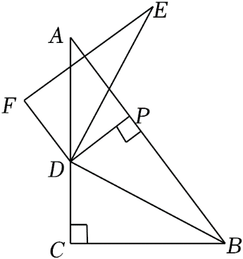

# Mathematics - 题目 3147

**ID**: aa303d865b144fa1bbc2e95a162fc0f8
**年级**: Grade 9
**难度**: Medium-Hard
**题型**: Calculation

## 题目
如图，在 ${\rm{R}}{\rm{t}}△ABC$ 中， $\angle C=90{}^\circ $ ， $AC=4$ ， ${\sin}A=\frac {3}{5}$ ．点P从点A出发，以每秒4个单位长度的速度向终点B匀速运动，过点P作 $PD\bot AB$ 交折线 $AC$ 、 $CB$ 于点 $D$ ，连接 $BD$ ，将 $\vartriangle DBP$ 绕点 $D$ 逆时针旋转 $90{}^\circ $ 得到 $\vartriangle DEF$ ．设点P的运动时间为t（秒）．(1)用含t的代数式表示线段 $PD$ 的长；​​​​​​​‌(2)当点E落在 $AB$ 边上时，求 $AD$ 的长；(3)当点F在 $\vartriangle ABC$ 内部时，求t的取值范围．(4)当线段 $DP$ 将 $\vartriangle ABC$ 的面积分成 $1:2$ 的两部分时，直接写出t的值为．

## 解答

1. （1）解：如图 $1-1$ 中，当点 $D$ 在线段 $AC$ 上时， $0<t\leqslant \frac {4}{5}$ ，
2. 
3. 在 $△ACB$ 中， $\angle C=90{}^\circ $ ， $AC=4$ ，
4. $\therefore {\sin}A=\frac {BC}{AB}=\frac {3}{5}$ ，设 $BC=3x$ ， $AB=5x$ ，
5. ∴ $4^{2}+\left ({3x}\right )^{2}=\left ({5x}\right )^{2}$ ，
6. 解得： $x=1$ ，即 $BC=3$ ， $AB=5$ ，
7. $\because AP=4t$ ，
8. $\therefore {\tan}A=\frac {DP}{AP}=\frac {3}{4}$ ，
9. $\therefore PD=3t$ ．
10. 如图 $1-2$ 中，当点 $D$ 在线段 $BC$ 上时， $\frac {4}{5}<t\leqslant \frac {5}{4}$ ．
11. 
12. $\because {\tan}B=\frac {DP}{PB}=\frac {4}{3}$ ，
13. $\therefore PD=\frac {4}{3}(5-4t)$ ，
14. 综上所述， $PD=\left\{\begin{array}{l}\begin{array}{}3t&(0<t\leqslant \frac {4}{5})\\\frac {4}{3}(5-4t)&(\frac {4}{5}<t\leqslant \frac {5}{4})\end{array}\end{array}\right.$ ；
15. （2）如图2中，当点 $E$ 落在 $AB$ 上时， $PD=PB=3t$ ，
16. 
17. $\because AP+PB=5$ ，
18. $\therefore 4t+3t=5$ ，
19. 解得， $t=\frac {5}{7}$ ，
20. $\therefore t=\frac {5}{7}$ 时，点 $E$ 落在 $AB$ 上，此时 $AD=\frac {25}{7}$ ；
21. （3）如图2中，当点 $F$ 落在 $AC$ 边上时， $CD+BD=3$ ，
22. 
23. $\therefore $  $\frac {3}{5}\times \frac {4}{3}(5-4t)+\frac {5}{3}(5-4t)=3$ ，
24. 解得， $t=\frac {35}{37}$ ．
25. 观察图象可知当 $\frac {35}{37}<t<\frac {5}{4}$ 时，点 $F$ 落在 $\vartriangle ABC$ 内部；
26. （4）如图 $1-1$ 中，当 $△APD$ 的面积 $=\frac {1}{3}\vartriangle ABC$ 的面积时，
27. 则有， $\frac {1}{2}\times 4t\times 3t=\frac {1}{3}\times \frac {1}{2}\times 3\times 4$ ，
28. $\therefore t=\frac {\sqrt {3}}{3}$ （负根已经舍去）．
29. 当四边形 $PDBC$ 的面积 $=\frac {1}{3}\vartriangle ABC$ 的面积时， $△APD$ 的面积 $=\frac {2}{3}△ABC$ 的面积，
30. 则有 $6t^{2}=4$ ，
31. $\therefore t=\frac {\sqrt {6}}{3}$ （舍去不合题意）（负根舍去），
32. 如图3中，当 $△PBD$ 的面积 $=\frac {1}{3}\vartriangle ABC$ 的面积时，
33. 则有， $\frac {1}{2}\times (5-4t)\times \frac {4}{3}(5-4t)=\frac {1}{3}\times \frac {1}{2}\times 3\times 4$ ，
34. $\therefore t=\frac {5+\sqrt {3}}{4}$ 或 $\frac {5-\sqrt {3}}{4}$ （舍去），
35. 综上所述，满足条件的 $t$ 的值为 $\frac {\sqrt {3}}{3}$ 或 $\frac {5+\sqrt {3}}{4}$ ．

## 知识点

**中文**:
  - 函数解析式
  - 旋转的性质
  - 解直角三角形

**English**:
  - Analytic Expressions of Functions
  - Properties of Rotation
  - Solving Right Triangles

---
