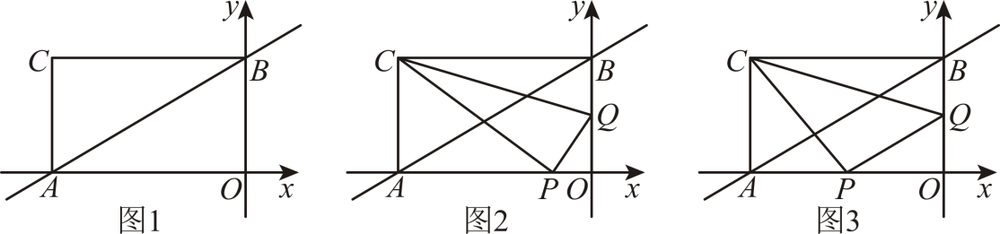

# Mathematics - 题目 3438

**ID**: ac40afa7c4504b648b3d567573e02b9b
**年级**: Grade 9
**难度**: Medium-Hard
**题型**: Calculation

## 题目
如图1，在平面直角坐标系中，点 $O$ 为坐标原点，直线 $y=kx+4k$ 与 $x$ 轴交于点 $\mathrm{A}$ ，与 $y$ 轴交于点 $B$ ，以 $AO、BO$ 为邻边作矩形 $AOBC$ ，其面积是8．(1)求直线 $AB$ 的解析式；​​​​​​​‌(2)如图2，点 $P$ 从点 $O$ 出发，沿线段 $OA$ 向终点 $\mathrm{A}$ 运动，速度为每秒2个单位长度，点 $Q$ 从点 $B$ 出发，沿线段 $BO$ 向终点 $O$ 运动，速度为每秒1个单位长度，连接 $PQ$ ， $P、Q$ 两点同时出发，运动时间为 $t$ 秒，当 $t$ 为何值时， $\vartriangle CPQ$ 的面积为 $\frac {13}{4}$ ；(3)如图3，在（2）的条件下，当 $t=1$ 时， $P、Q$ 两点同时停止运动，在 $x$ 轴上是否存在点 $M$ ，使得 $\angle MQP=45{}\degree $ ？若存在，求出点 $M$ 坐标，若不存在，请说明理由．

## 解答

1. （1）由直线 $y=kx+4k$ 与x轴交于点A，与y轴交于点B，
2. 当 $y=0$ 时， $kx+4k=0$ ，
3. 解得 $x=-4$ ，
4. ∴点 $A(-4,0)$ ，
5. ∴ $OA=4$ ．
6. ∵矩形 $AOBC$ 的面积是8，
7. ∴ $AO\cdot BO=4BO=8$ ，
8. 解得 $BO=2$ ，
9. ∴点 $B(0，2)$ ，
10. 将点B代入关系式，得 $4k=2$ ，
11. 解得 $k=\frac {1}{2}$ ，
12. ∴直线 $AB$ 的关系式为 $y=\frac {1}{2}x+2$ ；
13. （2）由点P从点O出发，眼线段 $OA$ 向终点运动，速度是每秒2个单位长度，点Q从点B出发，沿着线段 $BO$ 向终点O运动，速度是每秒1个单位长度，得 $PO=2t,AP=4-2t,QB=t,OQ=2-t$ ．
14. 由 $S{{}_{\vartriangle CPQ}}=S{{}_{矩形ACBO}}-S{{}_{\vartriangle ACP}}-S{{}_{\vartriangle POQ}}-S{{}_{\vartriangle BCQ}}=\frac {13}{4}$ ，
15. 即 $8-\frac {1}{2}\times (4-2t)\times 2-\frac {1}{2}\times 2t(2-t)-\frac {1}{2}\times 4t=13$ ，
16. 解得 $t{{}_{1}}=\frac {1}{2},t{{}_{2}}=\frac {3}{2}$ ，
17. ∴当 $t=\frac {1}{2}$ 或 $t=\frac {3}{2}$ 时， $\vartriangle CPQ$ 的面积是 $\frac {13}{4}$ ；
18. （3）存在，点M的坐标是 $(-\frac {1}{3},0)$ ．
19. 如图所示．
20. 当 $t=1$ 时，点P的坐标是 $(-2,0)$ ，点Q的坐标是 $(0,1)$ ，
21. 取点 $N(-1,-2)$ ．
22. 由图形可知 $PQ{^{2}}=5,PN{^{2}}=5,QN{^{2}}=10$ ，
23. 
24. ∴ $PQ{^{2}}+PN{^{2}}=QN{^{2}}$ ，
25. ∴ $\vartriangle PQN$ 是直角三角形，
26. ∴ $PQ=PN,\angle PQN=45{}\degree $ ．
27. 设 $NQ$ 的关系式为 $y=ax+b$ ，根据题意，得
28. $\begin{cases}b=1\\-a+b=-2\end{cases}$ ，
29. 解得 $\begin{cases}b=1\\a=3\end{cases}$ ，
30. ∴直线的关系式为 $y=3x+1$ ．
31. 当 $y=0$ 时， $x=-\frac {1}{3}$ ，
32. ∴点 $M(-\frac {1}{3},0)$ ．

## 知识点

**中文**:
  - 勾股定理的逆定理
  - 矩形的性质
  - 待定系数法求一次函数解析式

**English**:
  - Converse of Pythagorean Theorem
  - Properties of Rectangles
  - Finding Expressions by Undetermined Coefficients

---
