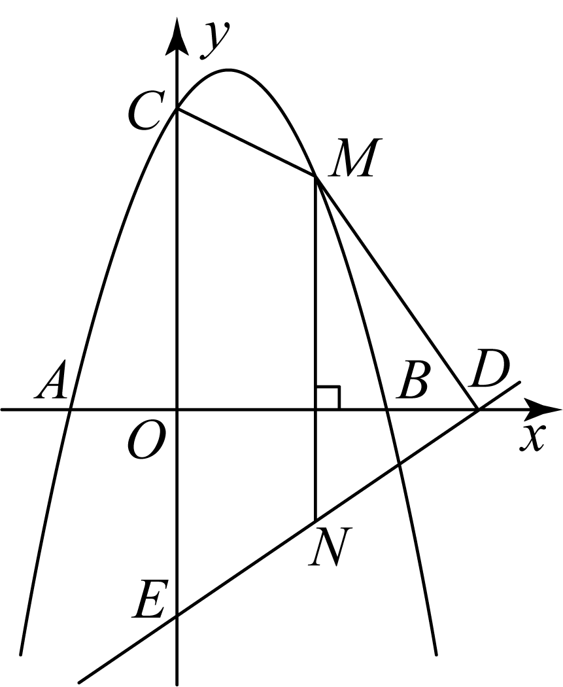

# Mathematics - 题目 3975

**ID**: affb52b393ae4fafba005dfa99c5067d
**年级**: Grade 9
**难度**: Medium-Hard
**题型**: Calculation

## 题目
综合与探究如图，抛物线 $y=ax{{}^{2}}+bx+6$ 与x轴交于 $A\left ({-2,0}\right )$ ， $B\left ({4,0}\right )$ 两点，与y轴交于点C，直线 $y=\frac {2}{3}x-4$ 与x轴交于点D，与y轴交于点E．若M为第一象限内抛物线上一点，过点M且垂直于x轴的直线交DE于点N，连接 $MC$ ， $MD$ ．(1)求抛物线的函数表达式及D，E两点的坐标．(2)当 $CM=EN$ 时，求点M的横坐标．(3)G为平面直角坐标系内一点，是否存在点M使四边形 $MDEG$ 是正方形．若存在，请直接写出点G的坐标；​​​​​​​‌若不存在，请说明理由．

## 解答

1. （1）把 $A\left ({-2,0}\right )$ ， $B\left ({4,0}\right )$ 代入 $y=ax{{}^{2}}+bx+6$ 中，得
2. $\left \{\hspace{-0.5em}\begin{array}{l}4a-2b+6=0\\16a+4b+6=0\end{array}\hspace{-0.5em}\right.$ ，解得 $\left \{\hspace{-0.5em}\begin{array}{l}a=-\frac {3}{4}\\b=\frac {3}{2}\end{array}\hspace{-0.5em}\right.$
3. ∴抛物线的函数表达式为 $y=-\frac {3}{4}x{{}^{2}}+\frac {3}{2}x+6$ ．
4. 把 $x=0$ 代入 $y=\frac {2}{3}x-4$ 中，得 $y=-4$ ，
5. ∴ $E\left ({0,-4}\right )$
6. 把 $y=0$ 代入 $y=\frac {2}{3}x-4$ 中，得 $x=6$ ，
7. ∴ $D\left ({6,0}\right )$
8. （2）设点M的横坐标为m，
9. ∴点M的坐标为 $\left ({m,-\frac {3}{4}m{{}^{2}}+\frac {3}{2}m+6}\right )\left ({0<m<4}\right )$ ，点N的坐标为 $\left ({m,\frac {2}{3}m-4}\right )$ ．
10. 如图，过点M作 $MP\bot y$ 轴于点P，过点N作 $NQ\bot y$ 轴于点Q．
11. 
12. ∵ $MN\bot x$ 轴
13. ∴ $MN{\rm{/\mskip-4mu/}}y$ 轴
14. ∴ $PM=NQ$
15. 又∵ $CM=EN$
16. ∴ ${\rm{R}}{\rm{t}}\mathrm{△}MCP≌{\rm{R}}{\rm{t}}\mathrm{△}NEQ$ ，
17. ∴ $CP=EQ$ ， $\angle MCP=\angle NEQ$ ．
18. 如图1，当点M在点C的上方时，
19. 
20. ∵ $\angle MCP=\angle NEQ$
21. ∴ $MC{\rm{/\mskip-4mu/}}EN$
22. ∴四边形 $CENM$ 为平行四边形，
23. ∴ $MN=CE=10$
24. ∴ $-\frac {3}{4}m{{}^{2}}+\frac {3}{2}m+6-\left ({\frac {2}{3}m-4}\right )=10$ ，
25. 解得 $m{{}_{1}}=0$ （舍去）， $m{{}_{2}}=\frac {10}{9}$ ．
26. 如图2，当点M在点C的下方时， $CP=EQ$ ，
27. 
28. ∴ $6-\left ({-\frac {3}{4}m{{}^{2}}+\frac {3}{2}m+6}\right )=\frac {2}{3}m-4-\left ({-4}\right )$ ，
29. 解得 $m{{}_{1}}=0$ （舍去）， $m{{}_{2}}=\frac {26}{9}$ ．
30. 综上所述，点M的横坐标为 $\frac {10}{9}$ 或 $\frac {26}{9}$ ．
31. （3）存在，点G的坐标为 $\left ({-4,2}\right )$
32. 如图3，设 $MN$ 与x轴交于点H
33. 
34. 当 $\mathrm{△}MHD≌\mathrm{△}DOE$ 时，四边形 $MDEG$ 是正方形，
35. ∴当 $MH=OD$ ， $DH=OE$ 时，四边形 $MDEG$ 是正方形，
36. ∴ $MH=OD=6$ ， $DH=OE=4$
37. ∴ $OH=2$
38. 把 $x=2$ 代入 $y=-\frac {3}{4}x{{}^{2}}+\frac {3}{2}x+6$ 中，得 $y=6$
39. ∴点M的坐标为 $\left ({2,6}\right )$
40. 根据平移性质可得点G的坐标为 $\left ({-4,2}\right )$

## 知识点

**中文**:
  - 两点间的距离公式
  - 二次函数的综合
  - 正方形的判定与性质综合
  - 全等三角形的综合问题

**English**:
  - Distance Formula
  - Comprehensive Quadratic Function Problems
  - Determination and Properties of Squares
  - Comprehensive Problems

---
