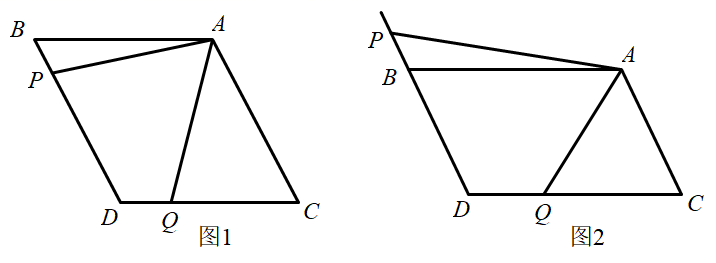

# Mathematics - 题目 1405

**ID**: affdde66d50e4a07ab46d21a4c48b797
**年级**: Grade 9
**难度**: Medium-Hard
**题型**: Calculation

## 题目
如图1， $▱ABCD$ 中， $AB=AC$ ， $P,Q$ 分别是 $BD,CD$ 上的点，且满足 $\angle PAQ=\angle C$ ．（1）求证： $\angle APB+\angle AQC=180^\circ $（2）在图1中，是否存在与AP相等的线段？若存在，请找出来，并加以证明；​​​​​​​‌若不存在，说明理由．（3）若将“ $AB=AC,P$ 为 $BD$ 上的点”改为：“ $AB=kAC,P$ 为DB延长线上的点”其他条件不变（如图2）若 $\angle AQC=α$ ，求线段 $CQ,PB,AP$ 之间的数量关系（用含 $k,α$ 的式子表示）

## 解答

1. （1）证明：∵四边形ABCD是平行四边形， $AB=AC$ ，
2. ∴四边形ABCD是菱形，
3. $\therefore AC//BD$ ，
4. $\therefore \angle D+\angle C=180{}^\circ $ ，
5. $\because \angle PAQ=\angle C$ ，
6. $\therefore \angle PAQ+\angle D=180{}^\circ $ ，
7. $\therefore \angle AQD+\angle APD=180{}^\circ $ ，
8. $\because \angle AQD+\angle AQC=180{}^\circ $ ，
9. $\therefore \angle APD=\angle AQC$ ，
10. $\because \angle APD+\angle APB=180{}^\circ $ ，
11. $\therefore \angle APB+\angle AQC=180{}^\circ $ ．
12. （2）存在， $AQ=AP$ ．
13. 如图，过点A作 $AP=AM$ ，交BD于点M，
14. 
15. ∴∠APM=∠AMP，
16. 由（1）知， $\angle APB+\angle AQC=180{}^\circ $ ，
17. ∴∠APM=∠AQC，
18. ∴∠AMP=∠AQC，
19. 又∵四边形ABCD为菱形，
20. ∴AB=AC，∠B=∠C，
21. ∴ $\Delta ABM\cong \Delta ACQ$ ，
22. ∴ $AM=AQ$ ，
23. 即AP=AQ．
24. （3）过点A作 $AP=AM$ ，交BD的延长线于点M，作 $AH\bot BD$ ，
25. 
26. ∵四边形ABCD是平行四边形，
27. ∴AC∥BD，∠C+∠BDC=180°，∠ACD=∠ABM，
28. ∵ $\angle PAQ=\angle C$ ，
29. ∴∠PAQ+∠BDC=180°，
30. ∴∠APB+∠AQD=180°，
31. ∴∠APB=∠AQC，
32. 又∵AP=AM，
33. ∴∠APB=∠AMP，
34. ∴∠AQC=∠AMP，
35. ∴ $\Delta ABM\sim \Delta ACQ$ ，
36. ∴ $\frac {BM}{CQ}=\frac {AB}{AC}=k$ ，
37. $\therefore BM=kCQ$ ，
38. 在等腰△APM中，AH⊥PM，
39. ∴ $PM=2PH=2HM=2PA\centerdot {\cos}\angle AMH=2PA\centerdot {\cos}α$ ，
40. $\therefore PM=PB+BM=PB+kCQ=2AP\centerdot {\cos}α$ ，
41. 即 $PB+kCQ=2AP\centerdot {\cos}α$ ．

## 知识点

**中文**:
  - 余弦
  - 菱形的判定与性质综合
  - 相似三角形的判定与性质综合
  - 全等三角形的判定与性质

**English**:
  - Cosine
  - Determination and Properties of Rhombuses
  - Determination and Properties
  - Determination and Properties

---
