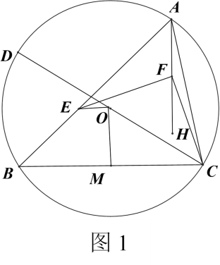
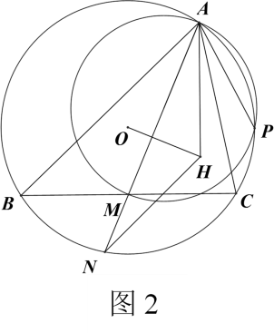

# Mathematics - 题目 3972

**ID**: b264d96fc2124736846cbb3f9c42daca
**年级**: Grade 9
**难度**: Medium-Hard
**题型**: Calculation

## 题目
如图1，设 $ΔABC$ 是一个锐角三角形，且 $AB\ne AC$ ， $Γ$ 为其外接圆， $O、H$ 分别为其外心和垂心， $CD$ 为圆 $Γ$ 直径， $M$ 为线段 $BC$ 上一动点且满足 $AH=2OM$ ．（1）证明： $M$ 为 $BC$ 中点；​​​​​​​‌（2）过 ${\rm{O}}$ 作 $BC$ 的平行线交 $AB$ 于点 $E$ ，若 $F$ 为 $AH$ 的中点，证明：  $EF\bot FC$ ；（3）直线 $AM$ 与圆 $Γ$ 的另一交点为 $N$ （如图2），以 $AM$ 为直径的圆与圆 $Γ$ 的另一交点为 $P$ ．证明：若 $AP、BC、OH$ 三线共点，则 $AH=HN$ ；反之也成立．

## 解答

1. 解：（1）连接 $AD,BD$ ，则 $DA\bot AC$ ， $DB\bot BC$
2. 又 $H$ 为 $ΔABC$ 垂心
3. ∴ $BH\bot AC$ ， $AH\bot BC$
4. ∴ $AD{\rm{/}}{\rm{/}}BH,BD{\rm{/}}{\rm{/}}AH$
5. ∴四边形 $ADBH$ 为平行四边形
6. ∴ $DB=AH=2OM$ ，又 $O$ 为 $CD$ 中点
7. ∴ $M$ 为 $BC$ 中点
8. （2）过 $E$ 作 $EG\bot BC$
9. 连接 $GH$ ，由（1）可知四边形 $EGHF$ 为平行四边形，四边形 $EGFA$ 为平行四边形
10. ∵ $CH\bot AB,AB\parallel GF$
11. ∴ $CH\bot GF$
12. ∴ $H$ 为 $\Delta FGC$ 垂心
13. ∴ $GH\bot CF,而{\rm{G}}{\rm{H}}\parallel EF$
14. ∴ $EF\bot FC$
15. （3）设 $AM$ 与 $OF$ 交点为 $I$
16. 由（1）可知四边形 $OMFA$ 为平行四边形
17. ∴ $I$ 为直径 $AM$ 中点
18. 而圆 $I$ 与圆 $Γ$ 相交弦为 $AP$
19. ∴ $OF\bot AP,而MH\parallel OF$
20. ∴ $MH\bot AP$
21. 设 $MC,AP交于Q$
22. 则 $H$ 为 $ΔAMQ$ 垂心
23. ∴ $QH\bot AM$
24. $AP、BC、OH$ 三线共点 $\Leftrightarrow $  $O,H,Q$ 三点共线
25. $\Leftrightarrow $  $OH\bot AN$  $\Leftrightarrow $  $AH=HN$
26. 【点睛】本题考查了圆内的综合问题，熟知圆的性质，平行四边形的判定和性质，垂心的作用是解题的关键．

## 知识点

**中文**:
  - 三角形内切圆与外接圆综合
  - 平行四边形的判定与性质
  - 圆的综合问题

**English**:
  - Incircle and Circumcircle
  - Determination and Properties
  - Comprehensive Circle Problems

---
