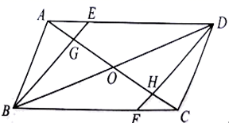

# Mathematics - 题目 3483

**ID**: b27794796ebd4d7ea6236aef82c8394d
**年级**: Grade 9
**难度**: Medium-Hard
**题型**: Calculation

## 题目
如图，在 $▱ABCD$ 中，点 $E$ 、 $F$ 分别在边 $AD$ 、 $BC$ 上，且 $\angle ABE=\angle CDF$ ．（1）探究四边形 $BEDF$ 的形状，并说明理由；​​​​​​​‌（2）连接 $AC$ ，分别交 $BE$ 、 $DF$ 于点 $G$ 、 $H$ ，连接 $BD$ 交 $AC$ 于点 $O$ ．若 $\frac {AG}{OG}=\frac {2}{3}$ ， $AE=4$ ，求 $BC$ 的长．

## 解答

1. （1）四边形 $BEDF$ 为平行四边形．
2. 
3. 理由如下：
4. ∵四边形 $ABCD$ 为平行四边形
5. ∴ $\angle ABC=\angle ADC$
6. ∵ $\angle ABE=\angle CDF$
7. ∴ $\angle EBF=\angle EDF$
8. ∵四边形 $ABCD$ 为平行四边形
9. ∴ $AD//BC$
10. ∴ $\angle EDF=\angle DFC=\angle EBF$
11. ∴ $BE//DF$
12. ∵ $AD//BC$
13. ∴四边形 $BEDF$ 为平行四边形
14. （2）设 $AG=2a$ ，∵ $\frac {AG}{OG}=\frac {2}{3}$
15. ∴ $OG=3a$ ， $AO=5a$
16. ∵四边形 $ABCD$ 为平行四边形
17. ∴ $AO=CO=5a$ ， $AC=10a$ ， $CG=8a$
18. ∵ $AD//BC$
19. $\angle AGE=\angle CGB,\angle AEG=\angle CBG,\angle EAG=\angle BCG$ ，
20. ∴ $ΔAGE∽ΔCGB$
21. ∴ $\frac {AE}{BC}=\frac {AG}{GC}=\frac {1}{4}$
22. ∵ $AE=4$
23. ∴ $BC=16$ ．

## 知识点

**中文**:
  - 两组对角分别相等的四边形是平行四边形
  - 相似三角形的判定

**English**:
  - Two Pairs of Equal Opposite Angles
  - Determination of Similar Triangles

---
