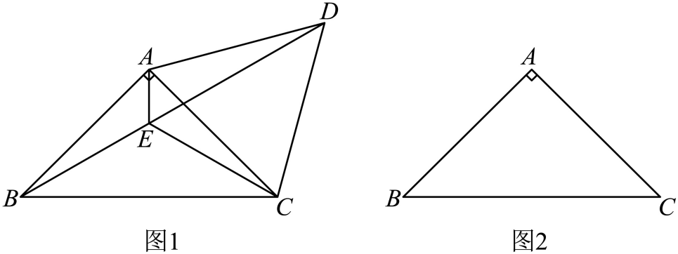

# Mathematics - 题目 424

**ID**: b3ca3f9a958849fd81005be45497230d
**年级**: Grade 9
**难度**: Medium-Hard
**题型**: Calculation

## 题目
已知：在 $\vartriangle ABC$ 中， $\angle BAC=90{}^\circ $ ， $AB=AC$ ．(1)如图 $1$ ，将线段 $AC$ 绕点 $A$ 逆时针旋转 $60{}^\circ $ 得到 $AD$ ，连接 $CD$ 、 $BD$ ， $∠BAC$ 的平分线交 $BD$ 于点 $E$ ，连接 $CE$ ．$①$ 求证： $\angle AED=\angle CED$ ；​​​​​​​‌$②$ 求证： $2CE+AE=BD$ ；(2)在图 $2$ 中，若将线段 $AC$ 绕点 $A$ 顺时针旋转 $60{}^\circ $ 得到 $AD$ ，连结 $CD$ 、 $BD$ ，连结 $CE$ ，请补全图形，若 $CE=6+2\sqrt {3}$ ，求 $BD$ ．

## 解答

1. （1）证明： $①$ 如图：
2. 
3. ∵将线段 $AC$ 绕点 $A$ 逆时针旋转 $60{}^\circ $ 得到 $AD$ ，
4. ∴ $AC=AD$ ， $\angle DAC=60{}^\circ $ ，
5. ∴ $\angle BAD=\angle BAC+\angle CAD=150{}^\circ $ ，且 $AB=AC=AD$ ，
6. ∴ $\angle ABD=\angle ADB=15{}^\circ $ ，
7. ∵ $\angle BAC=90{}^\circ $ ， $AB=AC$ ， $AE$ 平分 $∠BAC$ ，
8. ∴ $\angle BAE=\angle CAE=45{}^\circ $ ， $\angle ABC=\angle ACB=45{}^\circ $ ，
9. ∵ $AE=AE$ ，
10. ∴ $\vartriangle ABE≌\vartriangle ACE\left ({{\rm{S}}{\rm{A}}{\rm{S}}}\right )$ ，
11. ∴ $\angle ABE=\angle ACE=15{}^\circ $ ， $BE=CE$ ，
12. ∴ $\angle EBC=\angle ECB=30{}^\circ $ ，
13. ∴ $\angle CED=\angle EBC+\angle ECB=60{}^\circ $ ，
14. ∵ $\angle AED=\angle ABE+\angle BAE=60{}^\circ $ ，
15. ∴ $\angle AED=\angle CED$ ；
16. $②$ 过点 $A$ 作 $AH\bot BD$ 于点 $H$ ，如图：
17. 
18. 由 $①$ 知： $BE=CE$ ，
19. ∵ $\angle AED=60{}^\circ $ ， $AH\bot BD$ ，
20. ∴ $AE=2EH$ ，
21. ∵ $AB=AD$ ， $AH\bot BD$ ，
22. ∴ $BD=2BH$ ，
23. ∵ $BE+EH=BH$ ，
24. ∴ $BE+EH=\frac {1}{2}BD$ ，
25. ∴ $2BE+2EH=BD$ ，
26. ∴ $2CE+AE=BD$ ；
27. （2）补全图形如下：
28. 
29. 以 $A$ 为顶点， $AE$ 为一边作 $\angle EAF=60{}^\circ $ ，设 $AE$ 交 $BC$ 于 $K$ ，
30. ∵ $\angle BAC=90{}^\circ $ ， $AB=AC$ ，
31. ∴ $\angle BAE=\angle CAE=\angle ABC=\angle ACB=45{}^\circ $ ，
32. ∴ $BK=AK=CK$ ，
33. ∵将线段 $AC$ 绕点 $A$ 顺时针旋转 $60{}^\circ $ 得到 $AD$ ，
34. ∴ $AC=AD$ ， $\angle DAC=60{}^\circ $ ，
35. ∴ $\angle DAE=\angle DAC-\angle CAE=15{}^\circ $ ， $AB=AD$ ，
36. ∴ $\angle ABD=\angle ADB$ ， $\angle BAD=30{}^\circ $ ，
37. ∴ $\angle ABD=\angle ADB=75{}^\circ $ ，
38. ∴ $\angle AED=\angle ADB-\angle DAE=60{}^\circ $ ，
39. ∵ $AB=AC$ ， $\angle BAE=\angle CAE$ ，
40. ∴ $\vartriangle ABE≌\vartriangle ACE\left ({{\rm{S}}{\rm{A}}{\rm{S}}}\right )$ ，
41. ∴ $BE=CE=6+2\sqrt {3}$ ，
42. ∴ $AE$ 是 $BC$ 的垂直平分线，
43. ∴ $\angle BKE=90{}^\circ $ ，
44. ∴ $\angle KBE=30{}^\circ $ ，
45. ∴ $KE=\frac {1}{2}BE=3+\sqrt {3}$ ， $BK=\sqrt {3}KE=3+3\sqrt {3}=AK$ ，
46. ∴ $AE=KE+AK=6+4\sqrt {3}$ ，
47. ∵ $\angle EAF=60{}^\circ $ ， $\angle AED=60{}^\circ $ ，
48. ∴ $\mathrm{△}AEF$ 是等边三角形，
49. ∴ $AE=AF=EF=6+4\sqrt {3}$ ，
50. ∵ $AC=AD$ ， $\angle CAE=\angle DAF=45{}^\circ $ ，
51. ∴ $\vartriangle CAE≌\vartriangle DAF\left ({{\rm{S}}{\rm{A}}{\rm{S}}}\right )$ ，
52. ∴ $CE=DF=6+2\sqrt {3}$ ，
53. ∴ $BE=CE=DF=6+2\sqrt {3}$ ，
54. ∵ $DF+BE-EF=BD$ ，
55. ∴ $BD=6+2\sqrt {3}+6+2\sqrt {3}-\left ({6+4\sqrt {3}}\right )＝6$ ，
56. ∴ $BD$ 的长为 $6$ ．

## 知识点

**中文**:
  - 几何变换——旋转综合题

**English**:
  - Rotation Comprehensive Problems

---
