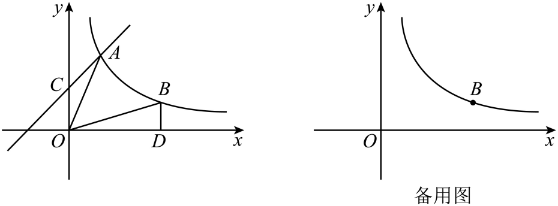

# Mathematics - 题目 3944

**ID**: b54e4d01bb7b47758e8894abe242b2ba
**年级**: Grade 9
**难度**: Medium-Hard
**题型**: Calculation

## 题目
如图，点 $A\left ({1,m}\right )$ 和点 $B$ 是反比例函数 $y{{}_{1}}=\frac {k}{x}\left ({k\mathrm{>}0\mathrm{,}x\mathrm{>}0}\right )$ 图象上的两点，一次函数 $y{{}_{2}}=ax+2\left ({a\ne 0}\right )$ 的图象经过点 $A$ ，与 $y$ 轴交于点 $C$ ，过点 $B$ 作 $BD\bot x$ 轴，垂足为 $D$ ，连接 $OA,OB$ ．已知 $ΔOAC$ 与 $ΔOBD$ 的面积满足 $S{{}_{\Delta OAC}}:S{{}_{\Delta OBD}}=2:3$ ．(1)求 $ΔOAC$ 的面积和 $k$ 的值；​​​​​​​‌(2)求直线 $AC$ 的表达式；(3)过点 $B$ 的直线 $MN$ 分别交 $x$ 轴和 $y$ 轴于 $M,N$ 两点， $NB=2MB$ ，若点 $P$ 为 $\angle MON$ 的平分线上一点，且满足 $OP{^{2}}=OM\cdot ON$ ，请求出点 $P$ 的坐标．

## 解答

1. （1）解：（1）∵一次函数y_{2}=ax+ 2与y轴交于C，
2. ∴C(0，2)，
3. ∴OC= 2，
4. ∴ $S{{}_{\Delta OAC}}=\frac {1}{2}\times {{2}}\times {{2}}\times 1{\rm{=}}1$ ，
5. ∵ $S{{}_{\Delta OAC}}:S{{}_{\Delta OBD}}=2:3$ ，
6. ∴ $S{{}_{\Delta OBD}}=\frac {3}{2}$ ，
7. ∵点B在反比例函数 $y{{}_{1}}=\frac {k}{x}$ 上，
8. ∴ $k=2\times \frac {3}{2}=3$ ；
9. （2）解：∵点A${\rm (1，\mathit{m})}$ 在反比例函数 $y{{}_{1}}=\frac {3}{x}$ 上，
10. ∴m= 3，
11. ∴A(1，3)，
12. 将A(1，3)代入一次函数y_{2}=ax+ 2得a+2=3，
13. ∴a=1，
14. ∴一次函数 $y{{}_{2}}=x+2$ ；
15. （3）解：设B(a，b)，
16. 当点N在y轴正半轴上时，作BH⊥y轴于H，
17. 
18. ∴BH∥OM，
19. ∴ $ΔNBH{\rm ∽}$  $ΔNMO$ ，
20. ∴ $\frac {BH}{OM}=\frac {BN}{MN}=\frac {NH}{NO}$  ，
21. ∵NB=2MB，
22. ∴ $\frac {BN}{MN}=\frac {2}{3}$ ，
23. ∴ $OM=\frac {3}{2}a{\rm ，\mathit{ON}=3\mathit{b}}$ ，
24. ∵OP^{2}=OM·ON，
25. ∴ $OP=\sqrt {OM\cdot ON}{\rm{=}}\sqrt {\frac {3}{2}a\cdot 3b}=\frac {3\sqrt {6}}{2}$ ，
26. ∵点P为 ${\rm ∠\mathit{MON}}$ 的平分线上一点，
27. ∴ ${\rm ∠\mathit{MON}=90°}$ ，
28. ∴点P到x轴和y轴的距离相等为 $\frac {3\sqrt {3}}{2}$ ，
29. ∴ $P\left ({\frac {3\sqrt {3}}{2}，\frac {3\sqrt {3}}{2}}\right )$ ，
30. 当点N在y轴负半轴上时，如图，
31. 
32. 同理可得， $OM=\frac {1}{2}BH=\frac {1}{2}a{\rm ，\mathit{ON}=\mathit{OH}=\mathit{b}}$ ，
33. ∴ $OP=\sqrt {OM\cdot ON}{\rm{=}}\sqrt {\frac {1}{2}a\cdot b}=\frac {\sqrt {6}}{2}$ ，
34. ∵点P为 ${\rm ∠\mathit{MON}}$ 的平分线上一点，
35. ∴ ${\rm ∠\mathit{MON}=90°}$ ，
36. ∴点P到x轴和y轴的距离相等为 $\frac {\sqrt {3}}{2}$ ，
37. ∴ $P\left ({\frac {\sqrt {3}}{2}，-\frac {\sqrt {3}}{2}}\right )$ ，
38. 综上所述， $P\left ({\frac {3\sqrt {3}}{2}，\frac {3\sqrt {3}}{2}}\right )$ 或 $\left ({\frac {\sqrt {3}}{2}，-\frac {\sqrt {3}}{2}}\right )$ ．

## 知识点

**中文**:
  - 反比例函数系数k的几何意义及应用
  - 反比例函数综合
  - 相似三角形的判定与性质综合
  - 待定系数法求一次函数解析式

**English**:
  - Geometric Meaning and Application of Coefficient k
  - Comprehensive Inverse Proportionality Problems
  - Determination and Properties
  - Finding Expressions by Undetermined Coefficients

---
