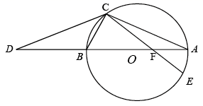

# Mathematics - 题目 2245

**ID**: b62d44066f624c23a0f681d0a3482002
**年级**: Grade 9
**难度**: Medium-Hard
**题型**: Calculation

## 题目
如图， $AB$ 为 $\odot O$ 的直径，C为 $\odot O$ 上一点，连接 $AC,BC$ ，D为 $AB$ 延长线上一点，连接 $CD$ ，且 $\angle BCD=\angle A$ ．（1）求证： $CD$ 是 $\odot O$ 的切线；​​​​​​​‌（2）若 $\odot O$ 的半径为 $\sqrt {5}$ ， $\vartriangle ABC$ 的面积为 $2\sqrt {5}$ ，求 $CD$ 的长；（3）在（2）的条件下，E为 $\odot O$ 上一点，连接 $CE$ 交线段 $OA$ 于点F，若 $\frac {EF}{CF}=\frac {1}{2}$ ，求 $BF$ 的长．

## 解答

1. （1）证明：连接 ${\rm OC}$ ，
2. ∵AB为⊙O直径，
3. ∴∠ACB＝90°，
4. ∴∠CAB+∠CBO＝90°，
5. 又∵OB＝OC，
6. ∴∠CBO＝∠BCO，
7. ∴∠CAB+∠BCO＝90°
8. ∵∠BCD＝∠A，
9. ∴∠BCD+∠BCO＝90°，
10. ∴OC⊥CD
11. ∴CD为⊙O切线；
12. 
13. （2）过点C作 ${\rm CM\bot AB}$ 于点M，
14. ∵ ${\rm \odot O}$ 的半径为 $\sqrt {5}$ ，
15. ∴AB= $2\sqrt {5}$ ，
16. ∵ ${\rm \vartriangle ABC}$ 的面积为 $2\sqrt {5}$ ，
17. ∴CM=2，
18. 在Rt△CMO中，CO= $\sqrt {5}$ ，CM=2，
19. ∴OM=1，
20. 由（1）得∠OCD=∠CMO=90°，
21. ∵∠COM=∠COD，
22. ∴△COM∽△DOC，
23. ∴ ${\rm \frac {DC}{CM}=\frac {OC}{OM}}$  ，
24. ∴ ${\rm \frac {DC}{2}=\frac {\sqrt {5}}{1}}$ ，
25. ∴ ${\rm CD=2\sqrt {5}}$ ，
26. （3）过点E作 ${\rm EN\bot AB}$ 于点N，连接 ${\rm OE}$ ，
27. ∵ ${\rm CM\bot AB}$ ， ${\rm EN\bot AB}$ ，
28. ∴△FCM∽△FEN，
29. ∴ ${\rm \frac {EN}{CM}=\frac {FE}{CF}=\frac {NF}{MF}=\frac {1}{2}}$  ，
30. 由（2）得CM=2，OM=1，
31. ∴EN=OM=1，
32. ∵OC=OE，
33. ∴Rt△COM≌Rt△OEN，
34. ∴ON=CM=2，
35. ∴MN=3，
36. ∵ ${\rm \frac {NF}{MF}=\frac {1}{2}}$ ，
37. ∴FM=2，
38. ∵OM=1，
39. ∴OF=1，
40. ∵BF=OB+OF，
41. ∴ ${\rm BF=1+\sqrt {5}}$ ．

## 知识点

**中文**:
  - 圆的综合问题

**English**:
  - Comprehensive Circle Problems

---
