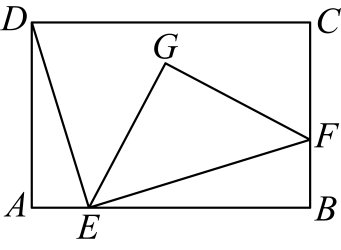

# Mathematics - 题目 3633

**ID**: b6d2b61e26f746b7a83ef288d91b9d3f
**年级**: Grade 9
**难度**: Medium-Hard
**题型**: Calculation

## 题目
如图，矩形 $ABCD$ 中， $AB=6$ ， $AD=4$ ，点 $E$ 是 $AB$ 边上的一个动点，连接 $DE$ ，过点 $E$ 作 $DE$ 的垂线交 $BC$ 于点 $F$ ，以 $EF$ 为斜边作等腰直角三角形 $EFG$ （点 $G$ 在 $EF$ 上方）．（1）若 $AE=1$ ，求 $BF$ 的长；​​​​​​​‌（2）当点E从点A运动到点B的过程中， $\mathrm{△}EFB$ 的外接圆的圆心也随之运动，求该圆心到 $AB$ 边的距离的最大值;（3）当点E从点A运动到点B时，点G也随之运动，设线段 $GB$ 长为t，四边形 $GEBF$ 的面积为s，问：s是t的函数吗？如果是，求出函数解析式，如果不是，说明理由．

## 解答

1. （1）解：∵ $AE=1$ ， $AB=6$ ，
2. ∴ $BE=5$ ，
3. ∵ $DE\bot EF$ ，
4. ∴ $\angle DEF=90{}\degree $ ，
5. ∵四边形 $ABCD$ 是矩形，
6. ∴ $\angle A=\angle B=90{}\degree $ ,
7. ∴ $\angle ADE+\angle AED=90{}\degree =\angle AED+\angle BEF$ ，
8. ∴ $\angle ADE=\angle BEF$ ，
9. ∴ $△AED∽△BFE$ ，
10. ∴ $\frac {AE}{BF}=\frac {AD}{BE}$ ，即 $\frac {1}{BF}=\frac {4}{5}$ ，
11. 解得 $BF=\frac {5}{4}$ ;
12. （2）解：如图，找 $EF$ 中点 $O$ ，作 $OH\bot AB$ 于 $H$ ，
13. 
14. 由题意知， ${\rm{R}}{\rm{t}}△EFB$ 的外接圆的圆心在线段 $EF$ 的中点 $O$ 处，圆心到 $AB$ 边的距离为 $OH$ ，
15. ∵ $OH\bot AB$ ， $\angle B=90{}\degree $ ，
16. ∴ $OH\mathrm{/\mskip-4mu/}BF$ ，
17. ∴ $△EHO∽△EBF$ ，
18. ∴ $\frac {OH}{BF}=\frac {EO}{EF}=\frac {1}{2}$ ，
19. ∴ $OH=\frac {1}{2}BF$ ，
20. 设 $BE=x$   $\left ({0\leqslant x\leqslant 6}\right )$ ，则 $AE=6-x$ ，
21. 由（1）可知 $△AED∽△BFE$ ，
22. ∴ $\frac {AE}{BF}=\frac {AD}{BE}$ ，
23. ∴ $\frac {6-x}{BF}=\frac {4}{x}$ ,
24. ∴ $BF=\frac {1}{4}\left ({6-x}\right )x=-\frac {1}{4}{\left({x-3}\right)^{2}}+\frac {9}{4}$ ，
25. ∵ $-\frac {1}{4}<0$ ，
26. ∴当 $x=3$ 时， $FB$ 有最大值，最大值为 $\frac {9}{4}$ ，
27. ∴ $OH$ 的最大值为 $\frac {9}{8}$ ，
28. ∴圆心到 $AB$ 边的距离的最大值为 $\frac {9}{8}$ ；
29. （3）解：s是t的函数，
30. 过点 $G$ 作 $MG\bot AB$ ， $NG\bot CB$ 于点 $M$ ， $N$ ，连接 $GB$ ，如图，
31. 
32. ∴ $\angle GME=\angle GMB=\angle GNF=90{}\degree $ ，
33. ∵ $\angle ABN=90{}\degree $ ，
34. ∴四边形 $BMGN$ 为矩形， $\angle MGN=90{}\degree $ ，
35. ∴ $BM=GN$ ， $GM=BN$ ，
36. ∵ $\vartriangle EFG$ 以 $EF$ 为斜边作等腰直角三角形，
37. ∴ $EG=GF$ ， $EG\bot GF$ ，
38. 则 $∠EGM+\angle MGF=∠MGF+\angle FGN=90{}\degree $ ，
39. ∴ $∠EGM=\angle FGN$ ，
40. ∴ $\vartriangle EGM≌\vartriangle FGN$ ，
41. ∴ $S{{}_{\vartriangle EGM}}=S{{}_{\vartriangle FGN}}$ ， $GM=GN$ ，
42. 则四边形 $BMGN$ 为正方形，
43. ∴四边形 $GEBF$ 的面积 $s=S{{}_{\vartriangle EGM}}+S{{}_{四边形BMGF}}=S{{}_{\vartriangle FGN}}+S{{}_{四边形BMGF}}=S{{}_{正方形BMGN}}=BM{^{2}}$ ，
44. ∵线段 $GB$ 的长 $t$ ，
45. 由勾股定理得 $BM{^{2}}+GM{^{2}}=BG{^{2}}$ ，
46. ∴ $2BM{^{2}}=BG{^{2}}$
47. ∴ $BM{^{2}}=\frac {1}{2}GB{^{2}}=\frac {1}{2}t{^{2}}$ ，
48. 那么， $s=\frac {1}{2}t{^{2}}$ ．

## 知识点

**中文**:
  - 三角形的外接圆
  - 二次函数的最值
  - 矩形的性质
  - 相似三角形的判定与性质综合

**English**:
  - Circumcircle of Triangle
  - Maximum/Minimum of Quadratic Functions
  - Properties of Rectangles
  - Determination and Properties

---
