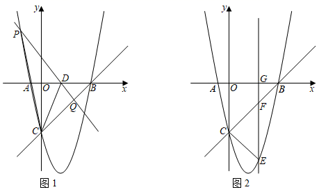

# Mathematics - 题目 245

**ID**: b7aa04d05da042a98f6262475a7005c1
**年级**: Grade 9
**难度**: Medium-Hard
**题型**: Calculation

## 题目
抛物线y＝ax^{2}+bx﹣5的图象与x轴交于A、B两点，与y轴交于点C，其中点A坐标为(﹣1，0)，一次函数y＝x+k的图象经过点B、C．（1）试求二次函数及一次函数的解析式；​​​​​​​‌（2）如图1，点D(2，0)为x轴上一点，P为抛物线上的动点，过点P、D作直线PD交线段CB于点Q，连接PC、DC，若S_{△CPD}＝3S_{△CQD}，求点P的坐标；（3）如图2，点E为抛物线位于直线BC下方图象上的一个动点，过点E作直线EG⊥x轴于点G，交直线BC于点F，当EF+ $\frac {\sqrt {2}}{2}$ CF的值最大时，求点E的坐标．

## 解答

1. 解：（1）∵抛物线y＝ax^{2}+bx﹣5的图象与y轴交于点C，
2. ∴C（0，﹣5），
3. ∵一次函数y＝x+k的图象经过点B、C，
4. ∴k＝﹣5，
5. ∴B（5，0），
6. 设抛物线的解析式为y＝a（x+1）（x﹣5）＝ax^{2}﹣4ax﹣5a，
7. ∴﹣5a＝﹣5，
8. ∴a＝1，
9. ∴二次函数的解析式为y＝x^{2}﹣4x﹣5，一次函数的解析式为y＝x﹣5．
10. （2）①当点P在直线BC的上方时，如图2﹣1中，作DH∥BC交y轴于H，过点D作直线DT交y轴于T，交BC于K，作PT∥BC交抛物线于P，直线PD交抛物线于Q．
11. 
12. ∵S_{△CPD}＝3S_{△CQD}，
13. ∴PD＝3DQ，
14. ∵PT∥DH∥BC，
15. ∴ $\frac {PD}{DQ}=\frac {DT}{DK}=\frac {TH}{HC}=3$ ，
16. ∵D（2，0），B（5，0），C（﹣5，0），
17. ∴OA＝OB＝5，OD＝OH＝2，
18. ∴HC＝3，
19. ∴TH＝9，OT＝7，
20. ∴直线PT的解析式为y＝x+7，
21. 由 $\begin{cases}y=x+7\\y=x{^{2}}-4x-5\end{cases}$ ，解得 $\begin{cases}x=\frac {5+\sqrt {73}}{2}\\y=\frac {19+\sqrt {73}}{2}\end{cases}$ 或 $\begin{cases}x=\frac {5-\sqrt {73}}{2}\\y=\frac {19-\sqrt {73}}{2}\end{cases}$ ，
22. ∴P（ $\frac {5+\sqrt {73}}{2}$ ， $\frac {19+\sqrt {73}}{2}$ ）或（ $\frac {5-\sqrt {73}}{2}$ ， $\frac {19-\sqrt {73}}{2}$ ），
23. ②当点P在直线BC的下方时，如图2﹣2中，
24. 
25. 当点P与抛物线的顶点（2，﹣9）重合时，PD＝9．DQ＝3，
26. ∴PQ＝3DQ，
27. ∴S_{△CPD}＝3S_{△CQD}，
28. 过点P作PP′∥BC，此时点P′也满足条件，
29. ∵直线PP′的解析式为y＝x﹣11，
30. 由 $\begin{cases}y=x-11\\y=x{^{2}}-4x-5\end{cases}$ ，解得 $\begin{cases}x=2\\y=-9\end{cases}$ 或 $\begin{cases}x=3\\y=-8\end{cases}$ ，
31. ∴P′（2，﹣9），P′（3，﹣8），
32. 综上所述，满足条件的点P的坐标为（ $\frac {5+\sqrt {73}}{2}$ ， $\frac {19+\sqrt {73}}{2}$ ）
33. 或（ $\frac {5-\sqrt {73}}{2}$ ， $\frac {19-\sqrt {73}}{2}$ ）或（2，﹣9）或（3，﹣8）．
34. （3）设E（m，m^{2}﹣4m﹣5），则F（m，m﹣5），
35. ∴EF＝（m﹣5）﹣（m^{2}﹣4m﹣5）＝5m﹣m^{2}，CF＝ $\sqrt {2}$ m，
36. ∴EF+ $\frac {\sqrt {2}}{2}$ CF＝﹣m^{2}+6m＝﹣（m﹣3）^{2}+9，
37. ∵﹣1＜0，
38. ∴m＝3时，EF+ $\frac {\sqrt {2}}{2}$ CF的值最大，此时E（3，﹣8）．

## 知识点

**中文**:
  - 实际问题与二次函数
  - 平行线的性质

**English**:
  - Real-world Problems and Quadratic Functions
  - Properties of Parallel Lines

---
