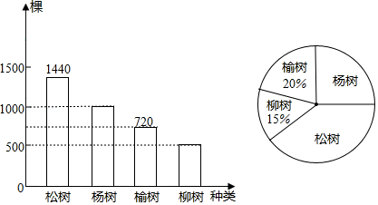

# Mathematics - 题目 362

**ID**: b84caec21da1483e9010dea8edd9923d
**年级**: Grade 9
**难度**: Medium-Hard
**题型**: 解答题（本题共4小题，17，18，19题各9分，20题12分，共39分）

## 题目
为了解树苗的数量，园林部门对种植的四类树苗进行了抽样调查，并将调查情况绘制成如下两幅统计图（不完整）．根据图表中的信息解答下列问题：（1）被抽查的树苗中，松树有棵，柳树苗占被抽查树苗总数的百分比是$\%$ ；​​​​​​​‌（2）此次被抽查的树苗共有棵，若杨树苗所对的圆心角为${}^\circ $ ；（3）今年共种树36000棵，松树约有多少棵．

## 解答

1. 解：（1）被抽查的树苗中，松树有1440棵，柳树苗占被抽查树苗总数的百分比是 $15\%$ ，
2. 故答案为：1440，15；
3. （2）树苗总数为 $720\div 20\%=3600$ （棵 $)$ ，
4. 松树所占百分比是 $1440\div 3600=40\%$ ，
5. $\therefore $ 杨树苗所占百分比是 $1-15\%-20\%-40\%=25\%$ ，所对的圆心角为 $360\times 25\%=90{}^\circ $ ．
6. 故答案为：3600，90；
7. （3） $\frac {1440}{3600}\times 36000=14400$ （棵 $)$ ，
8. 答：松树约有14400棵．
9. 【点评】考查扇形统计图、条形统计图的意义和制作方法，从统计图中获取数量及数量之间的关系是解决问题的关键，样本估计总体是统计中常用的方法．

## 知识点

**中文**:
  - 扇形统计图
  - 百分位数
  - 用样本估计总体
  - 条形统计图

**English**:
  - Pie Charts
  - Percentile
  - Estimating Population from Sample
  - Bar Charts

---
