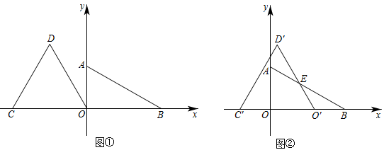

# Mathematics - 题目 3006

**ID**: b895c63ac63244c29ac0b3341eb7299b
**年级**: Grade 9
**难度**: Medium-Hard
**题型**: Calculation

## 题目
在平面直角坐标系中， $\vartriangle CDO$ 为等边三角形，点 $D$ 在第二象限，点 $C$ 在 $x$ 轴负半轴上， $\vartriangle ABO$ 为直角三角形，点 $A$ 在 $y$ 轴正半轴上，点 $B$ 在 $x$ 轴正半轴上， $OB=OC$ ， $\angle ABO=30{}^\circ $ ， $OA=2$ ．(1)如图①，求点 $D$ 的坐标；​​​​​​​‌(2)将 $\vartriangle CDO$ 沿 $x$ 轴向右平移，得到 $\mathrm{△}C^{′}D^{′}O^{′}$ ，点 $C$ ， $D$ ， $O$ 的对应点分别为 $C^{′}$ ， $D^{′}$ ， $O^{′}$ ，设 $OO^{′}=t$ ， $\mathrm{△}C^{′}D^{′}O^{′}$ 与 $\vartriangle ABO$ 重叠部分的面积为 $S$ ．①如图②，当 $\mathrm{△}C^{′}D^{′}O^{′}$ 与 $\vartriangle ABO$ 重叠的部分为四边形时， $D^{′}O^{′}$ 与 $AB$ 相交于点 $E$ ，试用含有 $t$ 的式子表示 $S$ ，并直接写出 $t$ 的取值范围；②当 $\frac {10\sqrt {3}}{9}\leqslant t\leqslant \frac {16\sqrt {3}}{9}$ 时，求 $S$ 的取值范围（直接写出结果即可）．

## 解答

1. (1)解：如图①，在Rt $\vartriangle ABO$ 中， $\angle ABO=30{}^\circ $ ， $OA=2$ ，
2. 
3. ∴ $OB=\sqrt {3}OA=2\sqrt {3}$ ，
4. ∴ $OC=OB=2\sqrt {3}$ ，
5. 过点D作 $DF\bot CO$ 于点 $F$ ，
6. ∵ $\vartriangle CDO$ 为等边三角形，
7. ∴ $\angle DOF=60{}^\circ $ ， $OF=\frac {1}{2}OC=\sqrt {3}$ ，
8. ∴ $DF=\sqrt {3}OF=3$ ，
9. ∴点D的坐标 $\left ({-\sqrt {3},3}\right )$ ；
10. (2)①如图②，过点E作 $EM\bot BO$ 于点M，
11. 
12. ∵ $\mathrm{△}C^{′}D^{′}O^{′}$ 为等边三角形，
13. ∴ $\angle D^{′}O^{′}C^{′}=60{}^\circ $ ，
14. ∴ $\angle O^{′}EB+\angle ABO=60{}^\circ $ ，
15. ∵ $\angle ABO=30{}^\circ $ ，
16. ∴ $\angle O^{′}EB=\angle ABO=30{}^\circ $ ，
17. ∴ $O^{′}E=O^{′}B$ ，
18. ∵ $OO^{′}=t$ ，
19. ∴ $O^{′}E=O^{′}B=OB-OO^{′}=2\sqrt {3}-t$ ，
20. 在Rt $\vartriangle O^{′}EM$ 中， $\angle EMO^{′}=90{}^\circ $ ， $\angle EO^{′}M=60{}^\circ $ ，
21. ∴ $EM=O^{′}E\cdot {\rm{s}}{\rm{i}}{\rm{n}}60{}^\circ =\frac {\sqrt {3}}{2}（2\sqrt {3}-t）$ ．
22. ∴ $S{{}_{\vartriangle O^{′}BE}}=\frac {1}{2}EM\cdot O^{′}B=\frac {\sqrt {3}}{4}（2\sqrt {3}-t）{^{2}}$ ，
23. ∴ $S=S{{}_{\vartriangle ABO}}-S{{}_{\vartriangle O^{′}BE}}=\frac {1}{2}\times 2\times 2\sqrt {3}-\frac {\sqrt {3}}{4}（2\sqrt {3}-t）{^{2}}$ ，
24. ∴ $S=-\frac {\sqrt {3}}{4}t{^{2}}+3t-\sqrt {3}$ ，
25. 在平移过程中，线段 $D^{′}O^{′}$ 经过A点之后，到线段 $D^{′}C$ 经过A点之前，重叠部分为四边形，
26. 当线段 $D^{′}O^{′}$ 经过A点时， $OO^{′}=\frac {OA}{{\tan}30{}^\circ }=\frac {2\sqrt {3}}{3}$ ,
27. 当线段 $D^{′}C$ 经过A点时， $OC^{′}=\frac {OA}{{\tan}30{}^\circ }=\frac {2\sqrt {3}}{3}$ ， $OO^{′}=O^{′}C^{′}-OC^{′}=2\sqrt {3}-\frac {2\sqrt {3}}{3}=\frac {4\sqrt {3}}{3}$ ，
28. ∴ $S=-\frac {\sqrt {3}}{4}t{^{2}}+3t-\sqrt {3}$ ， $（\frac {2\sqrt {3}}{3}＜t\leqslant \frac {4\sqrt {3}}{3}）$  ；
29. ②∵ $\frac {10\sqrt {3}}{9}\leqslant t\leqslant \frac {16\sqrt {3}}{9}$ ，且 $\frac {2\sqrt {3}}{3}＜\frac {10\sqrt {3}}{9}＜\frac {4\sqrt {3}}{3}＜\frac {16\sqrt {3}}{9}$ ，
30. 当 $\frac {10\sqrt {3}}{9}\leqslant t\leqslant \frac {4\sqrt {3}}{3}$ 时， $S=-\frac {\sqrt {3}}{4}t{^{2}}+3t-\sqrt {3}=-\frac {\sqrt {3}}{4}(t{^{2}}-2\sqrt {3}){^{2}}+2\sqrt {3}$ ，
31. $t=\frac {4\sqrt {3}}{3}$ 时，取得最大值，为 $S=-\frac {\sqrt {3}}{4}\times {\left({\frac {4\sqrt {3}}{3}}\right)^{2}}+3\times \frac {4\sqrt {3}}{3}-\sqrt {3}=\frac {5\sqrt {3}}{3}$ ，
32. ∴当 $t=\frac {10\sqrt {3}}{9}$ 时，取得最小值， $S=-\frac {\sqrt {3}}{4}\times {\left({\frac {10\sqrt {3}}{9}}\right)^{2}}+3\times \frac {10\sqrt {3}}{9}-\sqrt {3}=\frac {38\sqrt {3}}{27}$ ，
33. 当 $\frac {4\sqrt {3}}{3}\leqslant t\leqslant \frac {16\sqrt {3}}{9}$ 时，设 $C^{′}D^{′}$ 与AO交于点G，与AB交于点H，
34. 
35. ∵ $O^{′}C^{′}=OC=OB=2\sqrt {3}$ ， $O^{′}O=t$ ，
36. ∴ $O^{′}B=OC^{′}=2\sqrt {3}-t$ ，
37. ∴ $OG=\sqrt {3}OC^{′}=6-\sqrt {3}t$ ,
38. ∴ $AG=OA-OG=\sqrt {3}t-4$ ，
39. ∴ $AH=\frac {1}{2}AG=\frac {\sqrt {3}t-4}{2}$ ， $GH=\frac {\sqrt {3}}{2}AG=\frac {\sqrt {3}}{2}(\sqrt {3}t-4)$ ，
40. ∴ $S=S{{}_{四边形AOO^{′}E}}-S{{}_{\vartriangle AGH}}$
41. $=\frac {1}{2}OA\cdot OB-\frac {1}{2}AH\cdot GH-\frac {1}{2}O^{′}B\cdot EM$
42. $=-\frac {\sqrt {3}}{4}t{^{2}}+3t-\sqrt {3}-\frac {1}{2}\cdot \frac {\sqrt {3}t-4}{2}\cdot \frac {\sqrt {3}}{2}(\sqrt {3}t-4)$
43. $=-\frac {5\sqrt {3}}{8}t{^{2}}+6t-3\sqrt {3}$  $（\frac {4\sqrt {3}}{3}＜t\leqslant 2\sqrt {3}）$
44. 对称轴为 $x=-\frac {6}{2\times (-\frac {5\sqrt {3}}{8})}=\frac {8\sqrt {3}}{5}<\frac {16\sqrt {3}}{9}$ ，开口向下
45. 当 $x=\frac {8\sqrt {3}}{5}$ 时取得最大值为 $\frac {9\sqrt {3}}{5}$ ，当 $x=2\sqrt {3}$ 时取得最小值为 $\frac {3\sqrt {3}}{2}$ ，
46. ∵ $\frac {38\sqrt {3}}{27}<\frac {3\sqrt {3}}{2}<\frac {5\sqrt {3}}{3}<\frac {9\sqrt {3}}{5}$ ，
47. ∴ $\frac {38\sqrt {3}}{27}\leqslant S\leqslant \frac {9\sqrt {3}}{5}$ ，
48. ∴当 $\frac {10\sqrt {3}}{9}\leqslant t\leqslant \frac {16\sqrt {3}}{9}$ ，时，S的取值范围是 $\frac {38\sqrt {3}}{27}\leqslant S\leqslant \frac {9\sqrt {3}}{5}$ ．

## 知识点

**中文**:
  - 平移的性质
  - 等边三角形的性质
  - 解直角三角形

**English**:
  - Properties of Translation
  - Properties of Equilateral Triangles
  - Solving Right Triangles

---
