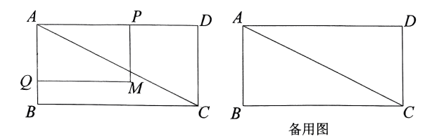

# Mathematics - 题目 2609

**ID**: b9395928f04b4910853684e6a8d21307
**年级**: Grade 9
**难度**: Medium-Hard
**题型**: Calculation

## 题目
如图，在矩形 $ABCD$ 中， $AC$ 是对角线， $AB=4$ ， $AD=8$ ．动点 $P$ 从点A出发，沿折线 $AD-DC$ 以每秒4个单位长度的速度向点 $C$ 运动；与此同时，动点 $Q$ 从点 $B$ 出发，沿线段 $BA$ 以每秒1个单位长度的速度向点A运动，当其中一点到达终点时， $P$ 、 $Q$ 两点同时停止运动，以 $AP$ 和 $AQ$ 为邻边作平行四边形 $ AQMP$ ．设点 $ P$ 的运动时间为 $t$ 秒（ $t>0$ ）．(1)用含 $t$ 的代数式表示线段 $AQ$ 的长为．(2) ${\rm{t}}{\rm{a}}{\rm{n}}\angle ACB={{}_{.​​​​​​​‌}}$．(3)当 $\vartriangle ACD$ 与平行四边形 $AQMP$ 重合部分是四边形时，求 $t$ 的取值范围．(4)当直线 $AC$ 将平行四边形 $AQMP$ 分成两部分的面积比为 $1:2$ 时，直接写出 $t$ 的值．

## 解答

1. （1）解：∵四边形 $ABCD$ 为矩形， $AB=4$ ， $AD=8$ ，
2. ∴ $AB=CD=4$ ， $BC=AD=8$ ，
3. ∵动点 $Q$ 从点 $B$ 出发，沿线段 $BA$ 以每秒1个单位长度的速度向点 $A$ 运动，
4. ∴ $BQ=t$ ，
5. ∴ $AQ=4-t$ ，
6. 故此题答案为: $4-t$ ．
7. （2）解：在 ${\rm{R}}{\rm{t}}\mathrm{△}ACB$ 中， $\angle B=90{}^\circ $ ， $AB=4$ ， $BC=8$ ，
8. ∴ ${\tan}\angle ACB=\frac {AB}{BC}=\frac {1}{2}$ ，
9. 故此题答案为： $\frac {1}{2}$ ．
10. （3）解：∵ $AD{\rm{/\mskip-4mu/}}BC$ ，
11. ∴ $\angle ACB=\angle DAC$ ，
12. ∴ ${\tan}\angle ACB={\tan}\angle DAC=\frac {1}{2}$ ，
13. 当 $P$ 在线段 $AD$ 上运动时，平行四边形 $AQMP$ 为矩形，
14. 当 $P$ 在线段 $CD$ 上运动时，四边形 $AQMP$ 为平行四边形，
15. 当点 $M$ 在线段 $AC$ 上时，如图：
16. 
17. 则 $PM=AQ=4-t$ ，
18. 由题意知， $AP=4t$ ，
19. ∴ ${\tan}\angle PAM=\frac {PM}{AP}=\frac {4-t}{4t}=\frac {1}{2}$ ，
20. 解得： $t=\frac {4}{3}$ ，
21. 当点 $M$ 和点 $C$ 重合时，如图：
22. 
23. 则 $DP=4t-8$ ， $AQ=PC=4-t$ ，
24. ∴ $DP+PC=CD$ ，即 $4t-8+4-t=4$ ，
25. 解得： $t=\frac {8}{3}$ ，
26. ∴当 $\vartriangle ACD$ 与平行四边形 $AQMP$ 重合部分是四边形时， $\frac {4}{3}<t<\frac {8}{3}$ ．
27. （4）解：由题意可知，被直线分成的两部分图形分别为梯形和三角形
28. 故梯形的面积是三角形面积的2位
29. 由三角形和梯形的在面积公式可得， $\left ({上底+下底}\right )\times 高\times \frac {1}{2}=2\times \frac {1}{2}\times 底\times 高$ ，
30. 而梯形和三角形的高相等，则可得 $\left ({上底+下底}\right )=2\times 底$ ，
31. 由三角形和梯形的面积公式可得：
32. 当点 $0<t\leqslant \frac {4}{3}$ ，即点 $M$ 在与线段 $AC$ 重合之前时，如图，设 $PM$ 交 $AC$ 于点 $E$ ，
33. 
34. 则 $AP=4t$ ， $AQ=PM=4-t$
35. 由 ${\tan}\angle PAE=\frac {PE}{AP}=\frac {PE}{4t}=\frac {1}{2}$ ，得 $PE=2t$
36. ∴ $EM=4-t-2t=4-3t$
37. 由 $\left ({上底+下底}\right )=2\times 底$ ，得 $4-t+4-3t=2\times 2t$
38. 解得： $t=1$ ；
39. 当点 $\frac {4}{3}\mathrm{<}t\mathrm{\leqslant }2$ ，即点 $M$ 在与线段 $AC$ 重合后，且点 $M$ 在线段 $AD$ 上时，如图，设 $QM$ 交 $AC$ 于点 $F$ ，
40. 
41. 则 $QM=AP=4t$ ， $AQ=4-t$ ，
42. 由 ${\tan}\angle DAC={\tan}\angle AFQ=\frac {AQ}{QF}=\frac {4-t}{QF}=\frac {1}{2}$ ，得 $QF=8-2t$ ，
43. ∴ $FM=4t-\left ({8-2t}\right )=6t-8$ ，
44. 由 $\left ({上底+下底}\right )=2\times 底$ ，得 $4t+6t-8=2\left ({8-2t}\right )$ ，
45. 解得： $t=\frac {12}{7}$ ；
46. 当点 $2<t\leqslant \frac {8}{3}$ ，即点 $P$ 在与线段 $CD$ 重合后，且点 $M$ 与点 $C$ 重合前时，如图，设 $QM$ 交 $AC$ 于点 $G$ ，
47. 
48. 则 $DP=4t-8$ ， $PM=AQ=4-t$
49. ∴ $DM=4t-8+4-t=3t-4$ ， $CM=4-\left ({3t-4}\right )=8-3t$ ， $CP=12-4t$ ，
50. ∵ $AP/\mskip-4mu/QM$ ，
51. ∴ $\vartriangle CMG∽\vartriangle CPA$ ，
52. ∴ $\frac {GM}{AP}=\frac {CM}{CP}=\frac {8-3t}{12-4t}$ ，
53. 假设 $GM=8-3t$ ，则 $AP=12-4t$ ，则 $QM=12-4t$ ， $QG=12-4t-\left ({8-3t}\right )=4-t$ ，
54. 由 $\left ({上底+下底}\right )=2\times 底$ ，得 $12-4t+8-3t=2\left ({4-t}\right )$ ，
55. 解得： $t=\frac {12}{5}$ ；
56. 当点 $\frac {8}{3}<t\leqslant 3$ ，即点 $P$ 在与线段 $CD$ 上，且点 $M$ 与点 $C$ 重合后时，如图，设 $QM$ 交 $BC$ 于点 $H$ ，
57. 
58. 则 $DP=4t-8$ ， $PM=AQ=4-t$ ， $PC=12-4t$ ，
59. ∴ $CM=4-t-\left ({12t-4t}\right )=3t-8$ ，
60. 由 $\left ({上底+下底}\right )=2\times 底$ ，得 $4-t+3t-8=2\left ({12-4t}\right )$ ，
61. 解得： $t=\frac {14}{5}$ ．
62. 综上所述，当 $t=1或\frac {12}{7}或\frac {12}{5}或\frac {14}{5}$ 时，直线将平行四边形 $AQMP$ 分成两部分的面积比为 $1:2$ ．

## 知识点

**中文**:
  - 矩形的性质
  - 解直角三角形

**English**:
  - Properties of Rectangles
  - Solving Right Triangles

---
