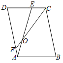

# Mathematics - 题目 1809

**ID**: b97ec5b8c71b4d26a1f2fa9a11b0acc6
**年级**: Grade 9
**难度**: Medium-Hard
**题型**: Calculation

## 题目
如图，E、F两点分别在平行四边形ABCD的边CD、AD上，AE＝CF，AE、CF相交于点O．（1）用尺规作出∠AOC的角平分线OM（保留作图痕迹，不写作法）；​​​​​​​‌（2）求证：OM一定经过B点．

## 解答

1. 解：（1）如图，OM即为所求；
2. 
3. （2）如图，连接BE、BF，
4. 
5. ∵△ABE以AB为底，高是平行四边形AB边的高，
6. ∴S_{△ABE}＝ $\frac {1}{2}$ S_{平行四边形}_{ABCD}，
7. 同理S_{△BCF}＝ $\frac {1}{2}$ S_{平行四边形}_{ABCD}，
8. ∴S_{△ABE}＝S_{△BCF}，
9. 作BG⊥OC于点G，BH⊥OA于点H，
10. ∴S_{△ABE}＝ $\frac {1}{2}$ AE•BH，
11. S_{△BCF}＝ $\frac {1}{2}$ CF•BG，
12. ∵S_{△ABE}＝S_{△BCF}，AE＝CF，
13. ∴BH＝BG，
14. ∵BG⊥OC，BH⊥OA，
15. ∴点B在∠AOC的平分线上，
16. 即OM一定经过B点．

## 知识点

**中文**:
  - 尺规作图——作角平分线
  - 平行四边形的对角线互相平分
  - 线段垂直平分线的性质

**English**:
  - Construction: Angle Bisector
  - Diagonals Bisect Each Other
  - Properties of Perpendicular Bisectors

---
