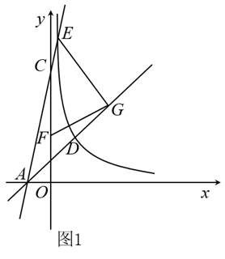
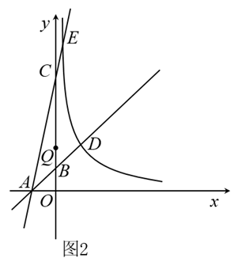

# Mathematics - 题目 584

**ID**: bbe60b3537e24104a23886561998f1b5
**年级**: Grade 9
**难度**: Medium-Hard
**题型**: Calculation

## 题目
如图1，在平面直角坐标系中， $OA=OB=\frac {1}{5}OC=2$ ，经过A，B两点的直线与反比例函数 $y=\frac {k}{x}$ 在第一象限内的图象交于点D，经过A，C两点的直线与反比例函数 $y=\frac {k}{x}$ 在第一象限内的图象交于点E，已知点D的坐标为（3，5）．(1)求直线AC的解析式及E点的坐标；​​​​​​​‌(2)若 $y$ 轴上有一动点F，直线AB上有一动点G．当 $EG+\frac {\sqrt {2}}{2}AG$ 最小时，求 $\vartriangle EFG$ 周长的最小值；(3)如图2，若 $y$ 轴上有一动点Q，直线AB上有一动点 $P$ ，以Q，P，E，D四点为顶点的四边形为平行四边形时，直接写出P点到直线AC的距离．

## 解答

1. （1）解：∵ ${\rm \mathit{OA}=\mathit{OB}=}\frac {1}{5}{\rm \mathit{OC}=2}$ ，
2. ∴A（−2，0），B（0，2），OC=10，
3. ∴C（0，10），
4. 设直线AC的解析式为y=mx+10，
5. ∴−2m+10=0，
6. 解得m=5，
7. ∴直线AC的解析式为y=5x+10①，
8. ∵点D（3，5）在反比例函数 $y=\frac {k}{x}$ 的图象上，
9. ∴k=3×5=15，
10. ∴反比例函数解析式为： $y=\frac {15}{x}②$ ，
11. 联立①②解得： $\begin{cases}x=1\\y=15\end{cases}或\begin{cases}x=-3\\y=-5\end{cases}$ ，
12. ∴点E在第一象限内，
13. ∴点E坐标为：（1，15）；
14. （2）如图1，
15. 
16. 由（1）值，A（−2，0），B（0，2），
17. 代入y=kx＋b中，可得k=1，b=2，
18. ∴直线AB的解析式为：y=x+2，
19. 过点G作GH⊥x轴于点H，
20. ∵OA=OB，
21. ∴ ${\rm ∠\mathit{OAB}=45°}$ ，
22. ∴ ${\rm \mathit{GH}=}\frac {\sqrt {2}}{2}AG$ ，
23. ∴ $EG+\frac {\sqrt {2}}{2}AG=EG+GH$ ，
24. 点G在EH上，且EH⊥x轴，
25. 即G（1，3）时， ${\rm \mathit{EG}＋}\frac {\sqrt {2}}{2}AG$ 最小，如图2，
26. 
27. 作点G（1，3）关于y轴的对称点 $G^{′}$ ，连接 $FG^{′}$ ，则 $FG^{′}=FG$ ，
28. ∴ $G^{′}{\rm （-1，3）}$ ，连接 $EG^{′}$ 交y轴于 $F^{′}$ ，
29. 此时，△EFG的周长最小，其值为：
30. $EG+F^{′}G+EF^{′}$
31. $=EG^{′}+F^{′}G^{′}+EF^{′}$
32. $=EG^{′}+EG$
33. $=\sqrt {{\left({1+1}\right)^{2}}+{\left({15-3}\right)^{2}}}+12$
34. $=2\sqrt {37}+12$ ．
35. 即 ${\rm △\mathit{EFG}}$ 的周长最小值为 $2\sqrt {37}{\rm +12}$ ；
36. （3）解：由（2）知，直线AB的解析式为y=x+2，
37. 设P（p，p+2），Q（0，q），
38. ∵以Q，P，E，D四点为顶点的四边形为平行四边形，D（3，5），E（1，15），
39. ①当PQ与DE为对角线时，
40. $\frac {1}{2}\left ({p+0}\right )=\frac {1}{2}\left ({3+1}\right )$ ，
41. ∴p=4，
42. ∴P（4，6），
43. 如图3，
44. 
45. 过P作PK⊥AC于K，
46. ∵A（−2，0），C（0，10），
47. ∴ ${\rm \mathit{AC}=}2\sqrt {26}$ ，
48. ∴ $S{{}_{△APC}}=\frac {1}{2}AC\cdot PK=\frac {1}{2}BC\cdot \left ({x{{}_{P}}-x{{}_{A}}}\right )$ ，
49. ∴ $\frac {1}{2}\times 2\sqrt {26}\cdot PK=\frac {1}{2}\left ({10-2}\right )\times \left ({4+2}\right )$ ，
50. ∴ $PK=\frac {12\sqrt {26}}{13}$ ，即点P到直线AC的距离为 $\frac {12\sqrt {26}}{13}$ ；
51. ②当PE与DQ为对角线时，
52. $\frac {1}{2}\left ({p+1}\right )=\frac {1}{2}\left ({3+0}\right )$ ，
53. ∴p=2，
54. ∴P（2，4），此时，点P与点B重合，
55. 同①方法可得，点P到直线AC的距离为 $\frac {8\sqrt {26}}{13}$ ，
56. ③当PD与QE为对角线时，
57. $\frac {1}{2}\left ({p+3}\right )=\frac {1}{2}\left ({1+0}\right )$ ，
58. ∴p=−2，
59. ∴P（−2，0），此时，点P与点A重合，
60. ∴点P到直线AC的距离为0，
61. 综上所述点P到直线AC的距离为 $\frac {12\sqrt {26}}{13}$ 或 $\frac {8\sqrt {26}}{13}$ 或0．

## 知识点

**中文**:
  - 反比例函数解析式
  - 平行四边形的对角线互相平分
  - 待定系数法求一次函数解析式

**English**:
  - Analytic Expression of Inverse Proportionality
  - Diagonals Bisect Each Other
  - Finding Expressions by Undetermined Coefficients

---
