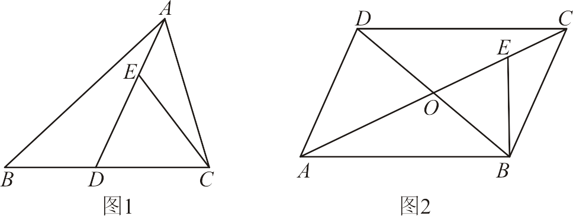

# Mathematics - 题目 3939

**ID**: bc413a5d304d41a1b9701386ce8df8fa
**年级**: Grade 9
**难度**: Medium-Hard
**题型**: Calculation

## 题目
【发现】如图1，在 $\vartriangle ABC$ 中，D为 $BC$ 上一点，连结 $AD$ ，在 $AD$ 上取一点E，连结 $CE$ ，若 $∠BAD=\angle ACE$ ， $CD=CE$ ，求证： $\vartriangle ABD∽\vartriangle CAE$ ．【应用】如图2，在平行四边形 $ABCD$ 中，对角线 $AC，BD$ 交于点O，E为 $OC$ 上一点，连结 $BE$ ， $\angle CBE=\angle DCO$ ， $BE=DO$ ，若 $BD=12,OE=5$ ，求 $AC$ 的长．​​​​​​​‌

## 解答

1. [发现]证明：∵ $CD=CE$ ，
2. ∴ $\angle CDE=\angle CED$ ，
3. ∵ $\angle CDE+\angle ADB=180{}\degree =\angle CED+\angle CEA$ ，
4. ∴ $\angle ADB=\angle CEA$ ，
5. 又∵ $∠BAD=\angle ACE$ ，
6. ∴ $△ABD∽△CAE$ ；
7. [应用]解：∵平行四边形 $ABCD$ 中，
8. ∴ $BO=DO=BE=6$ ， $OC=\frac {1}{2}AC$ ，
9. 同理[发现]， $\angle COD=\angle BOA=\angle BEC$ ，
10. ∵ $\angle CBE=\angle DCO$ ，
11. ∴ $\vartriangle CBE∽\vartriangle DCO$ ，
12. ∴ $\frac {CE}{DO}=\frac {BE}{OC}$ ，即 $\frac {CE}{6}=\frac {6}{5+CE}$ ，整理得， $CE{^{2}}+5CE-36=0$ ，
13. ∴ $\left ({CE-4}\right )\left ({CE+9}\right )=0$ ，
14. 解得， $CE=4$ 或 $CE=-9$ （舍去），
15. ∴ $OC=9$ ， $AC=18$ ，
16. ∴ $AC$ 的长为 $18$ ．

## 知识点

**中文**:
  - 平行四边形的对角线互相平分
  - 相似三角形的判定与性质综合

**English**:
  - Diagonals Bisect Each Other
  - Determination and Properties

---
