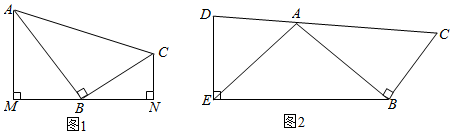

# Mathematics - 题目 2753

**ID**: bc89a32b7b0143f396886503d78d6b7f
**年级**: Grade 9
**难度**: Medium-Hard
**题型**: Calculation

## 题目
已知，在△ABC中，∠ABC＝90°（1）如图1，分别过A、C两点作经过点B的直线MN的垂线，垂足分别为M、N．①求证：△AMB∽△BNC；​​​​​​​‌②若△AMB∽△ABC，求证：AC＝AM+CN；（2）如图2，点D是CA延长线上的一点，DE⊥EB，AE＝AB，AD：BC：CA＝3：3：5，求 $\frac {EB}{BC}$ 的值．

## 解答

1. （1）①∵∠ABC＝90°，
2. ∴∠ABM+∠CBN＝90°，
3. ∵AM⊥BM，
4. ∴∠ABM+∠BAM＝90°，
5. ∴∠BAM＝∠CBN，
6. ∵∠BAM＝∠CBN，∠AMB＝∠BNC＝90°，
7. ∴△AMB∽△BNC；
8. ②如图1，作BH⊥AC于H，
9. 
10. 则∠AHB＝∠ABC＝90°，又∠BAH＝∠CAB，
11. ∴△AHB∽△ABC，
12. ∵△AMB∽△ABC，
13. ∴△AMB∽△AHB，
14. ∴∠BAM＝∠BAH，
15. 在△BAM和△BAH中，
16. $\begin{cases}\angle BAM=\angle BAH\\\angle AMB{\rm{=}}\angle AHB{\rm{=}}90{}^\circ \\AB=AB\end{cases}$ ，
17. ∴△BAM≌△BAH（AAS）
18. ∴AH＝AM，
19. 同理可证，CH＝CN，
20. ∴AC＝AH+CH＝AM+CN；
21. （2）如图2，过点A作AG⊥BE于G，过点C作CH⊥BE交EB的延长线于H，
22. 
23. ∵∠DEB＝90°，
24. ∴CH∥AG∥DE，
25. ∴ $\frac {EG}{GH}=\frac {DA}{AC}=\frac {3}{5}$ ，
26. 在Rt△ABC中， $\frac {BC}{AC}=\frac {3}{5}$ ，
27. ∴ $\frac {AB}{BC}=\frac {4}{3}$ ，
28. 由（1）①可知，△AGB∽△BHC
29. ∴ $\frac {AG}{BH}{\rm{=}}\frac {GB}{CH}{\rm{=}}\frac {AB}{BC}{\rm{=}}\frac {4}{3}$ ，
30. ∵AE＝AB，AG⊥BE，
31. ∴EG＝GB，
32. ∵ $\frac {EG}{GH}=\frac {3}{5}$ ，
33. ∴EG：BG：BH＝3：3：2，
34. 设EG＝3a，则BG＝3a，BH＝2a，
35. ∵ $\frac {GB}{CH}=\frac {4}{3}$ ，
36. ∴ $\frac {3a}{CH}=\frac {4}{3}$ ，
37. 解得， $CH=\frac {9}{4}a$ ，
38. 由勾股定理得， $BC=\sqrt {BH{^{2}}+CH{^{2}}}=\frac {\sqrt {145}}{4}a$ ，
39. ∴ $\frac {EB}{BC}=\frac {6a}{\frac {\sqrt {145}}{4}a}=\frac {24\sqrt {145}}{145}$ ．

## 知识点

**中文**:
  - 全等三角形实际应用
  - 相似三角形的判定与性质综合

**English**:
  - Applications of Congruent Triangles
  - Determination and Properties

---
