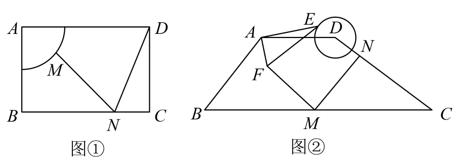

# Mathematics - 题目 2039

**ID**: bc8eae508e6049c4b6c32738671ba7bc
**年级**: Grade 9
**难度**: Medium-Hard
**题型**: Calculation

## 题目
（1）如图①，在矩形 $ABCD$ 中， $AB=4$ ， $BC=6$ ，以 $\mathrm{A}$ 为圆心， $2$ 为半径在矩形 $ABCD$ 内画弧，已知点 $M$ 是该弧上的一动点，点 $N$ 是 $BC$ 边上的动点，则 $MN+ND$ 的最小值为．（2）随着社会发展，人们生活品质日益提升，年轻人对高品质生活的追求愈发强烈．“荒野求生”、“生存大挑战”等栏目在网络上火爆，野外探险成为当下很多人想寻求刺激、提升生活品质的热门选择，图②是一片探险区域，其中四边形 $ABCD$ 是探险途中的必经区域， $AB=6000$ 米， $AD=4800$ 米， $AD{\rm{/\mskip-4mu/}}BC$ ， $\angle B+\angle C=90{}\degree $ ，且 ${\rm{s}}{\rm{i}}{\rm{n}}\angle B=\frac {4}{5}$ ，点 $\mathrm{A}$ 是探险入口，边界 $CD$ 上点 $\mathbf{N}$ 是探险出口，其中 $CN=AB$ ，点 $D$ 方圆 $1000$ 米的圆形区域是危险禁区，严禁探险者进入 $．$ 为了保证探险者的安全，在危险区域边界上设有一个可移动监测点 $E$ ，一旦探险者靠近并跨入危险区，便会触发警报，一支探险小队计划进入此区域探险，为确保队员统一行动、节省体力并高效前行，领队需提前确定两个集结点 $F$ 和点 $M$ ，其中点 $F$ 在探险区域内，且满足 $\angle EAF=90{}\degree $ ， $AE=2AF$ ，点 $M$ 在边界 $BC$ 上，探险路线是 $A\to F\to M\to N$ ，请帮助领队计算 $FM+MN$ 的最小值．​​​​​​​‌

## 解答

1. 解：（1） $\because $ 四边形 $ABCD$ 是矩形，
2. $\therefore CD=AB=4$ ， $AD=BC=6$ ， $\angle ADC=90{}\degree $ ，
3. 作点 $D$ 关于 $BC$ 的对称点 $D^{′}$ ，连接 $CD^{′}$ ，
4. 则 $CD^{′}=CD=4$ ，
5. 
6. 连接 $AM$ ， $ND{^{\prime }}$ ， $AD^{′}$ ，
7. 则 $AM+MN+ND=AM+MN+ND^{′}>AD^{′}$ ，
8. $\therefore MN+ND\geqslant AD^{′}-AM$ ，
9. $\because $ 在 $Rt\vartriangle ADD^{′}$ 中， $AD=6$ ， $DD^{′}=DC+CD^{′}=4+4=8$ ，
10. $\therefore AD^{′}=\sqrt {AD{^{2}}+DD^{′}{{^{2}}}}=\sqrt {6{^{2}}+8{^{2}}}=10$ ，
11. $\therefore MN+ND\geqslant AD^{′}-AM=10-2=8$ ，
12. $\therefore MN+ND$ 的最小值为 $8$ ，
13. 故答案为： $8$ ；
14. （2）连接 $DE$ ，过点 $\mathrm{A}$ 作 $AG\bot AD$ ，交 $BC$ 于点 $G$ ，在 $AG$ 上取点 $O$ ，使得 $AO=\frac {1}{2}AD=2400$ 米，
15. $\therefore \angle OAD=\angle FAE=90{}\degree $ ，
16. $\therefore \angle OAD-\angle FAD=\angle FAE-\angle FAD$ ，即 $\angle OAF=\angle DAE$ ，
17. $\because AE=2AF$ ， $AO=\frac {1}{2}AD$ ，
18. $\therefore \frac {AE}{AF}=\frac {AD}{AO}=2$ ，
19. $\therefore △ADE∽△AOF$ ，
20. $\therefore \frac {DE}{OF}=\frac {AD}{AO}=2$ ，
21. $\therefore OF=\frac {1}{2}DE=\frac {1}{2}\times 1000=500$ 米，
22. $\therefore $ 点 $F$ 在以点 $O$ 为圆心，半径为 $500$ 米的圆上运动，
23. 作点 $N$ 关于 $BC$ 的对称点 $N^{′}$ ，连接 $MN^{′}$ ， $ON^{′}$ ，则 $MN=MN^{′}$ ，
24. $\therefore FO+FM+MN=FO+FM+MN^{′}{\geqslant }ON^{′}$ ，
25. $\therefore FM+MN\geqslant ON^{′}-FO$ ，
26. 
27. 连接 $NN^{′}$ ，交 $BC$ 于点 $H$ ，延长 $N^{′}N$ ，交 $AD$ 的延长线于点 $K$ ，过点 $O$ 作 $OJ\bot NN^{′}$ 于点 $J$ ，
28. $\because AD{\rm{/\mskip-4mu/}}BC$ ， $AG\bot AD$ ，
29. $\therefore AG{\rm{/\mskip-4mu/}}BC$ ，
30. $\therefore $ 在 $Rt\vartriangle ABG$ 中， $AG=AB\cdot \sin B=6000\times \frac {4}{5}=4800$ 米，
31. $BG=\sqrt {AB{^{2}}-AG{^{2}}}=\sqrt {6000{^{2}}-4800{^{2}}}=3600$ 米，
32. $\because $ 点 $N$ 与 $N^{′}$ 关于 $BC$ 对称，
33. $\therefore NN^{′}{\bot }BC$ ，
34. $\because OJ\bot NN^{′}$ ， $AG\bot AD$ ，
35. $\therefore $ 四边形 $AOJK$ ，四边形 $OGHJ$ ，四边形 $AGHK$ 都是矩形，
36. $\therefore KH=AG=4800$ 米，
37. $\because $ 在 $Rt\vartriangle CNH$ 中， $\angle C+\angle CNH=90{}\degree $ ，又 $\angle B+\angle C=90{}\degree $ ，
38. $\therefore \angle CNH=\angle B$ ，
39. $\therefore {\rm{s}}{\rm{i}}{\rm{n}}\angle CNH=\sin B=\frac {4}{5}$ ，
40. $\therefore $ 在 $Rt\vartriangle CNH$ 中， $CH=CN\cdot {\rm{s}}{\rm{i}}{\rm{n}}\angle CNH=6000\times \frac {4}{5}=4800$ 米，
41. $NH=\sqrt {CN{^{2}}-CH{^{2}}}=\sqrt {6000{^{2}}-4800{^{2}}}=3600$ 米，
42. ${\tan}C=\frac {NH}{CH}=\frac {3600}{4800}=\frac {3}{4}$ ，
43. $\therefore KN=KH-NH=4800-3600=1200$ 米，
44. $\because AD\parallel BC$ ，
45. $\therefore \angle KDN=\angle C$ ，
46. $\therefore {\rm{t}}{\rm{a}}{\rm{n}}\angle KDN={\rm{t}}{\rm{a}}{\rm{n}}\angle C=\frac {3}{4}$ ，
47. 在 $Rt\vartriangle DKN$ 中， $DK=\frac {KN}{{\rm{t}}{\rm{a}}{\rm{n}}\angle KDN}=\frac {1200}{\frac {3}{4}}=1600$ 米，
48. $\therefore AK=AD+DK=4800+1600=6400$ 米，
49. $\therefore $ 在矩形 $AOJK$ 中， $OJ=AK=6400$ 米， $KJ=AO=2400$ 米，
50. $\because $ 点 $N$ 与 $N^{′}$ 关于 $BC$ 对称，
51. $\therefore N^{′}H=NH=3600$ 米，
52. $\therefore JN^{′}=KN+NH+N^{′}H-KJ=1200+3600+3600-2400=6000$ 米，
53. $\therefore $ 在 $Rt\vartriangle OJN^{′}$ 中， $ON^{′}=\sqrt {OJ{^{2}}+JN^{′}{{^{2}}}}=\sqrt {6400{^{2}}+6000{^{2}}}=400\sqrt {481}$ 米，
54. $\therefore FM+MN\geqslant ON^{′}-FO=400\sqrt {481}-500$ ，
55. 即 $FM+MN$ 的最小值为 $\left ({400\sqrt {481}-500}\right )$ 米．

## 知识点

**中文**:
  - 最短路径问题
  - 矩形的性质
  - 相似三角形的判定与性质综合
  - 解直角三角形

**English**:
  - Shortest Path Problems
  - Properties of Rectangles
  - Determination and Properties
  - Solving Right Triangles

---
