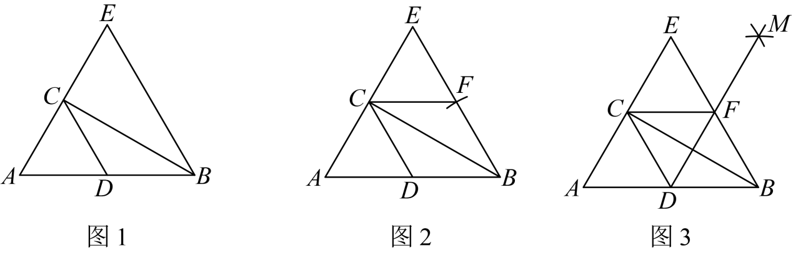

# Mathematics - 题目 3336

**ID**: bd8771bbc67443e8b1707feb5f5e7132
**年级**: Grade 9
**难度**: Medium-Hard
**题型**: Calculation

## 题目
如图1，在 ${\rm{R}}{\rm{t}}\mathrm{△}ABC$ 中， $CD$ 是斜边 $AB$ 上的中线， $BE\mathrm{/\mskip-4mu/}DC$ 交 $AC$ 的延长线于点 $E$ ．在 $BE$ 上作点 $F$ 使得四边形 $CDBF$ 是菱形．以下是两位同学的尺规作图的方法．小佳：如图2，以 $B$ 为圆心， $BD$ 长为半径作弧交 $BE$ 于点 $F$ ，连接 $CF$ ，则四边形 $CDBF$ 是菱形．小乐：如图3，分别以 $B$ ， $C$ 为圆心， $BC$ 长为半径作弧交于点 $M$ ，连接 $DM$ 交 $BE$ 于点 $F$ ，则四边形 $CDBF$ 是菱形．(1)填空：判断他们的作图方法是否正确．（填“正确”或“错误”）①小佳的做法；​​​​​​​‌②小乐的做法．(2)请从（1）中任选一项判断说明理由．（要求：写出推理过程）

## 解答

1. （1）解：①小佳的做法正确，理由如下：
2. ∵在 ${\rm{R}}{\rm{t}}\mathrm{△}ABC$ 中， $CD$ 是斜边 $AB$ 上的中线，
3. ∴ $CD=BD=\frac {1}{2}AB，∠ACB=90{}\degree $ ，
4. ∴ $\angle DCB=\angle DBC$ ，
5. ∵ $BE\mathrm{/\mskip-4mu/}DC$ ，
6. ∴ $\angle DCB=\angle CBE$ ，
7. ∴ $\angle DBC=\angle CBE$ ，
8. 又∵ $∠BCE=180{}\degree -∠ACB=90{}\degree =∠ACB，BC=BC$ ，
9. ∴ $△ABC≌△EBC\left ({{\rm{A}}{\rm{S}}{\rm{A}}}\right )$ ，
10. ∴ $AB=EB$ ，
11. 由作图方法可知， $BF=BD=\frac {1}{2}AB$ ，
12. ∴ $BF=\frac {1}{2}BE$ ，
13. ∴ $CF=\frac {1}{2}BE=BF$ ，
14. ∴ $CD=BD=BF=CF$ ，
15. ∴四边形 $CDBF$ 是菱形；
16. ②由作图方法可知， $DF$ 垂直平分 $BC$ ，
17. ∴ $CF=BF$ ，
18. ∴ $\angle FCB=\angle FBC$ ，
19. ∵在 ${\rm{R}}{\rm{t}}\mathrm{△}ABC$ 中， $CD$ 是斜边 $AB$ 上的中线，
20. ∴ $CD=BD=\frac {1}{2}AB，∠ACB=90{}\degree $ ，
21. ∴ $\angle DCB=\angle DBC$ ，
22. ∵ $BE\mathrm{/\mskip-4mu/}DC$ ，
23. ∴ $∠DBC=∠CBE=∠FCB=FBC$ ，
24. 又∵ $BC=BC$ ，
25. ∴ $△DBC≌△FBC\left ({{\rm{A}}{\rm{S}}{\rm{A}}}\right )$ ，
26. ∴ $CD=CF=BD=BF$ ，
27. ∴四边形 $CDBF$ 是菱形；
28. （2）①小佳的做法正确，理由如下：
29. ∵在 ${\rm{R}}{\rm{t}}\mathrm{△}ABC$ 中， $CD$ 是斜边 $AB$ 上的中线，
30. ∴ $CD=BD=\frac {1}{2}AB，∠ACB=90{}\degree $ ，
31. ∴ $\angle DCB=\angle DBC$ ，
32. ∵ $BE\mathrm{/\mskip-4mu/}DC$ ，
33. ∴ $\angle DCB=\angle CBE$ ，
34. ∴ $\angle DBC=\angle CBE$ ，
35. 又∵ $∠BCE=180{}\degree -∠ACB=90{}\degree =∠ACB，BC=BC$ ，
36. ∴ $△ABC≌△EBC\left ({{\rm{A}}{\rm{S}}{\rm{A}}}\right )$ ，
37. ∴ $AB=EB$ ，
38. 由作图方法可知， $BF=BD=\frac {1}{2}AB$ ，
39. ∴ $BF=\frac {1}{2}BE$ ，
40. ∴ $CF=\frac {1}{2}BE=BF$ ，
41. ∴ $CD=BD=BF=CF$ ，
42. ∴四边形 $CDBF$ 是菱形；
43. ②由作图方法可知， $DF$ 垂直平分 $BC$ ，
44. ∴ $CF=BF$ ，
45. ∴ $\angle FCB=\angle FBC$ ，
46. ∵在 ${\rm{R}}{\rm{t}}\mathrm{△}ABC$ 中， $CD$ 是斜边 $AB$ 上的中线，
47. ∴ $CD=BD=\frac {1}{2}AB，∠ACB=90{}\degree $ ，
48. ∴ $\angle DCB=\angle DBC$ ，
49. ∵ $BE\mathrm{/\mskip-4mu/}DC$ ，
50. ∴ $∠DBC=∠CBE=∠FCB=FBC$ ，
51. 又∵ $BC=BC$ ，
52. ∴ $△DBC≌△FBC\left ({{\rm{A}}{\rm{S}}{\rm{A}}}\right )$ ，
53. ∴ $CD=CF=BD=BF$ ，
54. ∴四边形 $CDBF$ 是菱形．

## 知识点

**中文**:
  - 直角三角形斜边上的中线
  - 菱形的判定
  - 线段垂直平分线的性质

**English**:
  - Median to Hypotenuse of Right Triangle
  - Determination of Rhombuses
  - Properties of Perpendicular Bisectors

---
