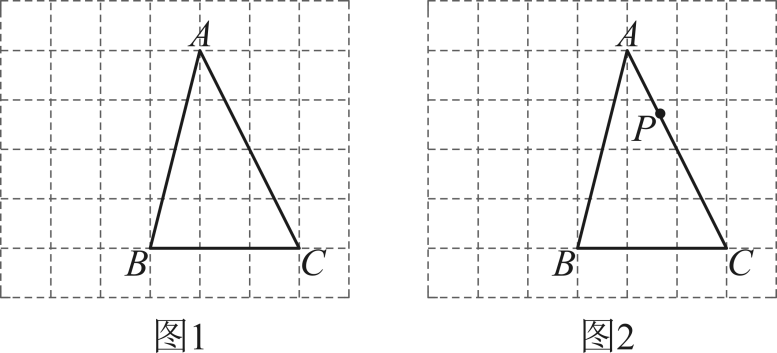

# Mathematics - 题目 38

**ID**: bf07794239924da58f69bfcda762466a
**年级**: Grade 9
**难度**: Medium-Hard
**题型**: Calculation

## 题目
如图是由小正方形组成的 $7\times 6$ 网格，每个小正方形的顶点叫做格点，A，B，C是格点，仅用无刻度的直尺在给定网格中完成如下两个问题．（1）在图1中，先在 $AB$ 上画点D，使 $\angle ADC=90{}\degree $ ，再作 $∠ADC$ 的平分线 $DE$ ．（2）如图2 ，P是线段 $AC$ 上一点（非格点），先作平行四边形 $ACBM$ ；​​​​​​​‌再将 $AP$ 绕 $AC$ 的中点旋转 $180{}\degree $ 得对应线段 $CQ$ ．

## 解答

1. （1）解：如图： $∠ADC$ 、 $DE$ 即为所求作，
2. ，
3. 取格点 $F$ ，连接 $CF$ 交 $AB$ 于 $D$ ，由网格特点可得， $AB\bot CF$ ，即 $\angle ADC=90{}\degree $ ，
4. 取格点 $E$ ，连接 $AE$ 、 $CE$ 、 $DE$ ，
5. 由勾股定理可得： $AE=CE=\sqrt {1{^{2}}+3{^{2}}}=\sqrt {10}$ ， $AC=\sqrt {2{^{2}}+4{^{2}}}=\sqrt {20}$ ，
6. ∴ $AE{^{2}}+CE{^{2}}=AC{^{2}}$ ，
7. ∴ $△ACE$ 为等腰直角三角形， $\angle AEC=90{}\degree $ ， $\angle ACE=\angle CAE=45{}\degree $ ，
8. ∵ $\angle AEC+\angle ADC=180{}\degree $ ，
9. ∴点 $\mathrm{A}$ 、 $D$ 、 $C$ 、 $E$ 四点共圆，
10. ∴ $\angle ADE=\angle ACE=\angle CDE=\angle CAE=45{}\degree $ ，
11. ∴ $DE$ 平分 $∠ADC$ ；
12. （2）解：如图：平行四边形 $ACBM$ 、 $CQ$ 即为所求作，
13. ，
14. 取格点 $M$ ，由网格特点可得 $AM=BC=3$ ， $AM{\rm{/\mskip-4mu/}}BC$ ，
15. ∴四边形 $ACBM$ 为平行四边形，
16. 取格点 $D$ 、 $E$ ，则 $E$ 为 $AC$ 的中点， $D$ 为 $BM$ 的中点，
17. ∴ $AE=CE$ ，
18. 取格点 $G$ 、 $F$ ，由网格特点可得 $G$ 、 $F$ 关于 $D$ 成中心对称，
19. 连接 $PG$ 交 $DE$ 于 $H$ ，连接 $FH$ 并延长交 $AC$ 于 $Q$ ，
20. 则由中心对称的性质可得， $P$ 、 $Q$ 关于点 $E$ 成中心对称，
21. ∴ $PE=QE$ ，
22. ∴ $AE-PE=CE-QE$ ，即 $AP=CQ$ ．

## 知识点

**中文**:
  - 中心对称的性质
  - 勾股定理
  - 圆周角定理

**English**:
  - Properties of Central Symmetry
  - Pythagorean Theorem
  - Inscribed Angle Theorem

---
