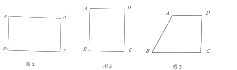

# Mathematics - 题目 611

**ID**: bf68ef4c2dbf4cb6bf495e63630d7ab9
**年级**: Grade 9
**难度**: Medium-Hard
**题型**: Calculation

## 题目
实践体验：（1）如图1：四边形ABCD是矩形，试在AD边上找一点P，使△BCP为等腰三角形；​​​​​​​‌（2）如图2：矩形ABCD中，AB=13，AD=12，点E在AB边上，BE=3,点P是矩形ABCD内或边上一点，且PE=5，点Q是CD边上一点，求PQ得最值；问题解决：（3）如图3，四边形ABCD中,AD∥BC，∠C=90°，AD=3，BC=6，DC=4,点E在AB边上，BE=2，点P是四边形ABCD内或边上一点，且PE=2，求四边形PADC面积的最值．

## 解答

1. （1）当P为AD中点时，
2. $\because \left \{\hspace{-0.5em}\begin{array}{l}{{}_{\hspace{-0.5em}\begin{array}{l}AB=CD\\\angle A=\angle D\end{array}\hspace{-0.5em}}^{AP=DP}}\end{array}\hspace{-0.5em}\right.$ ，
3. $\therefore ΔABP\cong ΔDCP（SAS)$
4. $\therefore BE=CE$
5. $\therefore $ △BCP为等腰三角形.
6. （2）以E为圆心，以5为半径画圆
7. 
8. ①    当E、P、Q三点共线时最PQ最小，PQ的最小值是12-5=7.
9. ②    当P点在 $P{{}_{2}}$ 位置时PQ最大，PQ的最大值是 $\sqrt {5{^{2}}{\rm{+}}12{^{2}}}{\rm{=}}{\rm{1}}{\rm{3}}$
10. （3）以E为圆心，以2为半径画圆.
11. 
12. 当点p为 $P{{}_{1}}$ 位置时，四边形PADC面积最大 ${\rm{=}}\frac {\left ({3{\rm{+}}6}\right )\times 4}{2}{\rm{=}}18$ .
13. 当点p为 $P{{}_{1}}$ 位置时，四边形PADC最小=四边形 $P{{}_{2}}ADF$ +三角形 $P{{}_{2}}CF$ = $\frac {24}{5}+\frac {144}{25}=\frac {354}{25}$ .

## 知识点

**中文**:
  - 点和圆的位置关系
  - 等腰三角形的判定

**English**:
  - Point and Circle Relationship
  - Determination of Isosceles Triangles

---
